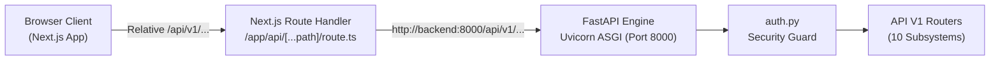
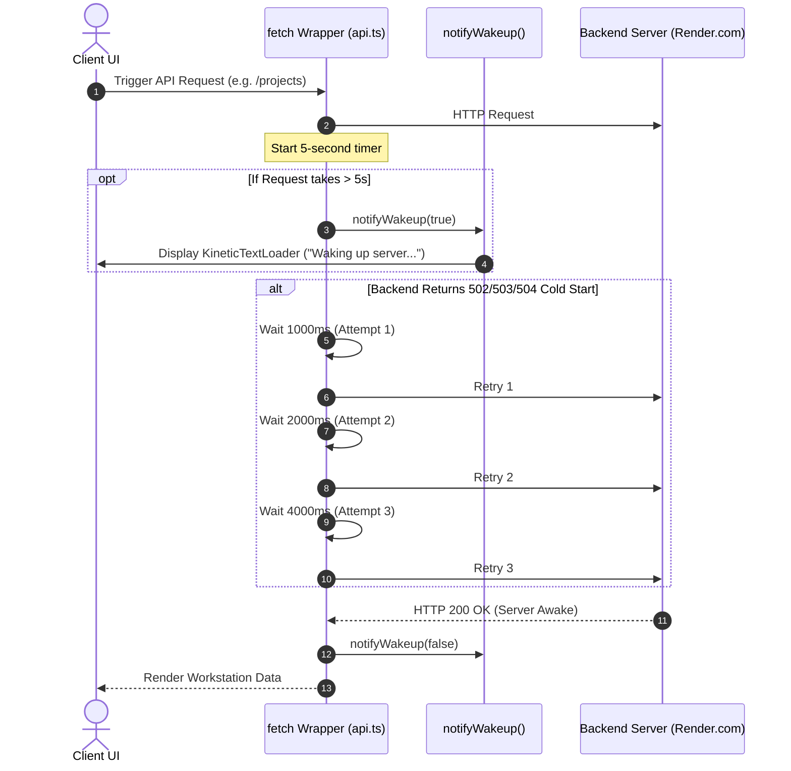

# OptiBuild REST API Specification & Endpoint Reference (API.md)

> **Document Type:** Complete REST API Specification, Schemas & Integration Reference  
> **Repository:** `divyal27/OptiBuild-Main`  
> **Version:** 2.0.0 (Production API Baseline)  
> **Date:** 2026-10-29  
> **Base URL:** `/api/v1` (FastAPI backend mounted at port `8000`, proxied via Next.js `/api/...`)  
> **Status:** Single Source of Truth for Endpoints, Schemas, Authentication Rules, and Error Handling

---

## 1. API Architecture & Global Conventions

### 1.1 Base URL & Routing Architecture
All business logic endpoints are mounted under the prefix `/api/v1` defined in [`backend/app/core/config.py`](file:///d:/OptiBuild%20BE%20Project/OptiBuild-Main/backend/app/core/config.py):
* **Local Backend URL:** `http://localhost:8000/api/v1`
* **Docker Network URL:** `http://backend:8000/api/v1`
* **Client Workstation Proxy:** Browser requests target `/api/v1/...` relative paths, routed through Next.js reverse proxy route handler [`frontend/src/app/api/[...path]/route.ts`](file:///d:/OptiBuild%20BE%20Project/OptiBuild-Main/frontend/src/app/api/[...path]/route.ts) to eliminate CORS restrictions.



### 1.2 Authentication & Token Delivery
Authentication enforces a **dual delivery mechanism**:
1. **HTTP-Only Cookie:** Successful login sets an `access_token` cookie with `HttpOnly=True`, `SameSite=Lax`, and `Max-Age=86400` (24 hours).
2. **Bearer Authorization Header:** Login also returns a JSON payload with `access_token`. Client requests may pass:
   ```http
   Authorization: Bearer <jwt_access_token>
   ```
* **JWT Algorithm:** `HS256` signed using `JWT_SECRET` ($\ge 32\text{ chars}$).
* **Token Claims Payload:**
  ```json
  {
    "sub": "user_uuid_here",
    "email": "pm@optibuild.io",
    "role": "project_manager",
    "name": "Rajesh Sharma (Project Manager)",
    "exp": 1730246400
  }
  ```

### 1.3 Role-Based Access Control (RBAC) Hierarchy
Seven discrete roles are enforced via dependency injection ([`require_roles`](file:///d:/OptiBuild%20BE%20Project/OptiBuild-Main/backend/app/core/auth.py#L123)):
* `admin`: Global superuser; bypasses all role restrictions.
* `project_manager`: Full access to RERA setup, WBS generation, scheduling, and delay optimization.
* `site_engineer`: Task progress reporting, site photo uploads, and CV stage inspection.
* `store_keeper`: Inbound material procurement logging and unparsed invoice uploading.
* `architect`: Architectural CAD/PDF blueprint drawing uploads (view-only vault).
* `accountant`: Budget vs. actual spend auditing, invoice variance tracking, and rate recalibration.
* `owner`: Executive KPI monitoring, Section 18 penalty tracking, and S-curve auditing.

### 1.4 Standard Error Response Format
All error responses adhere to standard FastAPI JSON structure:
```json
{
  "detail": "Descriptive error message explaining the failure condition."
}
```

| HTTP Status Code | Classification | Trigger Condition |
|:---|:---|:---|
| `200 OK` | Success | Request succeeded with response body. |
| `201 Created` | Resource Created | Project or certificate successfully persisted. |
| `400 Bad Request` | Client Validation Error | Cyclic task dependencies, missing predecessors, or invalid parameters. |
| `401 Unauthorized` | Authentication Failure | Missing, invalid, or expired JWT token / cookie. |
| `403 Forbidden` | Authorization Failure | User role lacks sufficient permissions or project membership. |
| `404 Not Found` | Resource Missing | Specified `project_id` or `task_id` does not exist in database. |
| `413 Content Too Large` | Storage Quota Exceeded | Uploaded file exceeds size limits (PDF > 10MB, Image > 5MB, DWG > 20MB). |
| `422 Unprocessable Entity`| Schema Validation Error | Pydantic validation failure on request payload fields. |
| `500 Server Error` | Computational Failure | Mathematical engine failure or uncaught runtime exception. |

---

## 2. Interactive Quick-Reference Endpoint Catalog (33 Endpoints)

| # | Subsystem | Method | Endpoint Path | Permitted Roles | Summary |
|:---:|:---|:---:|:---|:---|:---|
| 1 | **Auth** | `POST` | `/api/v1/auth/login` | Public | Authenticates credentials; returns JWT and sets cookie. |
| 2 | | `POST` | `/api/v1/auth/logout` | Authenticated | Clears authentication cookie. |
| 3 | | `GET` | `/api/v1/auth/me` | Authenticated | Returns current user profile and assigned projects. |
| 4 | **Users** | `GET` | `/api/v1/users` | `admin`, `pm` | Lists all organization user accounts. |
| 5 | | `POST` | `/api/v1/users` | `admin` | Provisions a new user account with role. |
| 6 | **Projects** | `GET` | `/api/v1/projects` | Authenticated | Lists all visible/assigned projects. |
| 7 | | `GET` | `/api/v1/projects/{project_id}` | Project Member | Returns complete project details, WBS, schedule, and team. |
| 8 | | `POST` | `/api/v1/projects/{project_id}/members` | `pm`, `admin` | Assigns an organization user to project team. |
| 9 | | `POST` | `/api/v1/projects/{project_id}/wbs` | `pm`, `admin` | Generates parametric WBS and persists tasks with floats. |
| 10 | | `POST` | `/api/v1/projects/{project_id}/schedule` | `pm`, `admin` | Runs CPM + GA RCPSP scheduler and persists results. |
| 11 | | `POST` | `/api/v1/projects/{project_id}/optimizer` | `pm`, `admin` | Evaluates delay recovery (penalty vs crash) and saves result. |
| 12 | | `POST` | `/api/v1/projects/{project_id}/benchmark` | `pm`, `admin` | Runs GA vs OR-Tools CP-SAT benchmark on project tasks. |
| 13 | | `PATCH` | `/api/v1/projects/{project_id}/tasks/{task_id}/progress` | `site_engineer`, `pm`, `admin` | Updates progress percentage and status of a schedule task. |
| 14 | | `GET` | `/api/v1/projects/{project_id}/drawings` | Project Member | Lists architectural CAD/PDF drawings for project. |
| 15 | | `POST` | `/api/v1/projects/{project_id}/drawings` | `architect`, `pm`, `admin` | Uploads an attach-only architectural drawing (**INV-2**). |
| 16 | | `GET` | `/api/v1/projects/{project_id}/photos` | Project Member | Lists uploaded site progress photos and CV stage predictions. |
| 17 | | `POST` | `/api/v1/projects/{project_id}/photos` | `site_engineer`, `pm`, `admin` | Uploads site photo, runs classifier heuristics, records result. |
| 18 | **Schedule** | `POST` | `/api/v1/schedule/cpm` | Authenticated | Stateless unconstrained CPM calculation (floats, critical path). |
| 19 | | `POST` | `/api/v1/schedule/optimize` | `pm`, `admin` | Stateless RCPSP Genetic Algorithm scheduler with resource limits. |
| 20 | **Optimizer** | `POST` | `/api/v1/optimizer/evaluate` | `pm`, `admin` | Stateless delay recovery evaluation: Section 18 penalty vs crashing. |
| 21 | **WBS** | `GET` | `/api/v1/wbs/default-ratios` | Authenticated | Returns CPWD standard building category ratio templates. |
| 22 | | `POST` | `/api/v1/wbs/generate` | `pm`, `admin` | Stateless WBS generator from building parameters. |
| 23 | **MahaRERA** | `POST` | `/api/v1/rera/upload-parse` | `pm`, `admin` | Extracts PDF text/tables; returns pre-fill draft (**INV-4**). |
| 24 | | `POST` | `/api/v1/rera/confirm` | `pm`, `admin` | Compulsory confirmation gate; persists confirmed project to DB. |
| 25 | **Materials**| `GET` | `/api/v1/materials/log` | Project Member | Returns procurement entries, category totals, and grand total. |
| 26 | | `POST` | `/api/v1/materials/log` | `store_keeper`, `pm`, `admin` | Logs an itemized material receipt record. |
| 27 | | `POST` | `/api/v1/materials/upload-bill` | `store_keeper`, `pm`, `admin` | Uploads invoice photo as unparsed evidence to S3 (**INV-3**). |
| 28 | | `POST` | `/api/v1/materials/classify-photo` | `site_engineer`, `pm`, `admin` | Stateless CV classification of site photo bytes (**INV-5**). |
| 29 | **Dashboard**| `GET` | `/api/v1/dashboard/budget-vs-actual` | `accountant`, `owner`, `pm`, `admin` | Returns 12-month S-Curve, category variance, and recalibrated costs. |
| 30 | | `POST` | `/api/v1/dashboard/recalibrate-crash-costs` | `accountant`, `pm`, `admin` | Updates critical path crash slopes from live invoice data. |
| 31 | **Benchmark**| `GET` | `/api/v1/benchmark/presets` | Authenticated | Returns construction benchmark presets (Small, Medium, Large). |
| 32 | | `POST` | `/api/v1/benchmark/run` | `pm`, `admin` | Executes side-by-side GA vs Google OR-Tools CP-SAT benchmark. |
| 33 | **Health** | `GET` | `/health` | Public | Service health check returning service status and version. |

---

## 3. Detailed Endpoint Reference (Subsystem by Subsystem)

### 3.1 Authentication & Access Control (`/auth`)
* **Router Source:** [`backend/app/api/v1/auth.py`](file:///d:/OptiBuild%20BE%20Project/OptiBuild-Main/backend/app/api/v1/auth.py)

#### 1. `POST /api/v1/auth/login`
Authenticates a user by email and password, generates an HS256 JWT, sets an HTTP-only browser cookie, and returns the user profile. Supports pre-seeded demo aliases (`site@optibuild.io` $\leftrightarrow$ `engineer@optibuild.io`).
* **Auth Required:** None (Public).
* **Request Body ([`LoginRequest`](file:///d:/OptiBuild%20BE%20Project/OptiBuild-Main/backend/app/schemas/auth.py#L5)):**
  ```json
  {
    "email": "pm@optibuild.io",
    "password": "Pm@123"
  }
  ```
* **Success Response (`200 OK` - [`TokenResponse`](file:///d:/OptiBuild%20BE%20Project/OptiBuild-Main/backend/app/schemas/auth.py#L20)):**
  * Also sets HTTP response header: `Set-Cookie: access_token=...; Path=/; Max-Age=86400; HttpOnly; SameSite=Lax`
  ```json
  {
    "access_token": "eyJhbGciOiJIUzI1NiIsIn...",
    "token_type": "bearer",
    "user": {
      "id": "e4f8d3c1-b2a1-4e8a-8d3f-5c2b1a0e9f8d",
      "email": "pm@optibuild.io",
      "full_name": "Rajesh Sharma (Project Manager)",
      "role": "project_manager",
      "is_active": true
    }
  }
  ```
* **Error Responses:**
  * `401 Unauthorized`: `{"detail": "Incorrect email or password."}`
  * `403 Forbidden`: `{"detail": "Account is deactivated. Contact your administrator."}`

---

#### 2. `POST /api/v1/auth/logout`
Clears the authentication cookie and ends the browser session.
* **Auth Required:** None / Authenticated.
* **Success Response (`200 OK`):**
  * Sets HTTP response header: `Set-Cookie: access_token=; Path=/; Max-Age=0`
  ```json
  {
    "message": "Logged out successfully."
  }
  ```

---

#### 3. `GET /api/v1/auth/me`
Returns current profile information for the authenticated user and their assigned active projects.
* **Auth Required:** Bearer Token or `access_token` Cookie.
* **Success Response (`200 OK`):**
  ```json
  {
    "user": {
      "id": "e4f8d3c1-b2a1-4e8a-8d3f-5c2b1a0e9f8d",
      "email": "pm@optibuild.io",
      "full_name": "Rajesh Sharma (Project Manager)",
      "role": "project_manager",
      "is_active": true
    },
    "projects": [
      {
        "id": "proj_94b2a8d1-7c3e-4b21-a5d6-8f9e1c2d3e4f",
        "name": "Emerald Heights Tower A",
        "status": "ACTIVE",
        "rera_registration_no": "P52100018921",
        "delay_days": 14,
        "created_at": "2026-10-29T10:00:00"
      }
    ]
  }
  ```
* **Error Responses:**
  * `401 Unauthorized`: `{"detail": "Authentication required. Provide a valid Bearer token or login cookie."}`

---

### 3.2 User Administration (`/users`)
* **Router Source:** [`backend/app/api/v1/users.py`](file:///d:/OptiBuild%20BE%20Project/OptiBuild-Main/backend/app/api/v1/users.py)

#### 4. `GET /api/v1/users`
Lists all registered organization users.
* **Auth Required:** `admin` or `project_manager`.
* **Success Response (`200 OK` - `List[UserProfile]`):**
  ```json
  [
    {
      "id": "u1",
      "email": "admin@optibuild.io",
      "full_name": "System Administrator",
      "role": "admin",
      "is_active": true
    },
    {
      "id": "u2",
      "email": "pm@optibuild.io",
      "full_name": "Rajesh Sharma (Project Manager)",
      "role": "project_manager",
      "is_active": true
    }
  ]
  ```

---

#### 5. `POST /api/v1/users`
Provisions a new organization user account. Hashes password with 12-round bcrypt.
* **Auth Required:** `admin`.
* **Request Body ([`CreateUserRequest`](file:///d:/OptiBuild%20BE%20Project/OptiBuild-Main/backend/app/schemas/auth.py#L26)):**
  ```json
  {
    "email": "new.engineer@optibuild.io",
    "password": "Password@123",
    "full_name": "Sanjay Verma",
    "role": "site_engineer"
  }
  ```
* **Success Response (`200 OK` - [`UserProfile`](file:///d:/OptiBuild%20BE%20Project/OptiBuild-Main/backend/app/schemas/auth.py#L10)):**
  ```json
  {
    "id": "u9",
    "email": "new.engineer@optibuild.io",
    "full_name": "Sanjay Verma",
    "role": "site_engineer",
    "is_active": true
  }
  ```
* **Error Responses:**
  * `400 Bad Request`: `{"detail": "User with email 'new.engineer@optibuild.io' already exists."}`

---

### 3.3 Project Lifecycle & Workstation Management (`/projects`)
* **Router Source:** [`backend/app/api/v1/projects.py`](file:///d:/OptiBuild%20BE%20Project/OptiBuild-Main/backend/app/api/v1/projects.py)

#### 6. `GET /api/v1/projects`
Lists all projects accessible to the authenticated user. Admins see all projects; other roles see assigned projects.
* **Auth Required:** Any authenticated role.
* **Success Response (`200 OK`):**
  ```json
  [
    {
      "id": "proj_94b2a8d1-7c3e-4b21-a5d6-8f9e1c2d3e4f",
      "name": "Emerald Heights Tower A",
      "status": "ACTIVE",
      "rera_registration_no": "P52100018921",
      "promoter_name": "Emerald Developers Ltd",
      "proposed_completion_date": "2027-12-31",
      "built_up_area_sqft": 120000.0,
      "number_of_floors": 14,
      "total_project_cost": 288000000.0,
      "delay_days": 14,
      "has_wbs": true,
      "has_schedule": true,
      "has_optimizer": true,
      "members_count": 5,
      "created_at": "2026-10-29T10:00:00"
    }
  ]
  ```

---

#### 7. `GET /api/v1/projects/{project_id}`
Returns complete project details including tasks, drawings, photos, members, and JSON snapshot snapshots (`wbs_data`, `schedule_data`, `optimizer_data`).
* **Auth Required:** Project Member or `admin`.
* **Path Parameter:** `project_id` (string).
* **Success Response (`200 OK`):**
  ```json
  {
    "id": "proj_94b2a8d1-7c3e-4b21-a5d6-8f9e1c2d3e4f",
    "name": "Emerald Heights Tower A",
    "status": "ACTIVE",
    "rera_registration_no": "P52100018921",
    "built_up_area_sqft": 120000.0,
    "delay_days": 14,
    "wbs_data": { ... },
    "schedule_data": { ... },
    "optimizer_data": { ... },
    "tasks": [
      {
        "id": "T01",
        "name": "Site Clearance & Excavation",
        "duration": 22,
        "normal_cost": 10080000.0,
        "crash_cost": 14500000.0,
        "crash_duration": 15,
        "is_critical": true,
        "total_float": 0,
        "free_float": 0,
        "progress_percent": 100.0,
        "status": "COMPLETED"
      }
    ],
    "drawings": [ ... ],
    "photos": [ ... ]
  }
  ```
* **Error Responses:**
  * `404 Not Found`: `{"detail": "Project with ID '...' not found."}`
  * `403 Forbidden`: `{"detail": "Access denied. You are not a member of project '...'."}`

---

#### 8. `POST /api/v1/projects/{project_id}/members`
Assigns an organization user to the project team with a specific role.
* **Auth Required:** `project_manager` or `admin`.
* **Request Body ([`AssignMemberRequest`](file:///d:/OptiBuild%20BE%20Project/OptiBuild-Main/backend/app/api/v1/projects.py#L47)):**
  ```json
  {
    "user_id": "u4",
    "role": "site_engineer"
  }
  ```
* **Success Response (`200 OK`):**
  ```json
  {
    "message": "Member assigned successfully.",
    "member_id": "m12",
    "user_id": "u4",
    "role": "site_engineer"
  }
  ```

---

#### 9. `POST /api/v1/projects/{project_id}/wbs`
Generates parametric WBS based on CPWD ratios, calculates CPM floats, populates `tasks` table, and updates `projects.wbs_data`.
* **Auth Required:** `project_manager` or `admin`.
* **Request Body ([`BuildingParametersInput`](file:///d:/OptiBuild%20BE%20Project/OptiBuild-Main/backend/app/schemas/wbs.py#L6)):**
  ```json
  {
    "built_up_area_sqft": 120000.0,
    "number_of_floors": 14,
    "number_of_basements": 2,
    "base_rate_per_sqft": 2400.0
  }
  ```
* **Success Response (`200 OK` - [`ParametricWbsResponse`](file:///d:/OptiBuild%20BE%20Project/OptiBuild-Main/backend/app/schemas/wbs.py#L36)):**
  ```json
  {
    "built_up_area_sqft": 120000.0,
    "base_rate_per_sqft": 2400.0,
    "total_estimated_cost": 288000000.0,
    "categories": [ ... ],
    "generated_tasks": [ ... ],
    "cpm_makespan_days": 312
  }
  ```

---

#### 10. `POST /api/v1/projects/{project_id}/schedule`
Executes Genetic Algorithm RCPSP resource-constrained scheduling on project tasks and saves result to `projects.schedule_data`.
* **Auth Required:** `project_manager` or `admin`.
* **Request Body ([`RunSchedulePayload`](file:///d:/OptiBuild%20BE%20Project/OptiBuild-Main/backend/app/api/v1/projects.py#L52)):**
  ```json
  {
    "resource_limits": {
      "masons": 14,
      "barbenders": 10,
      "concrete_pumps": 2,
      "tower_cranes": 1
    },
    "ga_population_size": 40,
    "ga_generations": 80
  }
  ```
* **Success Response (`200 OK` - [`CombinedScheduleResponse`](file:///d:/OptiBuild%20BE%20Project/OptiBuild-Main/backend/app/schemas/schedule.py#L90)):**
  ```json
  {
    "cpm": { "project_makespan": 312, "critical_path": ["T01", "T02", ...] },
    "ga": { "makespan": 348, "scheduled_tasks": [ ... ], "daily_resource_usage": { ... } },
    "resource_limits": { "masons": 14, "barbenders": 10, "concrete_pumps": 2, "tower_cranes": 1 }
  }
  ```

---

#### 11. `POST /api/v1/projects/{project_id}/optimizer`
Calculates statutory Section 18 penalty and executes greedy schedule crashing to recommend the cheaper delay recovery option. Saves result to `projects.optimizer_data` and logs to `delay_recovery_evaluations`.
* **Auth Required:** `project_manager` or `admin`.
* **Request Body ([`RERAPenaltyParams`](file:///d:/OptiBuild%20BE%20Project/OptiBuild-Main/backend/app/schemas/optimizer.py#L15)):**
  ```json
  {
    "total_allottee_investment": 250000000.0,
    "sbi_mclr_rate": 8.85,
    "rera_spread": 2.0,
    "delay_days": 14
  }
  ```
* **Success Response (`200 OK` - [`OptimizationResult`](file:///d:/OptiBuild%20BE%20Project/OptiBuild-Main/backend/app/schemas/optimizer.py#L51)):**
  ```json
  {
    "delay_days": 14,
    "days_recovered": 14,
    "effective_annual_rate": 10.85,
    "rera_daily_penalty": 74315.07,
    "total_rera_penalty": 1040410.98,
    "total_crash_cost": 680000.0,
    "net_savings": 360410.98,
    "recommendation": "CRASH",
    "recommendation_title": "Schedule Crashing Recommended",
    "rationale": "Crashing critical path activities saves ₹3,60,411 compared to paying statutory penalties.",
    "crashing_actions": [ ... ]
  }
  ```

---

#### 12. `POST /api/v1/projects/{project_id}/benchmark`
Executes side-by-side benchmark comparison between Genetic Algorithm and Google OR-Tools CP-SAT using project tasks. Saves result to `projects.benchmark_data`.
* **Auth Required:** `project_manager` or `admin`.
* **Request Body:**
  ```json
  {
    "cpsat_time_limit_seconds": 5.0,
    "ga_population_size": 40,
    "ga_generations": 80
  }
  ```
* **Success Response (`200 OK` - [`BenchmarkComparisonResult`](file:///d:/OptiBuild%20BE%20Project/OptiBuild-Main/backend/app/schemas/benchmark.py#L14)):**
  ```json
  {
    "benchmark_name": "Project Tasks Benchmark",
    "task_count": 22,
    "ga_metrics": { "solver_name": "Genetic Algorithm", "makespan_days": 348, "runtime_ms": 112.4 },
    "cpsat_metrics": { "solver_name": "OR-Tools CP-SAT", "makespan_days": 344, "runtime_ms": 1450.0 },
    "optimality_gap_percent": 1.16,
    "cpsat_is_optimal": true,
    "markdown_table": "| Solver | Makespan | Runtime | ..."
  }
  ```

---

#### 13. `PATCH /api/v1/projects/{project_id}/tasks/{task_id}/progress`
Updates task completion percentage, status, and actual start/finish dates.
* **Auth Required:** `site_engineer`, `project_manager`, or `admin`.
* **Path Parameters:** `project_id`, `task_id`.
* **Request Body ([`UpdateTaskProgressRequest`](file:///d:/OptiBuild%20BE%20Project/OptiBuild-Main/backend/app/api/v1/projects.py#L40)):**
  ```json
  {
    "progress_percent": 75.0,
    "status": "IN_PROGRESS",
    "actual_start": "2026-10-15"
  }
  ```
* **Success Response (`200 OK`):**
  ```json
  {
    "message": "Task progress updated successfully.",
    "task_id": "T02",
    "progress_percent": 75.0,
    "status": "IN_PROGRESS"
  }
  ```

---

#### 14. `GET /api/v1/projects/{project_id}/drawings`
Lists architectural, structural, and MEP drawings with short-lived presigned download URLs.
* **Auth Required:** Project Member or `admin`.
* **Success Response (`200 OK`):**
  ```json
  [
    {
      "id": "drw_1",
      "title": "Ground Floor Structural Framing Plan",
      "drawing_type": "STRUCTURAL",
      "file_name": "str_gf_framing_rev2.dwg",
      "file_url": "https://storage.optibuild.io/optibuild-artifacts/proj_1/drawings/str_gf_framing_rev2.dwg?token=...",
      "uploaded_at": "2026-10-29T10:00:00"
    }
  ]
  ```

---

#### 15. `POST /api/v1/projects/{project_id}/drawings`
Uploads an architectural CAD or PDF drawing to object storage.
* **Auth Required:** `architect`, `project_manager`, or `admin`.
* **Form Data:**
  * `file`: Binary file (`.dwg`, `.dxf`, `.pdf`, `.png`, `.jpg`). Limit: 20MB.
  * `title`: String sheet title.
  * `drawing_type`: String (`ARCHITECTURAL`, `STRUCTURAL`, `MEP`).
* **LOCKED INVARIANT (INV-2):** Stored strictly for viewing; **never OCR'd or parsed**.
* **Success Response (`201 Created`):**
  ```json
  {
    "id": "drw_2",
    "title": "Tower Core Section B-B",
    "drawing_type": "ARCHITECTURAL",
    "file_name": "tower_core_sec_bb.pdf",
    "file_url": "https://storage.optibuild.io/...",
    "uploaded_at": "2026-10-29T14:30:00"
  }
  ```
* **Error Responses:**
  * `413 Content Too Large`: `{"detail": "File exceeds maximum drawing limit of 20 MB."}`

---

#### 16. `GET /api/v1/projects/{project_id}/photos`
Lists uploaded site progress inspection photos and their heuristic CV classifications.
* **Auth Required:** Project Member or `admin`.
* **Success Response (`200 OK`):**
  ```json
  [
    {
      "id": "ph_1",
      "photo_url": "https://storage.optibuild.io/...",
      "predicted_stage": "STRUCTURAL_STAGE",
      "stage_label": "Structural Stage (RCC / Earthwork / Masonry Frame)",
      "confidence_score": 0.88,
      "detected_features": ["High spatial edge density (28.4): rebar grid / formwork patterns"],
      "notes": "Columns cast up to L5.",
      "uploaded_at": "2026-10-29T11:00:00"
    }
  ]
  ```

---

#### 17. `POST /api/v1/projects/{project_id}/photos`
Uploads a site progress photo, runs the heuristic CV classifier, and stores the photo in S3.
* **Auth Required:** `site_engineer`, `project_manager`, or `admin`.
* **Form Data:**
  * `file`: Binary image (JPEG, PNG, WebP). Limit: 5MB.
  * `notes`: Optional inspection notes string.
* **LOCKED INVARIANT (INV-5):** Heuristic classifier only; scheduling **never depends on CV classification**.
* **Success Response (`201 Created`):**
  ```json
  {
    "id": "ph_2",
    "photo_url": "https://storage.optibuild.io/...",
    "predicted_stage": "STRUCTURAL_STAGE",
    "stage_label": "Structural Stage (RCC / Earthwork / Masonry Frame)",
    "confidence_score": 0.92,
    "detected_features": [
      "High spatial edge density (31.2): rebar grid / formwork patterns",
      "Cementitious raw concrete gray spectrum detected"
    ],
    "notes": "Level 6 beam rebar tying in progress.",
    "uploaded_at": "2026-10-29T15:00:00"
  }
  ```
* **Error Responses:**
  * `413 Content Too Large`: `{"detail": "Image exceeds maximum limit of 5 MB."}`

---

### 3.4 Standalone Scheduling Engine (`/schedule`)
* **Router Source:** [`backend/app/api/v1/schedule.py`](file:///d:/OptiBuild%20BE%20Project/OptiBuild-Main/backend/app/api/v1/schedule.py)

#### 18. `POST /api/v1/schedule/cpm`
Stateless endpoint computing unconstrained CPM makespan, early/late times, total/free floats, and critical path.
* **Auth Required:** Any authenticated role.
* **Request Body ([`ScheduleRequest`](file:///d:/OptiBuild%20BE%20Project/OptiBuild-Main/backend/app/schemas/schedule.py#L75)):**
  ```json
  {
    "tasks": [
      { "id": "T01", "name": "Excavation", "duration": 10, "predecessors": [] },
      { "id": "T02", "name": "Footings", "duration": 15, "predecessors": ["T01"] }
    ]
  }
  ```
* **Success Response (`200 OK` - [`CPMResponse`](file:///d:/OptiBuild%20BE%20Project/OptiBuild-Main/backend/app/schemas/schedule.py#L38)):**
  ```json
  {
    "project_makespan": 25,
    "critical_path": ["T01", "T02"],
    "tasks": [
      {
        "id": "T01",
        "name": "Excavation",
        "duration": 10,
        "es": 0,
        "ef": 10,
        "ls": 0,
        "lf": 10,
        "total_float": 0,
        "free_float": 0,
        "is_critical": true,
        "predecessors": []
      }
    ],
    "adjacency_list": { "T01": ["T02"], "T02": [] }
  }
  ```
* **Error Responses:**
  * `400 Bad Request`: `{"detail": "Circular dependency error: Cyclic dependency detected among tasks: ['T01', 'T02']"}`

---

#### 19. `POST /api/v1/schedule/optimize`
Stateless endpoint computing both unconstrained CPM baseline and resource-constrained GA schedule.
* **Auth Required:** `project_manager` or `admin`.
* **Request Body ([`ScheduleRequest`](file:///d:/OptiBuild%20BE%20Project/OptiBuild-Main/backend/app/schemas/schedule.py#L75)):**
  ```json
  {
    "tasks": [
      {
        "id": "T01",
        "name": "Excavation",
        "duration": 10,
        "predecessors": [],
        "resource_demands": { "excavator": 2 }
      }
    ],
    "resource_limits": { "excavator": 2 },
    "ga_population_size": 60,
    "ga_generations": 100
  }
  ```
* **Success Response (`200 OK` - [`CombinedScheduleResponse`](file:///d:/OptiBuild%20BE%20Project/OptiBuild-Main/backend/app/schemas/schedule.py#L90)):** Returns combined CPM + GA object with resource load profile.

---

### 3.5 MahaRERA Delay Recovery Optimizer (`/optimizer`)
* **Router Source:** [`backend/app/api/v1/optimizer.py`](file:///d:/OptiBuild%20BE%20Project/OptiBuild-Main/backend/app/api/v1/optimizer.py)

#### 20. `POST /api/v1/optimizer/evaluate`
Stateless endpoint comparing statutory Section 18 delay interest against greedy schedule crashing.
* **Auth Required:** `project_manager` or `admin`.
* **Request Body ([`OptimizerEvaluateRequest`](file:///d:/OptiBuild%20BE%20Project/OptiBuild-Main/backend/app/schemas/optimizer.py#L65)):**
  ```json
  {
    "rera_params": {
      "total_allottee_investment": 250000000.0,
      "sbi_mclr_rate": 8.85,
      "rera_spread": 2.0,
      "delay_days": 14
    },
    "tasks": [
      {
        "id": "T04",
        "name": "Podium Columns RCC",
        "normal_duration": 16,
        "crash_duration": 11,
        "normal_cost": 150000.0,
        "crash_cost": 210000.0,
        "predecessors": ["T03"]
      }
    ],
    "target_recovery_days": 14
  }
  ```
* **Success Response (`200 OK` - [`OptimizationResult`](file:///d:/OptiBuild%20BE%20Project/OptiBuild-Main/backend/app/schemas/optimizer.py#L51)):** Returns `effective_annual_rate`, `total_rera_penalty`, `total_crash_cost`, `net_savings`, `recommendation`, and `crashing_actions`.

---

### 3.6 Parametric WBS & Cost Estimator (`/wbs`)
* **Router Source:** [`backend/app/api/v1/wbs.py`](file:///d:/OptiBuild%20BE%20Project/OptiBuild-Main/backend/app/api/v1/wbs.py)

#### 21. `GET /api/v1/wbs/default-ratios`
Returns the CPWD standard building package expenditure distribution template.
* **Auth Required:** Any authenticated role.
* **Success Response (`200 OK`):**
  ```json
  {
    "template": [
      {
        "category": "1. Substructure & Earthwork",
        "category_percentage": 12.0,
        "items": [ ... ]
      },
      {
        "category": "2. RCC Superstructure Frame",
        "category_percentage": 38.0,
        "items": [ ... ]
      }
    ]
  }
  ```

---

#### 22. `POST /api/v1/wbs/generate`
Stateless WBS generator from gross building parameters.
* **Auth Required:** `project_manager` or `admin`.
* **Request Body ([`BuildingParametersInput`](file:///d:/OptiBuild%20BE%20Project/OptiBuild-Main/backend/app/schemas/wbs.py#L6)):**
  ```json
  {
    "built_up_area_sqft": 75000.0,
    "number_of_floors": 15,
    "number_of_basements": 1,
    "base_rate_per_sqft": 2400.0
  }
  ```
* **Success Response (`200 OK` - [`ParametricWbsResponse`](file:///d:/OptiBuild%20BE%20Project/OptiBuild-Main/backend/app/schemas/wbs.py#L36)):** Returns 6 categories, allocated costs, generated tasks, and CPM makespan.

---

### 3.7 MahaRERA PDF Extraction & Confirmation Gate (`/rera`)
* **Router Source:** [`backend/app/api/v1/rera_parser.py`](file:///d:/OptiBuild%20BE%20Project/OptiBuild-Main/backend/app/api/v1/rera_parser.py)

#### 23. `POST /api/v1/rera/upload-parse`
Parses an uploaded MahaRERA certificate PDF using `pdfplumber` (falling back to `pypdf` and `pytesseract` OCR).
* **Auth Required:** `project_manager` or `admin`.
* **Form Data:**
  * `file`: Binary PDF document (`.pdf`). Limit: 10MB.
* **LOCKED INVARIANT (INV-4):** Returns an **unconfirmed draft**; creates zero database records.
* **Success Response (`200 OK` - [`MahaRERAPreFillDraft`](file:///d:/OptiBuild%20BE%20Project/OptiBuild-Main/backend/app/schemas/pdf_parser.py#L5)):**
  ```json
  {
    "project_name": "Emerald Heights",
    "rera_registration_no": "P52100018921",
    "promoter_name": "Emerald Developers Ltd",
    "proposed_completion_date": "2027-12-31",
    "built_up_area_sqft": 120000.0,
    "number_of_floors": 14,
    "total_project_cost": 288000000.0,
    "confidence_scores": {
      "rera_registration_no": "HIGH",
      "project_name": "HIGH",
      "built_up_area_sqft": "INFERRED"
    },
    "raw_pdf_url": "https://storage.optibuild.io/optibuild-artifacts/...",
    "requires_user_confirmation": true,
    "is_confirmed": false
  }
  ```
* **Error Responses:**
  * `400 Bad Request`: `{"detail": "Only PDF files are supported for MahaRERA parsing."}`

---

#### 24. `POST /api/v1/rera/confirm`
Compulsory confirmation gate. Persists the reviewed draft to `projects` and `rera_certificates`.
* **Auth Required:** `project_manager` or `admin`.
* **Request Body ([`ConfirmRERADraftRequest`](file:///d:/OptiBuild%20BE%20Project/OptiBuild-Main/backend/app/schemas/pdf_parser.py#L29)):**
  ```json
  {
    "project_name": "Emerald Heights",
    "rera_registration_no": "P52100018921",
    "promoter_name": "Emerald Developers Ltd",
    "proposed_completion_date": "2027-12-31",
    "plot_area_sqft": 45000.0,
    "built_up_area_sqft": 120000.0,
    "number_of_floors": 14,
    "number_of_basements": 2,
    "total_project_cost": 288000000.0,
    "raw_pdf_url": "https://storage.optibuild.io/..."
  }
  ```
* **Success Response (`200 OK` - [`ConfirmRERADraftResponse`](file:///d:/OptiBuild%20BE%20Project/OptiBuild-Main/backend/app/schemas/pdf_parser.py#L44)):**
  ```json
  {
    "status": "CONFIRMED",
    "project_id": "proj_94b2a8d1-7c3e-4b21-a5d6-8f9e1c2d3e4f",
    "project_name": "Emerald Heights",
    "rera_registration_no": "P52100018921",
    "message": "MahaRERA draft confirmed and verified by user. Saved successfully.",
    "confirmed_data": { ... }
  }
  ```

---

### 3.8 Materials Procurement & Site Photo CV Classifier (`/materials`)
* **Router Source:** [`backend/app/api/v1/materials.py`](file:///d:/OptiBuild%20BE%20Project/OptiBuild-Main/backend/app/api/v1/materials.py)

#### 25. `GET /api/v1/materials/log`
Returns logged material procurement entries, category subtotals, and total expenditure.
* **Auth Required:** Project Member or `admin`.
* **Query Parameter:** `project_id` (optional).
* **Success Response (`200 OK` - [`MaterialLogSummary`](file:///d:/OptiBuild%20BE%20Project/OptiBuild-Main/backend/app/schemas/materials.py#L44)):**
  ```json
  {
    "total_expenditure": 4250000.0,
    "total_entries_count": 12,
    "category_totals": {
      "Steel / Rebar": 2100000.0,
      "RMC Concrete": 1450000.0,
      "Cement": 700000.0
    },
    "items": [ ... ]
  }
  ```

---

#### 26. `POST /api/v1/materials/log`
Logs an inward material delivery record with unit rate, quantity, supplier, and optional unparsed invoice URL.
* **Auth Required:** `store_keeper`, `project_manager`, or `admin`.
* **Request Body ([`CreateMaterialLogRequest`](file:///d:/OptiBuild%20BE%20Project/OptiBuild-Main/backend/app/schemas/materials.py#L29)):**
  ```json
  {
    "project_id": "proj_94b2a8d1-7c3e-4b21-a5d6-8f9e1c2d3e4f",
    "date": "2026-10-29",
    "material_category": "Steel / Rebar",
    "item_description": "Fe-550D TMT Bars 16mm",
    "quantity": 18.0,
    "unit": "MT",
    "unit_rate": 58000.0,
    "vendor_name": "Tata Tiscon Distributor",
    "invoice_number": "INV-2026-8812",
    "wbs_code": "WBS-2.1",
    "bill_photo_url": "https://storage.optibuild.io/..."
  }
  ```
* **Success Response (`200 OK` - [`MaterialLogItem`](file:///d:/OptiBuild%20BE%20Project/OptiBuild-Main/backend/app/schemas/materials.py#L5)):** Returns logged item with computed `total_cost = 1044000.0` and `is_unparsed_evidence = true`.

---

#### 27. `POST /api/v1/materials/upload-bill`
Uploads a material bill image to object storage.
* **Auth Required:** `store_keeper`, `project_manager`, or `admin`.
* **Form Data:**
  * `file`: Binary image (JPEG, PNG, WebP). Limit: 5MB.
* **LOCKED INVARIANT (INV-3):** Stored strictly as **unparsed documentary evidence**; no OCR or scraping.
* **Success Response (`200 OK`):**
  ```json
  {
    "message": "Bill photo uploaded successfully as unparsed evidence.",
    "file_name": "invoice_8812.jpg",
    "file_url": "https://storage.optibuild.io/...",
    "is_unparsed_evidence": true
  }
  ```
* **Error Responses:**
  * `413 Content Too Large`: `{"detail": "Image exceeds maximum limit of 5 MB."}`

---

#### 28. `POST /api/v1/materials/classify-photo`
Stateless heuristic computer vision classification of site inspection photo bytes.
* **Auth Required:** `site_engineer`, `project_manager`, or `admin`.
* **Form Data:**
  * `file`: Binary image (JPEG, PNG, WebP). Limit: 5MB.
* **LOCKED INVARIANT (INV-5):** Evaluates spatial edge density and color spectrum; returns prediction without invoking neural networks or external services.
* **Success Response (`200 OK` - [`PhotoClassificationResponse`](file:///d:/OptiBuild%20BE%20Project/OptiBuild-Main/backend/app/schemas/materials.py#L51)):**
  ```json
  {
    "predicted_stage": "STRUCTURAL_STAGE",
    "stage_label": "Structural Stage (RCC / Earthwork / Masonry Frame)",
    "confidence_score": 0.88,
    "detected_features": [
      "High spatial edge density (28.4): rebar grid / formwork patterns",
      "Cementitious raw concrete gray spectrum detected"
    ],
    "file_name": "site_photo.jpg",
    "file_size_bytes": 1420500
  }
  ```

---

### 3.9 Executive Dashboard & Spend Recalibration (`/dashboard`)
* **Router Source:** [`backend/app/api/v1/dashboard.py`](file:///d:/OptiBuild%20BE%20Project/OptiBuild-Main/backend/app/api/v1/dashboard.py)

#### 29. `GET /api/v1/dashboard/budget-vs-actual`
Returns 12-month Planned vs. Actual S-Curve spend points, package-level budget variance, and recalibrated crash costs.
* **Auth Required:** `accountant`, `owner`, `project_manager`, or `admin`.
* **Query Parameter:** `project_id` (optional).
* **Success Response (`200 OK` - [`DashboardResponse`](file:///d:/OptiBuild%20BE%20Project/OptiBuild-Main/backend/app/schemas/dashboard.py#L30)):**
  ```json
  {
    "project_name": "Emerald Heights",
    "total_planned_budget": 288000000.0,
    "total_actual_spent": 194500000.0,
    "total_variance": 93500000.0,
    "is_over_budget": false,
    "budget_utilization_percent": 67.53,
    "categories": [ ... ],
    "s_curve_data": [
      {
        "month": "M01",
        "planned_monthly": 12000000.0,
        "actual_monthly": 11500000.0,
        "planned_cumulative": 12000000.0,
        "actual_cumulative": 11500000.0
      }
    ],
    "recalibration_available": true,
    "recalibrated_tasks": [ ... ]
  }
  ```

---

#### 30. `POST /api/v1/dashboard/recalibrate-crash-costs`
Recalibrates critical path activity crash cost slopes based on actual material invoice inflation.
* **Auth Required:** `accountant`, `project_manager`, or `admin`.
* **Query Parameter:** `project_id` (optional).
* **Success Response (`200 OK`):**
  ```json
  {
    "message": "Crash cost slopes recalibrated successfully from live procurement data.",
    "recalibrated_count": 4,
    "recalibrated_tasks": [
      {
        "task_id": "T04",
        "task_name": "Podium Columns RCC Casting",
        "baseline_crash_slope": 12000.0,
        "recalibrated_crash_slope": 12888.89,
        "material_factor_applied": 1.074,
        "change_percent": 7.41
      }
    ]
  }
  ```

---

### 3.10 Solver Benchmarking Engine (`/benchmark`)
* **Router Source:** [`backend/app/api/v1/benchmark.py`](file:///d:/OptiBuild%20BE%20Project/OptiBuild-Main/backend/app/api/v1/benchmark.py)

#### 31. `GET /api/v1/benchmark/presets`
Returns predefined standard construction benchmark presets (Small Substructure, Medium Superstructure, Large Complex).
* **Auth Required:** Any authenticated role.
* **Success Response (`200 OK`):**
  ```json
  [
    {
      "preset_id": "small_substructure",
      "name": "Small Substructure (10 tasks)",
      "task_count": 10,
      "resource_limits": { "excavator": 2, "labor": 12 }
    },
    {
      "preset_id": "medium_superstructure",
      "name": "Medium Superstructure (25 tasks)",
      "task_count": 25,
      "resource_limits": { "crane": 2, "concrete_pump": 2, "labor": 30 }
    }
  ]
  ```

---

#### 32. `POST /api/v1/benchmark/run`
Executes side-by-side solver benchmark comparing Genetic Algorithm against exact Google OR-Tools CP-SAT.
* **Auth Required:** `project_manager` or `admin`.
* **Request Body ([`BenchmarkRunRequest`](file:///d:/OptiBuild%20BE%20Project/OptiBuild-Main/backend/app/schemas/benchmark.py#L28)):**
  ```json
  {
    "benchmark_name": "SPPU Superstructure Construction Benchmark",
    "cpsat_time_limit_seconds": 5.0,
    "ga_population_size": 50,
    "ga_generations": 80,
    "random_seed": 42
  }
  ```
* **Success Response (`200 OK` - [`BenchmarkComparisonResult`](file:///d:/OptiBuild%20BE%20Project/OptiBuild-Main/backend/app/schemas/benchmark.py#L14)):** Returns solver metrics, makespan comparison, runtime in ms, optimality gap %, and a pre-rendered markdown summary table.

---

### 3.11 Health & Liveness (`/health`)
* **Source:** [`backend/app/main.py`](file:///d:/OptiBuild%20BE%20Project/OptiBuild-Main/backend/app/main.py#L61)

#### 33. `GET /health`
Liveness check returning service status, name, and version.
* **Auth Required:** None (Public).
* **Success Response (`200 OK`):**
  ```json
  {
    "status": "healthy",
    "service": "OptiBuild Backend Engine",
    "version": "1.0.0"
  }
  ```

---

## 4. Client Integration, Cold-Start Retries & Error Handling

### 4.1 Automatic Wakeup & 3x Exponential Backoff Retry ([`frontend/src/lib/api.ts`](file:///d:/OptiBuild%20BE%20Project/OptiBuild-Main/frontend/src/lib/api.ts))
When deploying on free-tier cloud instances (e.g. Render.com), backend containers spin down after 15 minutes of inactivity. The client-side fetch interceptor provides built-in resilience:



---

*API specification validated against backend router files in `backend/app/api/v1/` and approved as single source of truth in `API.md`.*

