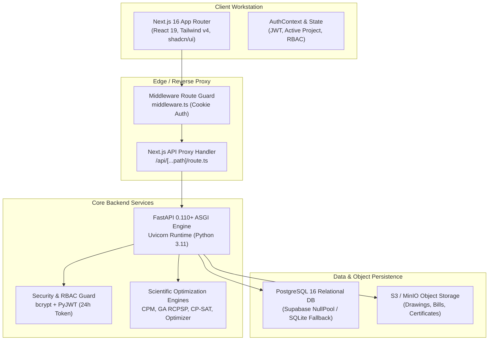
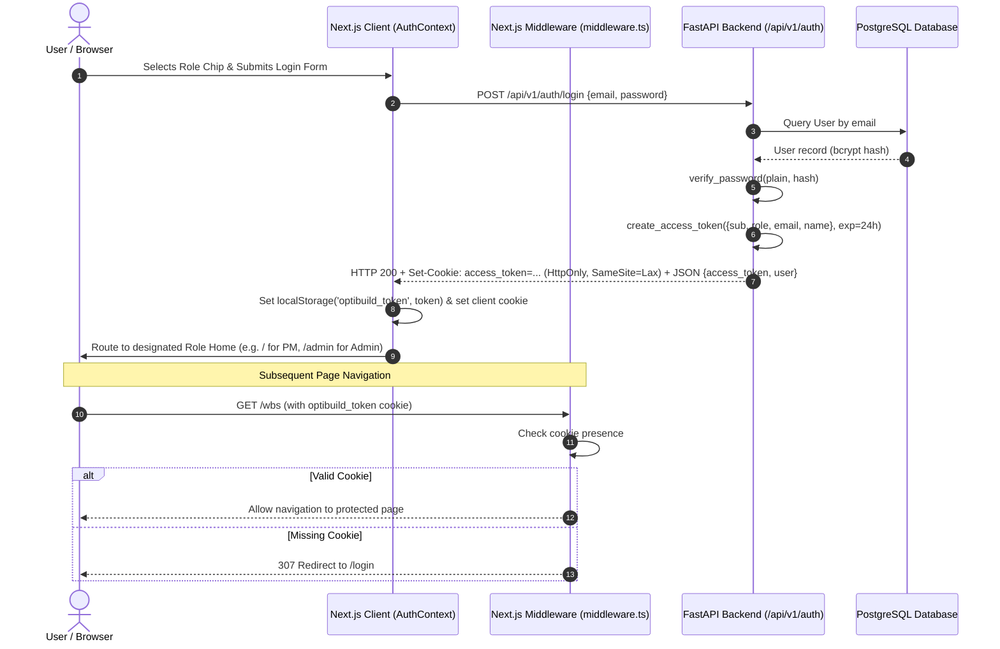
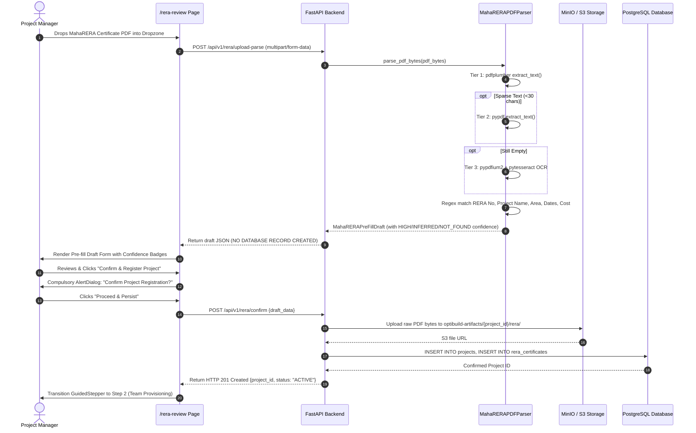
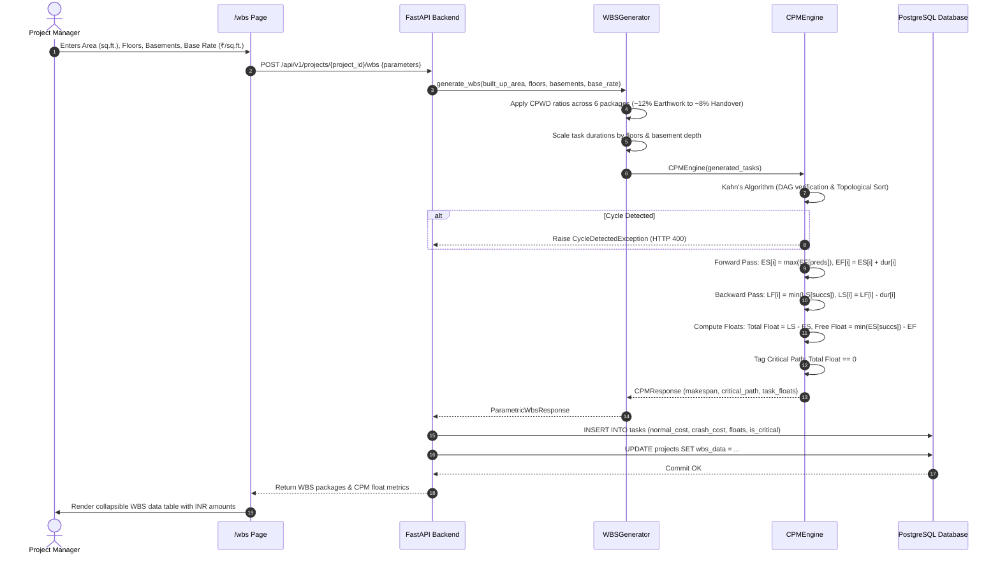
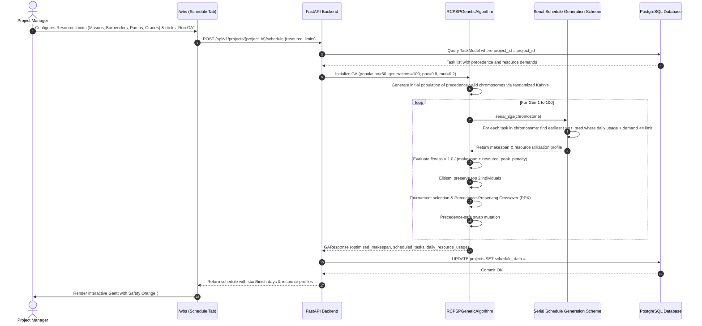
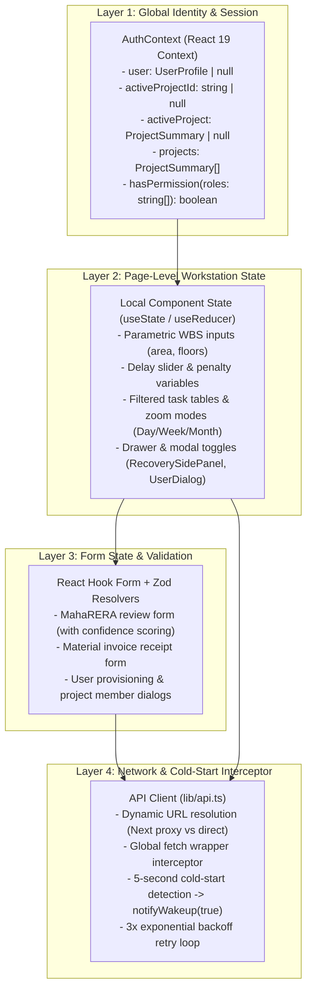

# OptiBuild System Architecture & Technical Blueprint (ARCHITECTURE.md)

> **Document Type:** Comprehensive System Architecture & Engineering Blueprint  
> **Repository:** `divyal27/OptiBuild-Main`  
> **Version:** 2.0.0 (Production Architecture Baseline)  
> **Date:** 2026-10-29  
> **Status:** Single Source of Truth for Architecture, Data Flow, State Management, and Conventions

---

## 1. System Overview & Architectural Principles

### 1.1 Executive Summary
**OptiBuild** is a full-stack, penalty-aware construction planning, resource leveling, and statutory compliance workstation designed specifically for the Indian real estate and civil engineering sector. Under **MahaRERA Section 18**, developers who default on promised possession deadlines are legally mandated to compensate home buyers with monthly interest at:
$$\text{Statutory Rate} = \text{SBI Highest MCLR} + 200\text{ bps (presently } 10.85\%\text{ p.a.)}$$
This interest accrues across total buyer investments (often hundreds of crores), creating catastrophic daily cash outflows of ₹50,000 to ₹10,00,000+ per delayed day.

OptiBuild directly integrates Critical Path Method (CPM) scheduling and Resource-Constrained Project Scheduling (RCPSP) with statutory delay financial penalties. It recommends whether it is financially optimal to **Crash Critical Path Activities** or **Pay Statutory Penalties**, with quantified net savings in Indian Rupees ($\text{INR } ₹$).



---

### 1.2 Five Locked Architectural Invariants
The system architecture strictly complies with 5 non-negotiable architectural boundaries:

| # | Invariant Rule | Architectural Boundary & Code Safeguard |
|:---|:---|:---|
| **INV-1** | **Hero Engine Primacy** | The CPM + Genetic Algorithm (RCPSP) scheduling engine ([`backend/app/engine/ga.py`](file:///d:/OptiBuild%20BE%20Project/OptiBuild-Main/backend/app/engine/ga.py)) is the central hero visual. All other modules (WBS generator, PDF parser, CV classifier, S-curve dashboard) serve as auxiliary feeders. |
| **INV-2** | **Architect Drawing Safeguard** | Architectural drawings (`.dwg`, `.dxf`, `.pdf`, `.png`) are strictly **attach-only**. Uploaded with metadata `{"type": "architect_drawing_attach_only", "unparsed": "true"}`. Stored in S3/MinIO for human viewing and **strictly never OCR'd or parsed**. |
| **INV-3** | **Bill Photo Evidence Safeguard** | Invoices uploaded to the procurement ledger are stored strictly as **unparsed documentary audit evidence**. No OCR, text scraping, or automated invoice parsing is permitted. |
| **INV-4** | **MahaRERA PDF Pre-Fill Safeguard** | MahaRERA certificate PDF extraction **only pre-fills a draft review form**. The system requires explicit human engineer verification inside an `AlertDialog` before any database record or project is created. |
| **INV-5** | **Decoupled CV Classifier Boundary** | The site progress photo classifier is a lightweight heuristic computer vision assessment module (`STRUCTURAL_STAGE` vs. `FINISHING_STAGE`). Algorithmic scheduling and delay optimization **never depend on the CV classifier** to execute. |

---

## 2. Technology Stack & Frameworks

### 2.1 Backend Architecture
* **Language & Runtime:** Python 3.11+ (Dockerized on `python:3.11-slim`)
* **API Framework:** FastAPI `>=0.110.0`
* **ASGI Server:** Uvicorn `>=0.28.0` with multi-worker support
* **Validation & Serialisation:** Pydantic v2 `>=2.6.0` (Strict typing and DTO schemas)
* **Object-Relational Mapping (ORM):** SQLAlchemy `>=2.0.28` (Declarative mapping with 2.0-style queries)
* **Database Drivers:** `psycopg2-binary>=2.9.9` (PostgreSQL), native `sqlite3` fallback
* **Mathematical & Algorithmic Engines:**
  * **Google OR-Tools:** `9.11.4210` (CP-SAT Constraint Programming Solver with Cumulative interval constraints)
  * **NetworkX:** `>=3.2.1` (Directed Acyclic Graph DAG validation, Kahn's topological sort, cycle detection)
  * **NumPy:** `>=1.26.0` & **SciPy:** `>=1.12.0`
* **Document & Image Processing:**
  * **PDF Extraction:** `pdfplumber>=0.10.0`, `pypdf>=4.0.0`, `pypdfium2>=4.28.0`
  * **OCR Engine:** `pytesseract>=0.3.10` (lazy-loaded fallback for scanned documents)
  * **Computer Vision:** `Pillow>=10.2.0` (spatial edge filtering and RGB color histogram analysis)
* **Object Storage:** `boto3>=1.34.0` (S3 API client compatible with MinIO, Supabase S3, AWS S3, Cloudflare R2)
* **Authentication & Cryptography:**
  * `bcrypt>=4.1.0` (Strict 12-round blowfish password hashing)
  * `PyJWT>=2.8.0` (HS256 JWT tokens with 24-hour expiration)
  * `python-multipart>=0.0.9` (Multipart form-data parsing for document uploads)
* **Test Suite:** `pytest>=8.0.0`, `httpx>=0.27.0` (FastAPI TestClient)

### 2.2 Frontend Architecture
* **Framework:** Next.js `16.4.0` (App Router, Turbopack, Partial Prerendering)
* **Core Runtime:** React `19.3.0` / React DOM `19.3.0`
* **Styling & Design Tokens:**
  * Tailwind CSS `v4` (`@tailwindcss/turbopack`, `tw-animate-css`)
  * shadcn/ui (`^4.21.4` on `@base-ui/react ^1.9.0`)
  * React Bits (Hardware-accelerated CSS/SVG motion primitives)
  * Vengeance UI (Kinetic loaders, shared avatar stacks, staggered grids)
* **State Management:** React 19 Context API (`AuthContext`), React Hook Form, URL SearchParams
* **Data Visualization & Scheduling:**
  * `recharts ^3.10.1` (S-Curves, Cost-Time trade-off curves, Benchmark bar charts)
  * `gantt-task-react ^0.3.9` (Interactive CPM/GA Gantt timeline)
* **Data Grids & Command Navigation:**
  * `@tanstack/react-table ^9.3.1` (High-density sortable, collapsible data grids)
  * `cmdk ^1.1.1` (Global `Ctrl+K` command palette)
* **Typography (Zero-Network Local Fonts):**
  * `@fontsource-variable/space-grotesk` (Headings)
  * `@fontsource-variable/ibm-plex-sans` (Interface Prose)
  * `@fontsource/ibm-plex-mono` (Numeric Data, Currency, IDs)

### 2.3 Storage & Container Infrastructure
* **PostgreSQL:** PostgreSQL 16 Alpine (`postgres:16-alpine`), compatible with Supabase Transaction Pooler (port 6543)
* **Object Storage:** MinIO (`cgr.dev/chainguard/minio:latest`) on ports 9000 (API) and 9001 (Console)
* **Orchestration:** Multi-container Docker Compose mesh with health checks and bridge networking

---

## 3. Repository Directory Structure & Monorepo Organization

```text
OptiBuild-Main/
├── backend/                            # FastAPI Python Backend
│   ├── app/
│   │   ├── main.py                     # App factory, CORS, router mounts, startup auto-seeding
│   │   ├── api/v1/                     # REST API Route Endpoints (32 endpoints across 10 modules)
│   │   │   ├── auth.py                 # Login, logout, me, JWT cookie issuing
│   │   │   ├── benchmark.py            # GA vs CP-SAT comparison runner & presets
│   │   │   ├── dashboard.py            # S-Curve spend analytics & crash cost recalibration
│   │   │   ├── materials.py            # Material procurement log & CV stage classifier
│   │   │   ├── optimizer.py            # MahaRERA Sec 18 penalty & schedule crashing
│   │   │   ├── projects.py             # Project CRUD, WBS/schedule/optimizer persistence, drawings, photos
│   │   │   ├── rera_parser.py          # MahaRERA PDF parsing and confirmation gate
│   │   │   ├── schedule.py             # CPM forward/backward pass & GA RCPSP solver
│   │   │   ├── users.py                # User administration and role provisioning
│   │   │   └── wbs.py                  # Parametric WBS generator & CPWD cost ratios
│   │   ├── core/
│   │   │   ├── auth.py                 # Password hashing (bcrypt), JWT generation, RBAC dependencies
│   │   │   └── config.py               # Pydantic Settings, CORS origins, storage quotas
│   │   ├── db/
│   │   │   ├── models.py               # 10 SQLAlchemy ORM database models
│   │   │   ├── session.py              # Engine creation, NullPool pooling, SQLite resilient fallback
│   │   │   ├── seed.py                 # Initializer for 7 demo role accounts & org
│   │   │   └── init_db.py              # Standalone DB initialization script
│   │   ├── engine/                     # Core Algorithmic & Scientific Engines
│   │   │   ├── benchmark.py            # Google OR-Tools CP-SAT formulation vs GA
│   │   │   ├── classifier.py           # Computer vision edge/color density stage classifier
│   │   │   ├── cpm.py                  # Critical Path Method (ES/EF, LS/LF, Floats, Kahn's DAG verify)
│   │   │   ├── ga.py                   # Genetic Algorithm for RCPSP (Serial SGS, PPX, Resource Leveling)
│   │   │   ├── optimizer.py            # MahaRERA Sec 18 penalty vs greedy cost slope crashing
│   │   │   ├── pdf_parser.py           # Multi-tier PDF parser (pdfplumber, pypdf, pypdfium2, Tesseract)
│   │   │   ├── recalibrate.py          # EV S-Curve spend auditor & crash cost slope updater
│   │   │   └── wbs_generator.py        # Parametric building WBS generator (CPWD standard ratios)
│   │   ├── schemas/                    # Pydantic v2 schemas for request/response DTOs
│   │   │   ├── auth.py                 # TokenResponse, UserProfile, LoginRequest, CreateUserRequest
│   │   │   ├── benchmark.py            # BenchmarkRunRequest, BenchmarkComparisonResult
│   │   │   ├── dashboard.py            # DashboardResponse, SCurvePoint, CategoryVariance
│   │   │   ├── materials.py            # MaterialLogItem, CreateMaterialLogRequest, MaterialLogSummary
│   │   │   ├── optimizer.py            # CrashableTaskItem, RERAPenaltyParams, OptimizationResult
│   │   │   ├── pdf_parser.py           # MahaRERAPreFillDraft, ConfirmRERADraftRequest
│   │   │   ├── schedule.py             # TaskInputItem, ScheduleRequest, CPMResponse, GAResponse
│   │   │   └── wbs.py                  # BuildingParametersInput, ParametricWbsResponse
│   │   └── storage/
│   │       └── s3.py                   # Boto3 client, presigned URLs, MIME/size validator, disk fallback
│   ├── tests/                          # 13 Test suites (45+ automated tests)
│   ├── Dockerfile                      # Python 3.11-slim + libpq + Tesseract OCR
│   └── requirements.txt                # Pinned Python package dependencies
├── frontend/                           # Next.js 16 + Tailwind CSS v4 Frontend
│   ├── public/                         # Static assets (CAD blueprints, icons, badges)
│   ├── src/
│   │   ├── middleware.ts               # Cookie-based routing & authentication gate
│   │   ├── app/                        # Next.js App Router (13 routes)
│   │   │   ├── layout.tsx              # Root HTML wrapper, technical font loading, metadata
│   │   │   ├── globals.css             # Design tokens, CSS variables, drafting grid background
│   │   │   ├── page.tsx                # Projects Overview (Staggered cards, KPIs, progress)
│   │   │   ├── login/page.tsx          # Split CAD login, 7-role instant fill chips, animated submit
│   │   │   ├── rera-review/page.tsx    # 4-step guided setup, PDF dropzone, confidence badges, confirm dialog
│   │   │   ├── wbs/page.tsx            # Parametric WBS generator, cost data table, interactive Gantt
│   │   │   ├── optimizer/page.tsx      # MahaRERA Sec 18 penalty vs schedule crashing trade-off analyzer
│   │   │   ├── dashboard/page.tsx      # S-Curve spend audit, category variance, invoice recalibration
│   │   │   ├── materials/page.tsx      # Procurement log, unparsed bill viewer, CV stage classifier
│   │   │   ├── admin/page.tsx          # User roster data table, user dialog, project member assignment
│   │   │   ├── drawings/page.tsx       # Architectural drawing vault (view-only blueprint cards)
│   │   │   ├── benchmark/page.tsx      # Solver benchmark (GA vs OR-Tools CP-SAT side-by-side)
│   │   │   └── api/[...path]/route.ts  # Next.js reverse proxy to FastAPI backend
│   │   ├── components/
│   │   │   ├── layout/                 # Sidebar, TopBar, CommandPalette (Ctrl+K), WakeupBanner
│   │   │   ├── optimizer/              # RecoverySidePanel (Dynamic recommendation comparison)
│   │   │   ├── project/                # GuidedStepper (4-step onboarding progress)
│   │   │   ├── schedule/               # GanttSchedule (gantt-task-react wrapper with design tokens)
│   │   │   ├── ui/                     # shadcn, React Bits, and Vengeance UI technical primitives
│   │   │   └── weather/                # SiteWeatherWidget (Open-Meteo rain & wind risk correlation)
│   │   ├── context/
│   │   │   └── AuthContext.tsx         # User state, JWT cookies, project switcher, RBAC role guard
│   │   └── lib/
│   │       ├── api.ts                  # API resolver, cold-start wakeup interceptor, 3x retry loop
│   │       └── utils.ts                # cn() class merger, formatINR() Indian Rupee formatter
│   ├── package.json                    # Frontend package dependencies & scripts
│   ├── tsconfig.json                   # TypeScript path aliases (@/*)
│   └── next.config.ts                  # Turbopack & standalone output configuration
├── docker-compose.yml                  # Docker Compose multi-container setup
├── PROJECT_AUDIT.md                    # Comprehensive architectural audit baseline
├── PRD.md                              # Product Requirements Document
├── DESIGN.md                           # Site-office engineering design system specification
├── DEPENDENCIES.md                     # Component and dependency registry log
└── README.md                           # Monorepo technical documentation
```

---

## 4. End-to-End Data Flow & Sequence Diagrams

### 4.1 Authentication & Session Life Cycle
Dual delivery model combines HTTP-only cookies with client-side Bearer authorization:



---

### 4.2 MahaRERA PDF Extraction & Confirmation Gate Flow
Enforces Invariant **INV-4** (No persistence without explicit human confirmation):



---

### 4.3 Parametric WBS Generation & CPM Float Precomputation
Transforms gross building parameters into a CPWD-standard 6-package WBS and precomputes topological critical paths:



---

### 4.4 Hero RCPSP Scheduling Engine Flow (GA + Serial SGS)
Resolves resource contention using Genetic Algorithm and Serial Schedule Generation Scheme:



---

### 4.5 MahaRERA Delay Recovery Optimizer Flow
Evaluates Statutory Penalties vs. Greedy Critical Path Schedule Crashing:

```mermaid
sequenceDiagram
    autonumber
    actor PM as Project Manager / Owner
    participant UI as /optimizer Page
    participant API as FastAPI Backend
    participant OPT_ENG as DelayRecoveryOptimizer
    participant CPM_ENG as CPMEngine
    participant DB as PostgreSQL Database

    PM->>UI: Inputs Delay Days (e.g. 14) and Allottee Investment Exposure (e.g. ₹25 Cr)
    UI->>API: POST /api/v1/projects/{project_id}/optimizer {delay_days, investment, sbi_mclr}
    
    API->>OPT_ENG: calculate_rera_penalty(investment, sbi_mclr, delay_days)
    OPT_ENG->>OPT_ENG: Effective Rate = SBI MCLR (8.85%) + Spread (2.0%) = 10.85%
    OPT_ENG->>OPT_ENG: Daily Penalty = Investment * (10.85 / 100 / 365)
    OPT_ENG->>OPT_ENG: Option A Total Penalty = Daily Penalty * delay_days
    
    API->>OPT_ENG: optimize_crashing(tasks, target_days=delay_days)
    OPT_ENG->>OPT_ENG: Calculate cost slopes: Si = (Crash Cost - Normal Cost) / (Normal Dur - Crash Dur)
    
    loop For Day 1 to target_days
        OPT_ENG->>CPM_ENG: Compute current CPM on modified durations
        CPM_ENG-->>OPT_ENG: Identify current critical path
        OPT_ENG->>OPT_ENG: Find critical task with MINIMUM cost slope that has remaining crash capacity
        OPT_ENG->>OPT_ENG: Compress task duration by 1 day; add cost slope to total_crash_cost
    end
    
    OPT_ENG->>OPT_ENG: Option B Total Crashing Cost = sum(marginal cost slopes)
    OPT_ENG->>OPT_ENG: Compare: Net Savings = Option A - Option B
    OPT_ENG->>OPT_ENG: Recommend Cheaper Strategy (CRASH vs ACCEPT_PENALTY)
    
    OPT_ENG-->>API: OptimizationResult (Option A, Option B, Net Savings, Recommendation)
    API->>DB: INSERT INTO delay_recovery_evaluations
    API->>DB: UPDATE projects SET optimizer_data = ...
    DB-->>API: Commit OK
    API-->>UI: Return Dual Trade-off Cards & Cost-Time Area Curve
    UI->>PM: Render dynamic (RECOMMENDED) badge on lower-cost strategy
```

---

## 5. State Management & Frontend Client Architecture

### 5.1 React 19 Client State Architecture
The frontend manages state across four distinct layers to ensure predictable data flow:



### 5.2 Client-Side Cold-Start Interceptor ([`frontend/src/lib/api.ts`](file:///d:/OptiBuild%20BE%20Project/OptiBuild-Main/frontend/src/lib/api.ts))
In serverless or free-tier cloud environments (e.g., Render.com free backend), instances spin down after inactivity. The API client implements an automatic monkey-patched `window.fetch` wrapper:
1. **Detection:** If any API request takes longer than **5 seconds**, it triggers `notifyWakeup(true)`.
2. **Visual Feedback:** The global [`WakeupBanner`](file:///d:/OptiBuild%20BE%20Project/OptiBuild-Main/frontend/src/components/layout/WakeupBanner.tsx) activates the [`KineticTextLoader`](file:///d:/OptiBuild%20BE%20Project/OptiBuild-Main/frontend/src/components/ui/KineticTextLoader.tsx) typography pulse, informing the user that the engine is spinning up.
3. **Resilience:** Intercepts HTTP `502`, `503`, and `504` gateway errors and retries up to **3 times** with exponential backoff ($1\text{s}, 2\text{s}, 4\text{s}$) before raising an error toast via `sonner`.

### 5.3 Next.js Reverse Proxy Route Handler ([`frontend/src/app/api/[...path]/route.ts`](file:///d:/OptiBuild%20BE%20Project/OptiBuild-Main/frontend/src/app/api/[...path]/route.ts))
* Resolves internal server-to-server traffic inside Docker networks (`http://backend:8000`).
* Forwards client cookies, auth headers, and query parameters directly to FastAPI.
* Eliminates browser CORS issues entirely during production deployments.
* Streams binary array buffers for large PDF certificates, drawings, and photos using `@ts-expect-error duplex: "half"`.

---

## 6. Database Schema & Data Persistence Architecture

### 6.1 Entity-Relationship (ER) Architecture
The relational layer consists of 10 SQLAlchemy ORM models in [`backend/app/db/models.py`](file:///d:/OptiBuild%20BE%20Project/OptiBuild-Main/backend/app/db/models.py):

```mermaid
erDiagram
    ORGANIZATIONS ||--o{ PROJECTS : owns
    ORGANIZATIONS ||--o{ USERS : employs
    USERS ||--o{ PROJECT_MEMBERS : assigned_to
    PROJECTS ||--o{ PROJECT_MEMBERS : includes
    PROJECTS ||--o{ TASKS : schedules
    PROJECTS ||--o{ MATERIAL_LOGS : audits
    PROJECTS ||--o{ PROJECT_DRAWINGS : archives
    PROJECTS ||--o{ RERA_CERTIFICATES : confirms
    PROJECTS ||--o{ SITE_PHOTOS : records
    PROJECTS ||--o{ DELAY_RECOVERY_EVALUATIONS : logs

    ORGANIZATIONS {
        string id PK "org_uuid"
        string name "Organization Name"
        datetime created_at
    }

    USERS {
        string id PK "user_uuid"
        string organization_id FK
        string email UK "Indexed unique email"
        string hashed_password "bcrypt hash"
        string full_name
        string role "admin|pm|site|store|arch|acc|owner"
        boolean is_active
        datetime created_at
    }

    PROJECTS {
        string id PK "proj_uuid"
        string organization_id FK
        string name
        string status "ACTIVE|COMPLETED|ON_HOLD"
        string rera_registration_no "P52100018921"
        string promoter_name
        string proposed_completion_date "YYYY-MM-DD"
        float plot_area_sqft
        float built_up_area_sqft
        float carpet_area_sqft
        int number_of_floors
        int number_of_basements
        float base_rate_per_sqft
        float total_project_cost
        float total_allottee_investment
        float sbi_mclr_rate "Default 8.85"
        float rera_spread "Default 2.0"
        int delay_days
        json wbs_data "Pre-computed WBS snapshot"
        json schedule_data "Pre-computed GA schedule snapshot"
        json optimizer_data "Pre-computed recovery snapshot"
        json benchmark_data "Pre-computed solver comparison"
        string created_by_id FK
        datetime created_at
        datetime updated_at
    }

    PROJECT_MEMBERS {
        string id PK "member_uuid"
        string project_id FK "Cascade Delete"
        string user_id FK "Cascade Delete"
        string role "Project-specific role override"
        datetime created_at
    }

    TASKS {
        string id PK "task_uuid"
        string project_id FK "Cascade Delete"
        string name "Activity Title"
        int duration "Normal duration in days"
        float normal_cost "INR normal cost"
        float crash_cost "INR crash cost"
        int crash_duration "Minimum duration in days"
        json predecessors "List of task IDs ['T01', 'T02']"
        json resource_demands "Daily resources {'masons': 10}"
        boolean is_critical "CPM criticality flag"
        int total_float "Total float in days"
        int free_float "Free float in days"
        float progress_percent "0.0 to 100.0"
        string status "PLANNED|IN_PROGRESS|COMPLETED"
        string actual_start "Date or null"
        string actual_finish "Date or null"
        datetime created_at
    }

    MATERIAL_LOGS {
        string entry_id PK "log_uuid"
        string project_id FK "Cascade Delete"
        string date "YYYY-MM-DD"
        string material_category "Steel|Concrete|Cement|Blocks"
        text item_description
        string wbs_code "WBS-1.1"
        float quantity
        string unit "MT|Cu.m|Bags|Brass"
        float unit_rate "INR unit rate"
        float total_amount "Quantity * Unit Rate"
        string supplier_name
        string invoice_no
        text bill_attachment_url "Unparsed S3 evidence URL"
        string logged_by_id FK
        datetime created_at
    }

    PROJECT_DRAWINGS {
        string id PK "drawing_uuid"
        string project_id FK "Cascade Delete"
        string title "Architectural / Structural Sheet Title"
        string drawing_type "ARCHITECTURAL|STRUCTURAL|MEP"
        string file_name "sanitized_filename.pdf"
        text file_url "Unparsed S3 URL"
        string uploaded_by_id FK
        datetime uploaded_at
    }

    RERA_CERTIFICATES {
        string id PK "cert_uuid"
        string project_id FK "Cascade Delete"
        string rera_registration_no
        string project_name
        string promoter_name
        string proposed_completion_date
        float plot_area_sqft
        float built_up_area_sqft
        float carpet_area_sqft
        int number_of_floors
        int number_of_basements
        float total_project_cost
        string status "CONFIRMED"
        text raw_pdf_url "S3 certificate URL"
        datetime confirmed_at
    }

    SITE_PHOTOS {
        string id PK "photo_uuid"
        string project_id FK "Cascade Delete"
        text photo_url "S3 image URL"
        string predicted_stage "STRUCTURAL_STAGE|FINISHING_STAGE"
        string stage_label "Human readable stage"
        float confidence_score "0.0 to 1.0"
        json detected_features "List of detected visual traits"
        text notes
        string engineer_confirmed_stage "Manual override"
        string uploaded_by_id FK
        datetime uploaded_at
    }

    DELAY_RECOVERY_EVALUATIONS {
        string id PK "eval_uuid"
        string project_id FK "Cascade Delete"
        int delay_days
        float rera_daily_penalty
        float rera_total_penalty
        float total_crash_cost
        int days_recovered
        float net_savings
        string recommendation "CRASH|ACCEPT_PENALTY"
        json crashing_actions "List of compressed activities"
        datetime evaluated_at
    }
```



### 6.2 Relational Session & Engine Pooling ([`backend/app/db/session.py`](file:///d:/OptiBuild%20BE%20Project/OptiBuild-Main/backend/app/db/session.py))
* **Supabase / Transaction Pooler Normalization:** The `clean_database_url()` routine strips `?pgbouncer=true` and normalizes URIs to `postgresql+psycopg2://`.
* **NullPool Connection Pooling:** In serverless or containerized setups connecting to external poolers (port 6543), SQLAlchemy connection pooling is bypassed using `poolclass=NullPool` to prevent session connection leaks.
* **Resilient SQLite Fallback:** When PostgreSQL is unreachable, the engine gracefully initializes local `sqlite:///./optibuild.db` with `connect_args={"check_same_thread": False}`, guaranteeing zero setup friction during local offline evaluation.

---

## 7. Security, RBAC & Defense-in-Depth Architecture

### 7.1 Role-Based Access Control Matrix
The system defines 7 discrete user personas with strict boundary separation:

| Route Path | Module Name | `admin` | `project_manager` | `site_engineer` | `store_keeper` | `architect` | `accountant` | `owner` |
|:---|:---|:---:|:---:|:---:|:---:|:---:|:---:|:---:|
| `/login` | Authentication Portal | Yes | Yes | Yes | Yes | Yes | Yes | Yes |
| `/` | Projects Overview & KPIs | Yes | **Home** | Read | Read | Read | Read | Read |
| `/rera-review` | MahaRERA Setup & PDF Parse | Yes | Yes | No | No | No | No | No |
| `/wbs` | Parametric WBS & Gantt | Yes | Yes | Read | No | No | No | Read |
| `/optimizer` | Delay Recovery Optimizer | Yes | Yes | No | No | No | No | Read |
| `/materials` | Procurement & Site Photos | Yes | Yes | **Home** | **Home** | No | Read | Read |
| `/drawings` | Architectural Vault (Attach) | Yes | Yes | Read | No | **Home** | No | Read |
| `/dashboard` | S-Curve Spend Audit & Recal | Yes | Yes | No | No | No | **Home** | **Home** |
| `/benchmark` | GA vs CP-SAT Benchmark | Yes | Yes | No | No | No | No | No |
| `/admin` | Team Provisioning & Roster | **Home** | No | No | No | No | No | No |

### 7.2 Multi-Layer Defense-in-Depth
1. **Layer 1: Edge / Next.js Middleware Gate ([`frontend/src/middleware.ts`](file:///d:/OptiBuild%20BE%20Project/OptiBuild-Main/frontend/src/middleware.ts)):**
   * Inspects HTTP cookies for `optibuild_token` or `auth_token`.
   * Unauthenticated requests to protected paths are redirected immediately to `/login`.
2. **Layer 2: UI Presentation Gate ([`frontend/src/components/ui/PermissionDenied.tsx`](file:///d:/OptiBuild%20BE%20Project/OptiBuild-Main/frontend/src/components/ui/PermissionDenied.tsx)):**
   * If an authenticated user navigates to a URL outside their permitted role, the page renders a high-contrast `PermissionDenied` shield with an explanation and a one-click button returning to their designated home route.
3. **Layer 3: FastAPI Dependency Injection Gate ([`backend/app/core/auth.py`](file:///d:/OptiBuild%20BE%20Project/OptiBuild-Main/backend/app/core/auth.py)):**
   * Every protected endpoint enforces `Depends(get_current_user)` and `Depends(require_roles(...))`.
   * Project-level endpoints enforce `check_project_membership()`, verifying that the user belongs to the active project's team.
   * `admin` role is granted global superuser bypass across all endpoints.

---

## 8. Object Storage & Asset Invariant Architecture

### 8.1 S3 / MinIO Storage Engine ([`backend/app/storage/s3.py`](file:///d:/OptiBuild%20BE%20Project/OptiBuild-Main/backend/app/storage/s3.py))
All binary artifacts (PDFs, blueprint drawings, and photos) are stored in an S3-compatible bucket (`optibuild-artifacts`):

```text
optibuild-artifacts/
└── {project_id}/
    ├── rera/             # Raw MahaRERA Registration PDF certificates (10 MB limit)
    ├── drawings/         # Architectural CAD/PDF blueprints (20 MB limit, ATTACH-ONLY)
    ├── bill_photos/      # Material invoice receipts (5 MB limit, UNPARSED EVIDENCE)
    └── site_photos/      # Progress inspection photos (5 MB limit, HEURISTIC CV ONLY)
```

### 8.2 Content-Type & Magic Byte Validation
To prevent malicious file execution and enforce invariant safety, files are validated prior to upload:

| Category | Size Quota | Magic Byte Verification | Permitted File Types |
|:---|:---|:---|:---|
| `maharera` | 10 MB | Header must start with `b"%PDF-"` | `.pdf` |
| `site_photo` | 5 MB | JPEG (`\xff\xd8\xff`), PNG (`\x89PNG\r\n\x1a\n`), WebP (`RIFF...WEBP`) | `.jpg`, `.jpeg`, `.png`, `.webp` |
| `bill_photo` | 5 MB | JPEG (`\xff\xd8\xff`), PNG (`\x89PNG\r\n\x1a\n`), WebP (`RIFF...WEBP`) | `.jpg`, `.jpeg`, `.png`, `.webp` |
| `architect_drawing`| 20 MB | PDF (`%PDF-`), AutoCAD DWG (`AC10`), or Images | `.dwg`, `.dxf`, `.pdf`, `.png`, `.jpg` |

* **Presigned Download URLs:** Presigned URLs are generated with a strict **600-second (10-minute) Time-To-Live (TTL)**.
* **Storage Quota:** Projects enforce a maximum storage quota (`MAX_PROJECT_STORAGE_MB: 200MB`). Uploads exceeding this quota raise HTTP 413 Content Too Large.
* **Local Disk Fallback:** If S3/MinIO is unavailable, files are written safely to `uploads/{project_id}/` on the local server disk.

---

## 9. Mathematical & Algorithmic Formulations

### 9.1 Critical Path Method (CPM)
* **Precedence Graph:** Directed Acyclic Graph $G = (V, E)$, where $V$ represents construction tasks and $(u, v) \in E$ enforces task $u$ must finish before task $v$ starts ($FS$ dependency).
* **Topological Sort:** Kahn's algorithm validates cycle absence:
  $$\text{in\_degree}(v) = |\{u \in V \mid (u, v) \in E\}|$$
* **Forward Pass (Early Dates):**
  $$ES_v = \begin{cases} 0 & \text{if } \text{Pred}(v) = \emptyset \\ \max_{u \in \text{Pred}(v)} (EF_u) & \text{otherwise} \end{cases}$$
  $$EF_v = ES_v + D_v$$
  $$\text{Project Makespan } T_{\text{CPM}} = \max_{v \in V} (EF_v)$$
* **Backward Pass (Late Dates):**
  $$LF_u = \begin{cases} T_{\text{CPM}} & \text{if } \text{Succ}(u) = \emptyset \\ \min_{v \in \text{Succ}(u)} (LS_v) & \text{otherwise} \end{cases}$$
  $$LS_u = LF_u - D_u$$
* **Floats & Criticality:**
  $$\text{Total Float } TF_v = LS_v - ES_v = LF_v - EF_v$$
  $$\text{Free Float } FF_v = \min_{w \in \text{Succ}(v)} (ES_w) - EF_v$$
  $$\text{Critical Path Task: } TF_v = 0$$

---

### 9.2 Resource-Constrained Scheduling (RCPSP) Genetic Algorithm
* **Chromosome:** Activity list $\lambda = (\lambda_1, \lambda_2, \dots, \lambda_n)$ representing a precedence-feasible permutation of tasks.
* **Decoding Scheme (Serial SGS):**
  At step $g$, task $j = \lambda_g$ is scheduled at the earliest start day $S_j \ge \max_{p \in \text{Pred}(j)} (C_p)$ such that:
  $$\sum_{i \in \mathcal{A}(t)} r_{i, k} + r_{j, k} \le R_k \quad \forall k \in \mathcal{K}, \forall t \in [S_j, S_j + D_j)$$
  where $\mathcal{A}(t)$ is the set of active tasks at day $t$, $r_{i,k}$ is demand for resource $k$, and $R_k$ is daily limit.
* **Precedence-Preserving Crossover (PPX):**
  Uses a random binary mask string of length $n$. For bit 1, the next available task from Parent 1 is appended; for bit 0, from Parent 2. Guarantees offspring are 100% precedence-valid without repair heuristics.

---

### 9.3 Statutory MahaRERA Section 18 Delay Penalty
* **Effective Annual Interest Rate:**
  $$r_{\text{eff}} = r_{\text{SBI\_MCLR}} + \text{RERA Spread} = 8.85\% + 2.00\% = 10.85\%\text{ p.a.}$$
* **Daily Accrued Penalty:**
  $$P_{\text{daily}} = I_{\text{allottees}} \times \left(\frac{r_{\text{eff}}}{100 \times 365}\right)$$
* **Total Statutory Liability (Option A):**
  $$P_{\text{total}} = P_{\text{daily}} \times \Delta t_{\text{delay}}$$

---

### 9.4 Greedy Critical Path Schedule Crashing
* **Marginal Crash Cost Slope:**
  $$S_i = \frac{C_{\text{crash}, i} - C_{\text{normal}, i}}{D_{\text{normal}, i} - D_{\text{crash}, i}} \quad (\text{₹ per day saved})$$
* **Iterative Crashing Algorithm:**
  For each required recovery day $d = 1, \dots, \Delta t_{\text{delay}}$:
  1. Recompute CPM on current activity durations to identify the live critical path $\mathcal{CP}$.
  2. Filter candidates $\mathcal{C} = \{i \in \mathcal{CP} \mid D_i > D_{\text{crash}, i}\}$.
  3. Select task $i^* = \arg\min_{i \in \mathcal{C}} (S_i)$ with the minimum cost slope.
  4. Compress $D_{i^*} \leftarrow D_{i^*} - 1$ and accrue cost:
     $$C_{\text{crashing}} \leftarrow C_{\text{crashing}} + S_{i^*}$$
* **Decision Optimization:**
  $$\text{Net Savings} = P_{\text{total}} - C_{\text{crashing}}$$
  $$\text{Recommendation} = \begin{cases} \text{CRASH CRITICAL PATH} & \text{if } C_{\text{crashing}} < P_{\text{total}} \\ \text{ACCEPT STATUTORY PENALTY} & \text{otherwise} \end{cases}$$

---

### 9.5 Google OR-Tools CP-SAT Exact Benchmark Formulation
* **Variables:**
  For each task $i \in V$, interval variable $I_i = \text{NewIntervalVar}(S_i, D_i, E_i)$ where $S_i \in [0, H]$ and $E_i = S_i + D_i$.
* **Constraints:**
  1. Precedence: $S_j \ge E_i \quad \forall (i, j) \in E$.
  2. Cumulative Resources: $\text{AddCumulative}(I_k, \mathbf{r}_k, R_k) \quad \forall k \in \mathcal{K}$.
  3. Makespan: $M \ge E_i \quad \forall i \in V$.
* **Objective:** Minimize $M$.

---

## 10. Conventions, Standards & Operational Patterns

### 10.1 Code Organization Conventions
* **Routers (`backend/app/api/v1/`):** Pure HTTP controller layer. Handles path parsing, authentication dependency injection, and Pydantic DTO responses.
* **Engines (`backend/app/engine/`):** Pure computational services. Stateless algorithms with no direct FastAPI or database session imports. Easy to test via unit tests.
* **Schemas (`backend/app/schemas/`):** Pydantic v2 models enforcing request validation, field descriptions, and OpenAPI examples.
* **Frontend Modules (`frontend/src/`):**
  * `app/`: Next.js 16 App Router pages and route handlers.
  * `components/ui/`: Atomic design primitives (shadcn/ui, React Bits, Vengeance UI).
  * `components/layout/`: Navigation shell (`Sidebar`, `TopBar`, `CommandPalette`, `WakeupBanner`).
  * `lib/`: Pure utility functions (`api.ts`, `utils.ts`).

### 10.2 UI & Styling Standards ([`DESIGN.md`](file:///d:/OptiBuild%20BE%20Project/OptiBuild-Main/DESIGN.md))
* **Strict 4px Border Radius:** Enforce `rounded-[4px]` globally. Pill buttons (`rounded-full`) and oversized rounded containers (`rounded-2xl`) are strictly prohibited.
* **1px Hairline Rules:** Structural separation achieved via `border border-border` rather than heavy drop shadows.
* **High Contrast Typography:** Headings in `Space Grotesk`, UI text in `IBM Plex Sans`, numbers and tables in `IBM Plex Mono` with `tabular-nums`.
* **Motion Guard:** Maximum 400ms duration, GPU-accelerated transforms/opacity only, zero looping decorative animations, and strict `prefers-reduced-motion` compliance.

### 10.3 Resilient Deployment Patterns
* **Dual Database Resilience:** Primary PostgreSQL with `NullPool` for external poolers; automatic fallback to local SQLite for offline demonstrations.
* **Dual Storage Resilience:** Primary S3/MinIO with presigned URLs; automatic fallback to local `uploads/` disk storage.
* **Cold-Start Resilience:** Client fetch interceptor detects slow backend spin-ups ($>5\text{s}$), activates kinetic typography, and retries 3 times with exponential backoff.

---

*Architectural blueprint validated against codebase baseline and approved as single source of truth in `ARCHITECTURE.md`.*

