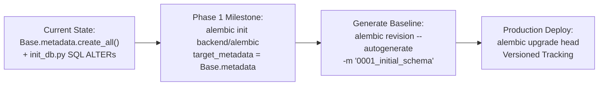

# OptiBuild Database Specification & Schema Reference (DATABASE.md)

> **Document Type:** Comprehensive Database Architecture, Schema Reference & Migration Guide  
> **Repository:** `divyal27/OptiBuild-Main`  
> **Version:** 2.0.0 (Production Database Baseline)  
> **Date:** 2026-10-29  
> **Status:** Single Source of Truth for Relational Schema, Models, Relationships, and Data Management  
> **Rule:** Documented strictly from actual codebase. **Zero schema alterations.**

---

## 1. Database Architecture & Engine Configuration

### 1.1 Dual Engine Strategy (PostgreSQL & SQLite)
OptiBuild utilizes a dual-engine architecture to ensure production performance while maintaining local development flexibility:

```mermaid
flowchart TD
    ENV["DATABASE_URL Environment Variable"] --> PARSE["clean_database_url() in session.py"]
    PARSE --> CHECK{"Engine Protocol"}
    
    CHECK -->|"postgresql://" or "postgres://"| PG["Production: PostgreSQL 16<br/>psycopg2-binary Driver<br/>poolclass: NullPool"]
    CHECK -->|"sqlite:///" or Unset Fallback| SQLITE["Development Fallback: SQLite 3<br/>File: optibuild.db<br/>connect_args: check_same_thread: False"]

    PG --> SUPA["Supabase / Transaction Pooler (Port 6543)<br/>Stripped '?pgbouncer=true'"]
    SQLITE --> LOCAL["Zero-Config Offline Demo<br/>Single-File Portability"]
```

1. **Production Engine (PostgreSQL 16):**
   * Primary deployment target (`postgres:16-alpine`).
   * Supports JSON/JSONB data structures, foreign key constraints with cascade deletes, and relational joins.
   * Compatible with Supabase Transaction Pooler (port `6543`).
2. **Resilient Local Fallback (SQLite 3):**
   * When `DATABASE_URL` is unset or PostgreSQL is unreachable, the system automatically falls back to `sqlite:///./optibuild.db`.
   * Configured with `connect_args={"check_same_thread": False}` for multi-threaded FastAPI execution.

### 1.2 Connection Pooling & Normalization ([`backend/app/db/session.py`](file:///d:/OptiBuild%20BE%20Project/OptiBuild-Main/backend/app/db/session.py))
* **URL Normalization:** The [`clean_database_url()`](file:///d:/OptiBuild%20BE%20Project/OptiBuild-Main/backend/app/db/session.py#L9) function sanitizes connection strings:
  * Strips `?pgbouncer=true` or `&pgbouncer=true` to prevent driver connection errors.
  * Normalizes legacy `postgres://` prefixes to `postgresql+psycopg2://` as required by SQLAlchemy 2.0.
* **NullPool Configuration:** External connection poolers (like PgBouncer or Supabase transaction pooling) maintain their own server-side connection pools. OptiBuild configures `poolclass=NullPool` for PostgreSQL to avoid double-pooling and session connection exhaustion:
  ```python
  if not url.startswith("sqlite"):
      kwargs["poolclass"] = NullPool
  else:
      kwargs["connect_args"] = {"check_same_thread": False}
  ```

### 1.3 Session Lifecycle & FastAPI Dependency
Database sessions are injected into FastAPI endpoints using the [`get_db()`](file:///d:/OptiBuild%20BE%20Project/OptiBuild-Main/backend/app/db/session.py#L99) generator:
```python
def get_db() -> Generator[Session, None, None]:
    db = SessionLocal()
    try:
        yield db
    finally:
        db.close()
```
This guarantees deterministic connection cleanup on every request, even when exceptions are raised during execution.

---

## 2. Entity-Relationship Diagram (Complete ERD)

The relational schema consists of **10 SQLAlchemy ORM models** defined in [`backend/app/db/models.py`](file:///d:/OptiBuild%20BE%20Project/OptiBuild-Main/backend/app/db/models.py):

```mermaid
erDiagram
    ORGANIZATIONS ||--o{ PROJECTS : owns
    ORGANIZATIONS ||--o{ USERS : employs
    USERS ||--o{ PROJECT_MEMBERS : "assigned to"
    PROJECTS ||--o{ PROJECT_MEMBERS : includes
    PROJECTS ||--o{ TASKS : schedules
    PROJECTS ||--o{ MATERIAL_LOGS : audits
    PROJECTS ||--o{ PROJECT_DRAWINGS : archives
    PROJECTS ||--o{ RERA_CERTIFICATES : confirms
    PROJECTS ||--o{ SITE_PHOTOS : records
    PROJECTS ||--o{ DELAY_RECOVERY_EVALUATIONS : logs

    ORGANIZATIONS {
        string id PK "UUID (String 50)"
        string name "Organization Name"
        datetime created_at "UTC Timestamp"
    }

    USERS {
        string id PK "UUID (String 50)"
        string email UK "Indexed unique email"
        string hashed_password "bcrypt blowfish hash"
        string full_name "User Full Name"
        string role "admin|pm|site|store|arch|acc|owner"
        boolean is_active "Account status flag"
        datetime created_at "UTC Timestamp"
    }

    PROJECTS {
        string id PK "UUID (String 50, Indexed)"
        string organization_id FK "organizations.id"
        string name "Project Title"
        string status "ACTIVE|COMPLETED|ON_HOLD"
        string rera_registration_no "Indexed MahaRERA No"
        string promoter_name "Promoter / Developer"
        string proposed_completion_date "YYYY-MM-DD"
        float plot_area_sqft "Total Plot Area"
        float built_up_area_sqft "Gross Built-up Area"
        float carpet_area_sqft "Net Usable Carpet Area"
        int number_of_floors "Above-ground floors"
        int number_of_basements "Basement levels"
        float base_rate_per_sqft "Base rate (default ₹2,400)"
        float total_project_cost "Estimated project budget"
        float total_allottee_investment "Allottee investment exposure"
        float sbi_mclr_rate "SBI MCLR (default 0.0885)"
        float rera_spread "RERA spread (default 0.02)"
        int delay_days "Days delayed past RERA date"
        json wbs_data "Pre-computed WBS snapshot"
        json schedule_data "Pre-computed GA schedule snapshot"
        json optimizer_data "Pre-computed recovery snapshot"
        json benchmark_data "Pre-computed benchmark comparison"
        string created_by_id FK "users.id"
        datetime created_at "UTC Creation Timestamp"
        datetime updated_at "UTC Last Modified Timestamp"
    }

    PROJECT_MEMBERS {
        string id PK "UUID (String 50)"
        string project_id FK "projects.id (CASCADE)"
        string user_id FK "users.id (CASCADE)"
        string role "Project role override"
        datetime created_at "UTC Timestamp"
    }

    TASKS {
        string id PK "Task Code (String 50, Indexed)"
        string project_id FK "projects.id (CASCADE)"
        string name "Task Activity Name"
        int duration "Normal duration in days"
        float normal_cost "INR normal cost"
        float crash_cost "INR crash cost"
        int crash_duration "Minimum duration in days"
        json predecessors "Task ID dependency list"
        json resource_demands "Daily resource demands map"
        boolean is_critical "Critical path flag"
        int total_float "Total Float in days"
        int free_float "Free Float in days"
        float progress_percent "Completion percentage"
        string status "NOT_STARTED|IN_PROGRESS|COMPLETED"
        string actual_start "Actual start date"
        string actual_finish "Actual finish date"
        datetime created_at "UTC Timestamp"
    }

    MATERIAL_LOGS {
        string entry_id PK "UUID (String 50, Indexed)"
        string project_id FK "projects.id (CASCADE)"
        string date "YYYY-MM-DD"
        string material_category "Steel|RMC|Cement|Blocks|Sand"
        text item_description "Item description"
        string wbs_code "Associated WBS package code"
        float quantity "Bill quantity"
        string unit "MT|Cu.m|Bags|Brass"
        float unit_rate "Rate in INR per unit"
        float total_amount "Quantity * Unit Rate"
        string supplier_name "Vendor / Supplier Name"
        string invoice_no "Supplier Tax Invoice Number"
        text bill_attachment_url "Unparsed S3 Evidence URL"
        string logged_by_id FK "users.id"
        datetime created_at "UTC Timestamp"
    }

    PROJECT_DRAWINGS {
        string id PK "UUID (String 50)"
        string project_id FK "projects.id (CASCADE)"
        string title "Drawing Sheet Title"
        string drawing_type "ARCHITECTURAL|STRUCTURAL|MEP"
        string file_name "Sanitized file name"
        text file_url "Unparsed S3 Drawing URL"
        string uploaded_by_id FK "users.id"
        datetime uploaded_at "UTC Timestamp"
    }

    RERA_CERTIFICATES {
        string id PK "UUID (String 50, Indexed)"
        string project_id FK "projects.id (CASCADE)"
        string rera_registration_no "Indexed MahaRERA No"
        string project_name "Sanctioned Project Name"
        string promoter_name "Promoter / Developer Name"
        string proposed_completion_date "YYYY-MM-DD"
        float plot_area_sqft "Plot area"
        float built_up_area_sqft "Built-up area"
        float carpet_area_sqft "Carpet area"
        int number_of_floors "Sanctioned floors"
        int number_of_basements "Sanctioned basements"
        float total_project_cost "Estimated cost"
        string status "CONFIRMED"
        text raw_pdf_url "S3 raw certificate URL"
        datetime confirmed_at "UTC Timestamp"
    }

    SITE_PHOTOS {
        string id PK "UUID (String 50, Indexed)"
        string project_id FK "projects.id (CASCADE)"
        text photo_url "S3 photo URL"
        string predicted_stage "STRUCTURAL_STAGE|FINISHING_STAGE"
        string stage_label "Readable stage title"
        float confidence_score "CV Confidence (0.0 to 1.0)"
        json detected_features "List of detected traits"
        text notes "Field inspection notes"
        string engineer_confirmed_stage "Manual engineer override"
        string uploaded_by_id FK "users.id"
        datetime uploaded_at "UTC Timestamp"
    }

    DELAY_RECOVERY_EVALUATIONS {
        string id PK "UUID (String 50, Indexed)"
        string project_id FK "projects.id (CASCADE)"
        int delay_days "Days delayed past RERA"
        float rera_daily_penalty "Daily Section 18 penalty"
        float rera_total_penalty "Option A total penalty"
        float total_crash_cost "Option B total crashing cost"
        int days_recovered "Total schedule days compressed"
        float net_savings "Option A - Option B savings"
        string recommendation "CRASH|ACCEPT_PENALTY"
        json crashing_actions "Itemized compressed activities"
        datetime evaluated_at "UTC Timestamp"
    }
```



---

## 3. Comprehensive Table Schemas (All 10 Tables)

### 3.1 `organizations` Table
* **Model Class:** [`Organization`](file:///d:/OptiBuild%20BE%20Project/OptiBuild-Main/backend/app/db/models.py#L22)
* **Purpose:** Multi-tenant root organization entity for enterprise isolation.

| Column Name | Data Type | Nullable | Default | Constraints & Indexes | Description |
|:---|:---|:---:|:---:|:---:|:---|
| `id` | `VARCHAR(50)` | No | `uuid4()` | Primary Key | Unique organization identifier. |
| `name` | `VARCHAR(255)` | No | — | — | Registered enterprise name (e.g. "OptiBuild Infrastructure Corp"). |
| `created_at` | `DATETIME` | Yes | `utcnow()` | — | Organization provisioning timestamp. |

* **ORM Relationships:**
  * `projects`: `relationship("Project", back_populates="organization")`

---

### 3.2 `users` Table
* **Model Class:** [`User`](file:///d:/OptiBuild%20BE%20Project/OptiBuild-Main/backend/app/db/models.py#L32)
* **Purpose:** Global user identity, credential store, and default role assignment.

| Column Name | Data Type | Nullable | Default | Constraints & Indexes | Description |
|:---|:---|:---:|:---:|:---:|:---|
| `id` | `VARCHAR(50)` | No | `uuid4()` | Primary Key | Unique user identifier. |
| `email` | `VARCHAR(255)` | No | — | Unique, Index | User login email address (case-sensitive unique index). |
| `hashed_password` | `VARCHAR(255)` | No | — | — | 12-round bcrypt hash string (`$2b$12$...`). |
| `full_name` | `VARCHAR(255)` | No | — | — | Full name and display title. |
| `role` | `VARCHAR(50)` | No | `'site_engineer'` | — | Global system role: `admin`, `project_manager`, `site_engineer`, `store_keeper`, `architect`, `accountant`, `owner`. |
| `is_active` | `BOOLEAN` | Yes | `True` | — | Account activation toggle for soft-deactivation. |
| `created_at` | `DATETIME` | Yes | `utcnow()` | — | Account creation timestamp. |

* **ORM Relationships:**
  * `project_memberships`: `relationship("ProjectMember", back_populates="user", cascade="all, delete-orphan")`

---

### 3.3 `projects` Table
* **Model Class:** [`Project`](file:///d:/OptiBuild%20BE%20Project/OptiBuild-Main/backend/app/db/models.py#L46)
* **Purpose:** Core construction project record storing physical dimensions, statutory RERA parameters, financial escrow parameters, and pre-computed algorithmic snapshots.

| Column Name | Data Type | Nullable | Default | Constraints & Indexes | Description |
|:---|:---|:---:|:---:|:---:|:---|
| `id` | `VARCHAR(50)` | No | `uuid4()` | Primary Key, Index | Unique project identifier. |
| `organization_id` | `VARCHAR(50)` | Yes | — | FK $\rightarrow$ `organizations.id` | Owning enterprise tenant. |
| `name` | `VARCHAR(255)` | No | — | — | Project commercial title (e.g. "Emerald Heights Tower A"). |
| `status` | `VARCHAR(50)` | Yes | `'ACTIVE'` | — | Lifecycle state: `ACTIVE`, `COMPLETED`, `ON_HOLD`. |
| `rera_registration_no` | `VARCHAR(100)` | Yes | — | Index | Statutory MahaRERA registration number (e.g. `P52100018921`). |
| `promoter_name` | `VARCHAR(255)` | Yes | — | — | Name of developer entity registered on RERA. |
| `proposed_completion_date` | `VARCHAR(50)` | Yes | — | — | Promised handover deadline date (`YYYY-MM-DD`). |
| `plot_area_sqft` | `FLOAT` | Yes | `0.0` | — | Total sanctioned plot area in square feet. |
| `built_up_area_sqft` | `FLOAT` | Yes | `0.0` | — | Gross built-up area used for parametric WBS scaling. |
| `carpet_area_sqft` | `FLOAT` | Yes | `0.0` | — | Net usable residential/commercial carpet area. |
| `number_of_floors` | `INTEGER` | Yes | `0` | — | Number of above-ground RCC floors. |
| `number_of_basements` | `INTEGER` | Yes | `0` | — | Number of underground basement levels. |
| `base_rate_per_sqft` | `FLOAT` | Yes | `2400.0` | — | Baseline construction cost rate in ₹/sq.ft. |
| `total_project_cost` | `FLOAT` | Yes | `0.0` | — | Total sanctioned project expenditure in INR. |
| `total_allottee_investment`| `FLOAT` | Yes | `0.0` | — | Cumulative buyer collections exposed to Section 18 delay interest. |
| `sbi_mclr_rate` | `FLOAT` | Yes | `0.0885` | — | State Bank of India Highest MCLR rate ($8.85\%$). |
| `rera_spread` | `FLOAT` | Yes | `0.02` | — | Statutory premium spread mandated by RERA rules ($2.0\%$). |
| `delay_days` | `INTEGER` | Yes | `0` | — | Current delay in calendar days past proposed completion date. |
| `wbs_data` | `JSON` | Yes | — | — | Pre-computed parametric WBS package and task breakdown snapshot. |
| `schedule_data` | `JSON` | Yes | — | — | Pre-computed Genetic Algorithm RCPSP schedule and timeline snapshot. |
| `optimizer_data` | `JSON` | Yes | — | — | Pre-computed delay recovery crashing trade-off snapshot. |
| `benchmark_data` | `JSON` | Yes | — | — | Pre-computed GA vs OR-Tools CP-SAT comparison snapshot. |
| `created_by_id` | `VARCHAR(50)` | Yes | — | FK $\rightarrow$ `users.id` | User who registered the project. |
| `created_at` | `DATETIME` | Yes | `utcnow()` | — | Registration timestamp. |
| `updated_at` | `DATETIME` | Yes | `utcnow()` | On Update `utcnow()` | Last modification timestamp. |

* **ORM Relationships:**
  * `organization`: `relationship("Organization", back_populates="projects")`
  * `members`: `relationship("ProjectMember", back_populates="project", cascade="all, delete-orphan")`
  * `tasks`: `relationship("TaskModel", back_populates="project", cascade="all, delete-orphan")`
  * `materials`: `relationship("MaterialLogModel", back_populates="project", cascade="all, delete-orphan")`
  * `drawings`: `relationship("ProjectDrawing", back_populates="project", cascade="all, delete-orphan")`
  * `site_photos`: `relationship("SitePhotoModel", back_populates="project", cascade="all, delete-orphan")`

---

### 3.4 `project_members` Table
* **Model Class:** [`ProjectMember`](file:///d:/OptiBuild%20BE%20Project/OptiBuild-Main/backend/app/db/models.py#L90)
* **Purpose:** Join table managing project team rosters and project-level role overrides.

| Column Name | Data Type | Nullable | Default | Constraints & Indexes | Description |
|:---|:---|:---:|:---:|:---:|:---|
| `id` | `VARCHAR(50)` | No | `uuid4()` | Primary Key | Unique membership record identifier. |
| `project_id` | `VARCHAR(50)` | No | — | FK $\rightarrow$ `projects.id`, Index | Project foreign key (`ondelete="CASCADE"`). |
| `user_id` | `VARCHAR(50)` | No | — | FK $\rightarrow$ `users.id`, Index | User foreign key (`ondelete="CASCADE"`). |
| `role` | `VARCHAR(50)` | No | — | — | Role assigned within the project team context. |
| `created_at` | `DATETIME` | Yes | `utcnow()` | — | Team assignment timestamp. |

* **ORM Relationships:**
  * `project`: `relationship("Project", back_populates="members")`
  * `user`: `relationship("User", back_populates="project_memberships")`

---

### 3.5 `tasks` Table
* **Model Class:** [`TaskModel`](file:///d:/OptiBuild%20BE%20Project/OptiBuild-Main/backend/app/db/models.py#L103)
* **Purpose:** Granular WBS construction activities with durations, costs, resource demands, and CPM floats.

| Column Name | Data Type | Nullable | Default | Constraints & Indexes | Description |
|:---|:---|:---:|:---:|:---:|:---|
| `id` | `VARCHAR(50)` | No | — | Primary Key, Index | Task code identifier (e.g. `T01`, `WBS-1.1`). |
| `project_id` | `VARCHAR(50)` | Yes | — | FK $\rightarrow$ `projects.id`, Index | Project foreign key (`ondelete="CASCADE"`). |
| `name` | `VARCHAR(255)` | No | — | — | Descriptive title of construction activity. |
| `duration` | `INTEGER` | No | `1` | — | Normal activity duration in calendar days. |
| `normal_cost` | `FLOAT` | Yes | `0.0` | — | Baseline normal execution cost in INR. |
| `crash_cost` | `FLOAT` | Yes | `0.0` | — | Compressed execution cost in INR at maximum crash effort. |
| `crash_duration` | `INTEGER` | Yes | — | — | Absolute minimum compressed duration in days. |
| `predecessors` | `JSON` | Yes | `list` | — | JSON array of predecessor task IDs (`["T01", "T02"]`). |
| `resource_demands` | `JSON` | Yes | `dict` | — | JSON map of daily resource requirements (`{"masons": 12, "labor": 20}`). |
| `is_critical` | `BOOLEAN` | Yes | `False` | — | CPM critical path flag (`Total Float == 0`). |
| `total_float` | `INTEGER` | Yes | `0` | — | Total float days before project makespan is delayed ($LS - ES$). |
| `free_float` | `INTEGER` | Yes | `0` | — | Free float days before immediate successors are delayed. |
| `progress_percent` | `FLOAT` | Yes | `0.0` | — | Current progress completion ($0.0\%$ to $100.0\%$). |
| `status` | `VARCHAR(50)` | Yes | `'NOT_STARTED'` | — | Activity state: `NOT_STARTED`, `IN_PROGRESS`, `COMPLETED`. |
| `actual_start` | `VARCHAR(50)` | Yes | — | — | Recorded site start date (`YYYY-MM-DD`). |
| `actual_finish` | `VARCHAR(50)` | Yes | — | — | Recorded site completion date (`YYYY-MM-DD`). |
| `created_at` | `DATETIME` | Yes | `utcnow()` | — | Task record creation timestamp. |

* **ORM Relationships:**
  * `project`: `relationship("Project", back_populates="tasks")`

---

### 3.6 `material_logs` Table
* **Model Class:** [`MaterialLogModel`](file:///d:/OptiBuild%20BE%20Project/OptiBuild-Main/backend/app/db/models.py#L127)
* **Purpose:** Itemized material procurement records linked to WBS packages and unparsed documentary bill proof.

| Column Name | Data Type | Nullable | Default | Constraints & Indexes | Description |
|:---|:---|:---:|:---:|:---:|:---|
| `entry_id` | `VARCHAR(50)` | No | — | Primary Key, Index | Unique procurement entry ID (e.g. `MAT-2026-001`). |
| `project_id` | `VARCHAR(50)` | Yes | — | FK $\rightarrow$ `projects.id`, Index | Project foreign key (`ondelete="CASCADE"`). |
| `date` | `VARCHAR(20)` | No | — | — | Inward material delivery date (`YYYY-MM-DD`). |
| `material_category` | `VARCHAR(100)` | No | — | — | Category: `Steel / Rebar`, `RMC Concrete`, `Cement`, `AAC Blocks`, `Sand & Aggregates`. |
| `item_description` | `TEXT` | Yes | — | — | Detailed specifications (e.g. "Fe-550D TMT Rebar 16mm"). |
| `wbs_code` | `VARCHAR(50)` | Yes | — | — | Linked WBS package code (e.g. `WBS-2.1`). |
| `quantity` | `FLOAT` | No | — | — | Invoiced quantity delivered to site. |
| `unit` | `VARCHAR(50)` | No | — | — | Engineering unit: `MT`, `Cu.m`, `Bags`, `Blocks`, `Brass`. |
| `unit_rate` | `FLOAT` | No | — | — | Actual unit purchase rate in INR. |
| `total_amount` | `FLOAT` | No | — | — | Total invoice line amount ($\text{Quantity} \times \text{Unit Rate}$). |
| `supplier_name` | `VARCHAR(255)` | No | — | — | Vendor or distributor name. |
| `invoice_no` | `VARCHAR(100)` | No | — | — | Supplier tax invoice / delivery challan number. |
| `bill_attachment_url`| `TEXT` | Yes | — | — | **LOCKED INVARIANT (INV-3):** Presigned S3 URL to unparsed invoice proof. |
| `logged_by_id` | `VARCHAR(50)` | Yes | — | FK $\rightarrow$ `users.id` | Store keeper who received and recorded delivery. |
| `created_at` | `DATETIME` | Yes | `utcnow()` | — | Procurement entry timestamp. |

* **ORM Relationships:**
  * `project`: `relationship("Project", back_populates="materials")`

---

### 3.7 `project_drawings` Table
* **Model Class:** [`ProjectDrawing`](file:///d:/OptiBuild%20BE%20Project/OptiBuild-Main/backend/app/db/models.py#L149)
* **Purpose:** Architectural, structural, and MEP engineering drawing vault.

| Column Name | Data Type | Nullable | Default | Constraints & Indexes | Description |
|:---|:---|:---:|:---:|:---:|:---|
| `id` | `VARCHAR(50)` | No | `uuid4()` | Primary Key | Unique drawing record identifier. |
| `project_id` | `VARCHAR(50)` | No | — | FK $\rightarrow$ `projects.id`, Index | Project foreign key (`ondelete="CASCADE"`). |
| `title` | `VARCHAR(255)` | No | — | — | Engineering drawing sheet title (e.g. "Typical Floor RCC Slab Layout"). |
| `drawing_type` | `VARCHAR(100)` | Yes | `'ARCHITECTURAL'`| — | Category: `ARCHITECTURAL`, `STRUCTURAL`, `MEP`. |
| `file_name` | `VARCHAR(255)` | No | — | — | Sanitized original filename (`.dwg`, `.dxf`, `.pdf`). |
| `file_url` | `TEXT` | No | — | — | **LOCKED INVARIANT (INV-2):** S3 object URL (strictly attach-only, never OCR'd). |
| `uploaded_by_id` | `VARCHAR(50)` | Yes | — | FK $\rightarrow$ `users.id` | Architect or engineer who uploaded drawing. |
| `uploaded_at` | `DATETIME` | Yes | `utcnow()` | — | Upload timestamp. |

* **ORM Relationships:**
  * `project`: `relationship("Project", back_populates="drawings")`

---

### 3.8 `rera_certificates` Table
* **Model Class:** [`RERACertificateModel`](file:///d:/OptiBuild%20BE%20Project/OptiBuild-Main/backend/app/db/models.py#L164)
* **Purpose:** Audit record of confirmed MahaRERA project registration certificates.

| Column Name | Data Type | Nullable | Default | Constraints & Indexes | Description |
|:---|:---|:---:|:---:|:---:|:---|
| `id` | `VARCHAR(50)` | No | `uuid4()` | Primary Key, Index | Unique certificate record identifier. |
| `project_id` | `VARCHAR(50)` | Yes | — | FK $\rightarrow$ `projects.id`, Index | Project foreign key (`ondelete="CASCADE"`). |
| `rera_registration_no` | `VARCHAR(100)` | No | — | Index | MahaRERA registration number (e.g. `P52100018921`). |
| `project_name` | `VARCHAR(255)` | No | — | — | Registered project name. |
| `promoter_name` | `VARCHAR(255)` | Yes | — | — | Registered promoter / developer entity. |
| `proposed_completion_date` | `VARCHAR(50)` | Yes | — | — | Sanctioned possession date (`YYYY-MM-DD`). |
| `plot_area_sqft` | `FLOAT` | Yes | — | — | Registered plot area. |
| `built_up_area_sqft` | `FLOAT` | Yes | — | — | Registered built-up area. |
| `carpet_area_sqft` | `FLOAT` | Yes | — | — | Registered carpet area. |
| `number_of_floors` | `INTEGER` | Yes | — | — | Sanctioned number of floors. |
| `number_of_basements` | `INTEGER` | Yes | — | — | Sanctioned number of basements. |
| `total_project_cost` | `FLOAT` | Yes | — | — | Estimated project cost in INR. |
| `status` | `VARCHAR(50)` | Yes | `'CONFIRMED'` | — | **LOCKED INVARIANT (INV-4):** Only created after human `AlertDialog` confirmation. |
| `raw_pdf_url` | `TEXT` | Yes | — | — | Presigned S3 URL to original uploaded certificate PDF. |
| `confirmed_at` | `DATETIME` | Yes | `utcnow()` | — | Confirmation timestamp. |

---

### 3.9 `site_photos` Table
* **Model Class:** [`SitePhotoModel`](file:///d:/OptiBuild%20BE%20Project/OptiBuild-Main/backend/app/db/models.py#L184)
* **Purpose:** Site progress photos evaluated by the heuristic computer vision classifier.

| Column Name | Data Type | Nullable | Default | Constraints & Indexes | Description |
|:---|:---|:---:|:---:|:---:|:---|
| `id` | `VARCHAR(50)` | No | `uuid4()` | Primary Key, Index | Unique photo record identifier. |
| `project_id` | `VARCHAR(50)` | Yes | — | FK $\rightarrow$ `projects.id`, Index | Project foreign key (`ondelete="CASCADE"`). |
| `photo_url` | `TEXT` | No | — | — | Presigned S3 URL to progress photo. |
| `predicted_stage` | `VARCHAR(50)` | No | — | — | **LOCKED INVARIANT (INV-5):** CV heuristic prediction (`STRUCTURAL_STAGE` vs. `FINISHING_STAGE`). |
| `stage_label` | `VARCHAR(255)` | No | — | — | Human-readable label for predicted stage. |
| `confidence_score` | `FLOAT` | No | — | — | Statistical confidence score ($0.0$ to $1.0$). |
| `detected_features` | `JSON` | Yes | — | — | JSON list of detected traits (e.g. edge density, gray spectrum). |
| `notes` | `TEXT` | Yes | — | — | Site engineer field inspection notes. |
| `engineer_confirmed_stage` | `VARCHAR(50)` | Yes | — | — | Manual human verification override. |
| `uploaded_by_id` | `VARCHAR(50)` | Yes | — | FK $\rightarrow$ `users.id` | Site engineer who captured photo. |
| `uploaded_at` | `DATETIME` | Yes | `utcnow()` | — | Upload timestamp. |

* **ORM Relationships:**
  * `project`: `relationship("Project", back_populates="site_photos")`

---

### 3.10 `delay_recovery_evaluations` Table
* **Model Class:** [`DelayRecoveryEvaluationModel`](file:///d:/OptiBuild%20BE%20Project/OptiBuild-Main/backend/app/db/models.py#L202)
* **Purpose:** Audit ledger of MahaRERA Section 18 penalty vs. schedule crashing evaluations.

| Column Name | Data Type | Nullable | Default | Constraints & Indexes | Description |
|:---|:---|:---:|:---:|:---:|:---|
| `id` | `VARCHAR(50)` | No | `uuid4()` | Primary Key, Index | Unique evaluation evaluation ID. |
| `project_id` | `VARCHAR(50)` | Yes | — | FK $\rightarrow$ `projects.id`, Index | Project foreign key (`ondelete="CASCADE"`). |
| `delay_days` | `INTEGER` | No | — | — | Evaluated schedule delay in calendar days. |
| `rera_daily_penalty` | `FLOAT` | No | — | — | Computed daily statutory Section 18 penalty in INR. |
| `rera_total_penalty` | `FLOAT` | No | — | — | Option A total statutory penalty liability in INR. |
| `total_crash_cost` | `FLOAT` | No | — | — | Option B total greedy schedule crashing investment in INR. |
| `days_recovered` | `INTEGER` | No | — | — | Total days successfully compressed on critical path. |
| `net_savings` | `FLOAT` | No | — | — | Financial differential ($\text{Option A} - \text{Option B}$) in INR. |
| `recommendation` | `VARCHAR(50)` | No | — | — | Strategy outcome: `CRASH` vs. `ACCEPT_PENALTY`. |
| `crashing_actions` | `JSON` | Yes | — | — | JSON array of itemized task compressions and marginal cost slopes. |
| `evaluated_at` | `DATETIME` | Yes | `utcnow()` | — | Evaluation calculation timestamp. |

---

## 4. Hybrid Relational + Document Architecture (JSON Columns)

OptiBuild implements a hybrid storage model: structured relational tables for queryable entities, paired with denormalized **JSON document columns** for complex mathematical engine snapshots.

```
┌────────────────────────────────────────────────────────────────────────┐
│                        PROJECTS TABLE ROW                              │
├───────────────────────────────┬────────────────────────────────────────┤
│ Relational Columns            │ JSON Document Snapshot Columns         │
├───────────────────────────────┼────────────────────────────────────────┤
│ id: "proj_94b2..."            │ wbs_data: { packages: [...], ... }     │
│ name: "Emerald Heights"       │ schedule_data: { ga_makespan: 340, ...}│
│ rera_no: "P52100018921"       │ optimizer_data: { option_a: 540000, ..}│
│ built_up_area: 120000.0       │ benchmark_data: { cp_sat: {...}, ... } │
└───────────────────────────────┴────────────────────────────────────────┘
```

### 4.1 Specification of Snapshot Columns in `projects`

#### 1. `wbs_data` (Parametric WBS Snapshot)
Generated by [`WBSGenerator`](file:///d:/OptiBuild%20BE%20Project/OptiBuild-Main/backend/app/engine/wbs_generator.py#L93):
```json
{
  "built_up_area_sqft": 120000.0,
  "number_of_floors": 14,
  "number_of_basements": 2,
  "base_rate_per_sqft": 2400.0,
  "total_estimated_cost": 288000000.0,
  "categories": [
    {
      "category_code": "CAT-1",
      "category_name": "1. Substructure & Earthwork",
      "category_percentage": 12.0,
      "allocated_budget": 34560000.0,
      "items": [
        {
          "code": "WBS-1.1",
          "title": "Site Clearance, Shoring & Bulk Excavation",
          "duration": 22,
          "allocated_cost": 10080000.0,
          "predecessors": [],
          "resource_demands": { "excavator": 2, "labor": 12 }
        }
      ]
    }
  ],
  "cpm_baseline": {
    "project_makespan": 312,
    "critical_path": ["WBS-1.1", "WBS-1.2", "WBS-2.1", "WBS-2.2"]
  }
}
```

#### 2. `schedule_data` (Hero RCPSP Schedule Snapshot)
Generated by [`RCPSPGeneticAlgorithm`](file:///d:/OptiBuild%20BE%20Project/OptiBuild-Main/backend/app/engine/ga.py#L14):
```json
{
  "cpm_unconstrained_makespan": 312,
  "ga_optimized_makespan": 348,
  "resource_limits": { "masons": 14, "barbenders": 10, "concrete_pumps": 2, "tower_cranes": 1 },
  "tasks": [
    {
      "id": "T01",
      "name": "Site Excavation",
      "start_day": 0,
      "finish_day": 22,
      "duration": 22,
      "is_critical": true,
      "resource_demands": { "excavator": 2, "labor": 12 }
    }
  ],
  "daily_resource_usage": {
    "masons": [0, 0, 8, 12, 14, 14, 10, ...],
    "concrete_pumps": [0, 0, 1, 2, 2, 1, 0, ...]
  }
}
```

#### 3. `optimizer_data` (Delay Recovery Crashing Snapshot)
Generated by [`DelayRecoveryOptimizer`](file:///d:/OptiBuild%20BE%20Project/OptiBuild-Main/backend/app/engine/optimizer.py#L12):
```json
{
  "delay_days": 14,
  "total_allottee_investment": 250000000.0,
  "effective_annual_rate": 10.85,
  "daily_penalty": 74315.07,
  "option_a_penalty": {
    "total_penalty": 1040410.98,
    "statutory_formula": "SBI MCLR (8.85%) + 200 bps = 10.85% p.a."
  },
  "option_b_crashing": {
    "total_crash_cost": 680000.0,
    "days_recovered": 14,
    "actions": [
      {
        "task_id": "T04",
        "task_name": "Podium Columns RCC Casting",
        "days_compressed": 5,
        "cost_slope": 12000.0,
        "added_cost": 60000.0
      }
    ]
  },
  "net_savings": 360410.98,
  "recommendation": "CRASH",
  "recommendation_text": "Crashing critical path activities saves ₹3,60,411 compared to paying statutory MahaRERA penalties."
}
```

#### 4. `benchmark_data` (Solver Comparison Snapshot)
Generated by [`CPSATRCPSPSolver`](file:///d:/OptiBuild%20BE%20Project/OptiBuild-Main/backend/app/engine/benchmark.py#L14):
```json
{
  "preset": "Medium Superstructure (25 tasks)",
  "cpm_lower_bound": 210,
  "solvers": {
    "genetic_algorithm": {
      "makespan_days": 238,
      "runtime_ms": 142.5,
      "status": "FEASIBLE"
    },
    "or_tools_cp_sat": {
      "makespan_days": 234,
      "runtime_ms": 1840.2,
      "status": "OPTIMAL",
      "optimality_gap_percent": 0.0
    }
  }
}
```

---

## 5. Schema Synchronization & Migration Management

### 5.1 Current Migration Mechanism ([`backend/app/db/init_db.py`](file:///d:/OptiBuild%20BE%20Project/OptiBuild-Main/backend/app/db/init_db.py))
Schema creation and synchronisation are currently executed programmatically:
1. **Creation:** `Base.metadata.create_all(bind=engine)` creates all missing tables.
2. **Column Migration:** For PostgreSQL connections, [`init_db.py`](file:///d:/OptiBuild%20BE%20Project/OptiBuild-Main/backend/app/db/init_db.py#L35) executes raw idempotent SQL statements (`ALTER TABLE ... ADD COLUMN IF NOT EXISTS ...`) to synchronize newly added columns without dropping existing data.
3. **Table Inspection:** Queries SQLAlchemy `inspect(engine).get_table_names()` to verify that all 10 expected tables are present.

### 5.2 Transition Plan to Versioned Alembic Migrations
As documented in [`PROJECT_AUDIT.md`](file:///d:/OptiBuild%20BE%20Project/OptiBuild-Main/PROJECT_AUDIT.md#L556), the Phase 1 modernization roadmap will initialize Alembic without altering any table or column structures.



#### Step-by-Step Alembic Initialization Guide:
1. **Initialize Alembic directory:**
   ```powershell
   cd backend
   alembic init alembic
   ```
2. **Configure `backend/alembic/env.py`:**
   ```python
   from backend.app.db.session import Base
   from backend.app.db import models  # Register all 10 models
   target_metadata = Base.metadata
   ```
3. **Generate initial baseline migration:**
   ```powershell
   alembic revision --autogenerate -m "0001_initial_schema"
   ```
4. **Stamp existing database:**
   If tables already exist in production, stamp without re-running:
   ```powershell
   alembic stamp head
   ```

---

## 6. Data Seeding & Default State

### 6.1 Demo Role Seeding ([`backend/app/db/seed.py`](file:///d:/OptiBuild%20BE%20Project/OptiBuild-Main/backend/app/db/seed.py))
The database seeds **1 default organization** and **7 demo user accounts** across all RBAC personas:

* **Default Organization:** `OptiBuild Infrastructure Corp`

| Email Address | Default Password | Full Name | Role Identifier | Primary Responsibilities |
|:---|:---|:---|:---|:---|
| `admin@optibuild.io` | `Admin@123` | System Administrator | `admin` | User provisioning & system configuration |
| `pm@optibuild.io` | `Pm@123` | Rajesh Sharma (Project Manager) | `project_manager` | RERA onboarding, WBS, GA scheduling, delay recovery |
| `site@optibuild.io` | `Site@123` | Amit Patil (Site Engineer) | `site_engineer` | Site photo upload & task progress reporting |
| `engineer@optibuild.io`| `Engineer@123`| Amit Patil (Site Engineer) | `site_engineer` | Alias account for field site engineers |
| `store@optibuild.io` | `Store@123` | Suresh Deshmukh (Store Keeper) | `store_keeper` | Procurement receipts & unparsed bill evidence |
| `architect@optibuild.io`| `Architect@123`| Pooja Kulkarni (Lead Architect) | `architect` | View-only CAD/PDF blueprint drawing archive |
| `accountant@optibuild.io`| `Accountant@123`| Vikas Joshi (Project Accountant)| `accountant` | Budget vs. Actual spend audit & rate recalibration |
| `owner@optibuild.io` | `Owner@123` | Anand Singhania (Owner / Developer)| `owner` | Executive risk dashboard & penalty monitoring |

### 6.2 Zero-Mock Invariant Rule
* **Strict Policy:** The seed script initializes **zero mock projects, zero synthetic tasks, and zero simulated MahaRERA certificates**.
* **Rationale:** Preserves pristine database state. Projects, WBS packages, and schedules must be generated exclusively through actual user workflows (PDF upload or manual setup).

### 6.3 Startup Auto-Seed Gate
In [`backend/app/main.py`](file:///d:/OptiBuild%20BE%20Project/OptiBuild-Main/backend/app/main.py#L54), the application invokes `auto_seed_if_empty()` on startup:
```python
def auto_seed_if_empty():
    db = SessionLocal()
    try:
        count = db.query(User).count()
        if count == 0:
            seed_database()
    finally:
        db.close()
```
If the `users` table contains zero records (such as on fresh Docker volume initialization), it seeds the 7 demo accounts and the default organization automatically.

---

## 7. Indexes, Constraints & Query Optimization

### 7.1 Index Catalog
OptiBuild creates targeted database indexes to guarantee sub-10ms query execution across high-frequency lookup paths:

| Table Name | Indexed Column(s) | Index Type | Query Optimization Purpose |
|:---|:---|:---:|:---|
| `users` | `email` | Unique B-Tree | Fast credential lookups during authentication (`/auth/login`). |
| `projects` | `id` | Primary B-Tree | Primary key lookup on project detail requests. |
| `projects` | `rera_registration_no` | B-Tree | Project search and combobox autocomplete filtering. |
| `project_members` | `project_id` | B-Tree | Membership checks and project team roster queries. |
| `project_members` | `user_id` | B-Tree | Listing projects assigned to a specific user (`/projects`). |
| `tasks` | `id` | Primary B-Tree | Task lookups and predecessor dependency resolution. |
| `tasks` | `project_id` | B-Tree | Fast retrieval of all tasks belonging to an active schedule. |
| `material_logs` | `entry_id` | Primary B-Tree | Procurement log entry identification. |
| `material_logs` | `project_id` | B-Tree | Fetching material log records and package spend aggregations. |
| `project_drawings` | `project_id` | B-Tree | Listing architectural drawings for active project vault. |
| `rera_certificates` | `project_id` | B-Tree | Retrieving confirmed certificate data for active project. |
| `rera_certificates` | `rera_registration_no`| B-Tree | Verifying existing RERA registration uniqueness. |
| `site_photos` | `project_id` | B-Tree | Fetching site photo inspection timeline. |
| `delay_recovery_evaluations` | `project_id` | B-Tree | Retrieving latest delay recovery evaluation history. |

### 7.2 Foreign Key Cascading Strategy
To prevent orphaned child records and simplify project lifecycle deletion, foreign keys enforce strict cascading:

* **Cascade On Delete (`ondelete="CASCADE"`):**
  * Deleting a `Project` automatically deletes all associated:
    * `project_members`
    * `tasks`
    * `material_logs`
    * `project_drawings`
    * `rera_certificates`
    * `site_photos`
    * `delay_recovery_evaluations`
  * Deleting a `User` cascades to delete associated `project_members` rows.
* **Audit Foreign Keys (`nullable=True`):**
  * `logged_by_id`, `uploaded_by_id`, and `created_by_id` references to `users.id` do not cascade-delete to preserve historical audit attribution.

---

## 8. Statutory & Domain Rules Enforced at Database Level

1. **MahaRERA Section 18 Statutory Rate Parameters:**
   * `projects.sbi_mclr_rate`: Stored as `0.0885` ($8.85\%$).
   * `projects.rera_spread`: Stored as `0.02` ($2.0\%$).
   * Combined statutory interest rate = $10.85\%$ p.a.
   * `projects.total_allottee_investment`: Total funds collected from allottees subject to daily statutory interest.
2. **CPWD Standard 6-Package WBS Ratios:**
   * Tasks and costs adhere to CPWD building expenditure ratios:
     1. Substructure & Earthwork (~12%)
     2. Superstructure RCC Frame (~38%)
     3. Masonry & Plastering (~14%)
     4. Electrical & Plumbing MEP (~16%)
     5. Flooring & Finishing (~12%)
     6. Handover & External Development (~8%)
3. **Five Locked Invariant Guardrails in Database:**
   * **INV-1:** `tasks` table stores CPM floats (`total_float`, `free_float`) and criticality (`is_critical`).
   * **INV-2:** `project_drawings.file_url` stores unparsed URLs. No OCR text columns exist on this table.
   * **INV-3:** `material_logs.bill_attachment_url` stores unparsed bill image URLs for documentary audit proof only.
   * **INV-4:** `rera_certificates.status` defaults to `'CONFIRMED'`, persisted only after explicit user confirmation in `AlertDialog`.
   * **INV-5:** `site_photos` stores `predicted_stage` and `confidence_score` purely as visual inspection records; no scheduling engine queries or foreign keys point to `site_photos`.

---

## 9. Backup, Restore & Operational Procedures

### 9.1 PostgreSQL Backup & Restore
* **Full Database Dump:**
  ```powershell
  docker compose exec postgres pg_dump -U optibuild -d optibuild_db -F c -b -v -f /tmp/optibuild_backup.dump
  docker cp $(docker compose ps -q postgres):/tmp/optibuild_backup.dump ./backups/
  ```
* **Restore from Backup:**
  ```powershell
  docker cp ./backups/optibuild_backup.dump $(docker compose ps -q postgres):/tmp/
  docker compose exec postgres pg_restore -U optibuild -d optibuild_db -v -c /tmp/optibuild_backup.dump
  ```

### 9.2 SQLite Backup
* For local SQLite deployments:
  ```powershell
  sqlite3 optibuild.db ".backup './backups/optibuild_sqlite_backup.db'"
  ```

---

*Database specification verified against `backend/app/db/models.py` and approved as single source of truth in `DATABASE.md`.*

