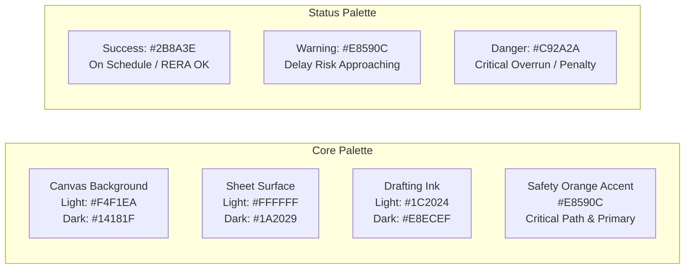
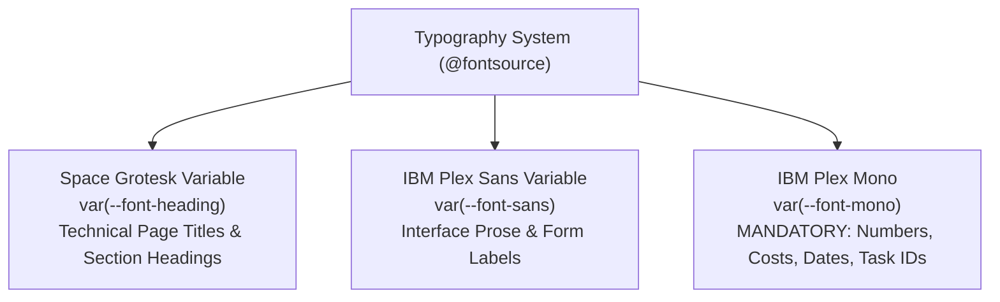
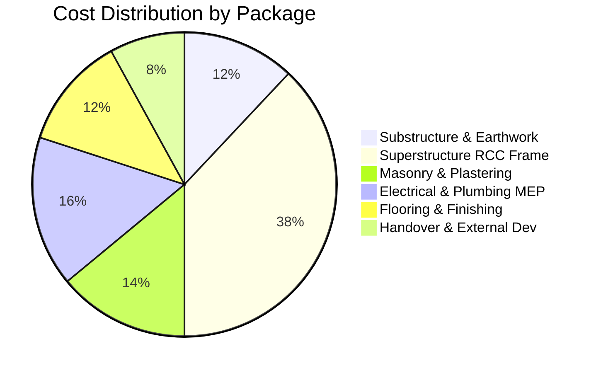

# OptiBuild Engineering Design System & Specification (DESIGN.md)

> **Document Type:** Comprehensive Design System Specification & Component Standards  
> **Repository:** `divyal27/OptiBuild-Main`  
> **Version:** 2.0.0 (Post-UI Rebuild Production Baseline)  
> **Status:** Single Source of Truth for Visual Identity, Layouts, Tokens, and Components  
> **Guiding Dials:** Design Variance: Low-to-Medium | Motion Intensity: Medium (Subtle & Purposeful) | Visual Density: High (Engineering Workstation)

---

## 1. Visual Identity & Brand Philosophy

### 1.1 Brand Essence
**OptiBuild** is a mission-critical civil engineering construction management and statutory compliance workstation (MahaRERA compliance, CPM scheduling, resource-constrained genetic algorithms, delay recovery optimization).

* **Aesthetic Philosophy:** Industrial **Site Office Workstation & CAD Drafting Terminal**. It evokes the precision of engineering drawings, blueprint paper, technical drafting pens, and site safety markers.
* **Anti-Slop House Style:** Strictly eliminates generic consumer SaaS tropes:
  * **NO** arbitrary purple or pink gradient meshes.
  * **NO** playful cartoon illustrations or floating decorative emoji stickers.
  * **NO** generic three-card marketing rows with oversized padding.
  * **NO** decorative looping background animations on data tables or analytical dashboards.
* **Surface Model (Framed Sheet):** A quiet, structural chrome shell framing crisp content sheets with hairline 1px architectural rules (`border-border`) and subtle 24px x 24px drafting grid lines (`.blueprint-grid-bg`).
* **Hero Visual:** The Resource-Constrained Project Scheduling (RCPSP) Gantt timeline with the Critical Path prominently highlighted in **Safety Orange (`#E8590C`)**.

---

## 2. Color Palette & Semantic Design Tokens

The color system enforces strict **WCAG AA contrast** ($\ge 4.5:1$ for body text and data numbers) across both light and dark workstation themes.

* **Light Mode (Drafting Vellum):** Default mode. Warm, parchment-tinted paper optimized for bright site offices and sunlight/projector readability.
* **Dark Mode (CAD Terminal):** High-contrast carbon slate optimized for late-night site workstation and engineering terminal usage.



### 2.1 CSS Variables & Semantic Mapping ([`frontend/src/app/globals.css`](file:///d:/OptiBuild%20BE%20Project/OptiBuild-Main/frontend/src/app/globals.css))

| Token Variable | Light Mode (Vellum Parchment) | Dark Mode (Carbon Terminal) | Semantic Role & Application |
|:---|:---|:---|:---|
| `--background` | `#F4F1EA` (Warm blueprint paper) | `#14181F` (Carbon dark) | Main application canvas and page background. |
| `--card` / `--surface` | `#FFFFFF` (Crisp drafting sheet) | `#1A2029` (Muted carbon tile) | Panels, cards, tables, dialogs, drawers, side panels. |
| `--popover` | `#FFFFFF` | `#1A2029` | Dropdowns, comboboxes, tooltips, select menus. |
| `--foreground` | `#1C2024` (Deep charcoal drafting ink) | `#E8ECEF` (High-contrast slate) | Primary headings, table text, data values. |
| `--muted-foreground` | `#5C6470` (Graphite pencil gray) | `#8A94A6` (Muted steel) | Captions, secondary labels, table headers, unit labels. |
| `--border` / `--input` | `#D4CBBA` (Blueprint hairline rule) | `#283243` (Steel structural rule) | 1px borders, separators, form input outlines. |
| `--grid-line` | `rgba(28, 32, 36, 0.05)` | `rgba(232, 236, 239, 0.04)` | Subtle 24px x 24px architectural drafting grid lines. |
| `--primary` | `#E8590C` (Safety Orange) | `#E8590C` (Safety Orange) | **Single Accent Color**: Primary buttons, critical path, active states. |
| `--primary-foreground`| `#FFFFFF` | `#FFFFFF` | Text on safety orange backgrounds. |
| `--secondary` | `#EAE4D5` (Soft vellum tint) | `#222935` (Dark slate) | Secondary buttons, inactive tabs, badge backgrounds. |
| `--secondary-foreground`| `#1C2024` | `#E8ECEF` | Text on secondary elements. |
| `--muted` | `#EBE5D7` | `#222935` | Inactive table row hovers, disabled controls. |
| `--destructive` | `#C92A2A` (Crimson Red) | `#FA5252` (Bright Red) | Statutory delay penalties, schedule crashes, delete actions. |
| `--status-success` | `#2B8A3E` (Forest Green) | `#2F9E44` (Vibrant Green) | On-schedule tasks, confirmed RERA certificates, cheaper options. |
| `--status-warning` | `#E8590C` (Safety Orange) | `#F59E0B` (Amber Warning) | Schedule float compression, delay risk warnings. |

### 2.2 Role Badge Token Palette
High-contrast role badges identify team members across the project overview, admin roster, and top bar:

| Role Identifier | Role Display Name | Badge Code | Visual Tokens (Border / Text / Background) |
|:---|:---|:---|:---|
| `admin` | System Administrator | `ADM` | `text-primary border-primary/40 bg-primary/10` |
| `project_manager` | Project Manager | `PM` | `text-primary border-primary/40 bg-primary/10` |
| `site_engineer` | Site Engineer | `ENG` | `text-sky-600 dark:text-sky-400 border-sky-500/40 bg-sky-500/10` |
| `store_keeper` | Store Keeper | `STR` | `text-amber-600 dark:text-amber-400 border-amber-500/40 bg-amber-500/10` |
| `architect` | Lead Architect | `ARC` | `text-emerald-600 dark:text-emerald-400 border-emerald-500/40 bg-emerald-500/10` |
| `accountant` | Project Accountant | `ACC` | `text-indigo-600 dark:text-indigo-400 border-indigo-500/40 bg-indigo-500/10` |
| `owner` | Owner / Developer | `OWN` | `text-purple-600 dark:text-purple-400 border-purple-500/40 bg-purple-500/10` |

---

## 3. Typography & Numerical Formatting

Typography uses locally loaded packages from `@fontsource` to ensure **zero external network latency** and complete privacy:



### 3.1 Font Families & Styles
1. **Headings (`var(--font-heading)`):** `Space Grotesk Variable`
   * Clean, technical, geometric sans-serif for page titles, modal headers, and card titles.
   * Letter spacing: `-0.02em`. Weight: `600` (Semi-bold) or `700` (Bold).
2. **Body Prose (`var(--font-sans)`):** `IBM Plex Sans Variable`
   * Clean, legible technical prose for descriptions, form inputs, dialog instructions, and button labels.
   * Letter spacing: `-0.011em`. Weight: `400` (Regular) or `500` (Medium).
3. **Monospace & Data Numbers (`var(--font-mono)`):** `IBM Plex Mono`
   * **MANDATORY** for all numeric figures, currency amounts, percentages, calendar dates, task IDs (`T01`, `WBS-1.2`), RERA numbers (`P52100018921`), and table cells.
   * Always rendered with `font-variant-numeric: tabular-nums` to guarantee vertical column alignment across data grids.

### 3.2 Indian Rupee (INR) Number Formatting Standard
All currency figures must be formatted using the Indian numbering system (thousands, lakhs, crores) via the [`formatINR()`](file:///d:/OptiBuild%20BE%20Project/OptiBuild-Main/frontend/src/lib/utils.ts#L12) utility:

* **Full Format:** `₹15,00,000` (e.g. `formatINR(1500000)` $\rightarrow$ `₹15,00,000`).
* **Compact Format:**
  * $\ge 1\text{ Crore}$ ($1,00,00,000$): `₹18.00 Cr`
  * $\ge 1\text{ Lakh}$ ($1,00,000$): `₹12.50 L`
  * $< 1\text{ Lakh}$: `₹45.0 K` or `₹58,000`
* **Tabular Numbers:** Monetary amounts rendered inside cards or tables must always carry class `font-mono tabular-nums`.

---

## 4. Spacing, Geometry & Visual Density

* **Border Radius:** Strict **4px maximum** across the entire UI (`rounded-[4px]`).
  * Tokens: `--radius-sm: 2px`, `--radius-md: 4px`, `--radius-lg: 4px`, `--radius-xl: 4px`.
  * Pill buttons (`rounded-full`) and oversized rounded cards (`rounded-xl`, `rounded-2xl`) are **strictly prohibited**.
* **Border Width:** Uniform **1px hairline rules** (`border border-border`).
  * Depth is conveyed through clean surface tinting and crisp border definition rather than heavy, blurry drop shadows.
* **Visual Density:** **HIGH**.
  * Card padding: compact `p-3.5` to `p-4.5`.
  * Data table row height: dense `py-2 px-3`.
  * Section gap: `space-y-4` to `space-y-6`.
  * Form field padding: `py-1.5 px-2.5` (`text-xs`).
* **Table Containment:** Every table is wrapped in an internal overflow container (`overflow-x-auto`) to ensure the page body never scrolls horizontally on desktop.

---

## 5. Component Architecture & System Sources

Every UI element is assigned to one of three strictly defined component registries:

```
┌────────────────────────────────────────────────────────────────────────┐
│                      THREE COMPONENT SOURCES                           │
├────────────────────┬────────────────────┬──────────────────────────────┤
│ 1. shadcn/ui (90%) │ 2. React Bits (8%) │ 3. Vengeance UI (2%)         │
│ Structure & Form   │ Motion & Numbers   │ Industrial Flourishes        │
├────────────────────┼────────────────────┼──────────────────────────────┤
│ Sidebar            │ Counter            │ KineticTextLoader            │
│ TopBar             │ StatusMark         │ SharedTooltipAvatars         │
│ Table & DataTable  │ GuidedStepper      │ StaggeredGrid                │
│ Dialog & Alert     │ BlueprintBackground│ MyAnimatedButton (Login CTA) │
│ Sheet & Tabs       │                    │                              │
│ Command (Ctrl+K)   │                    │                              │
│ Input, Select      │                    │                              │
└────────────────────┴────────────────────┴──────────────────────────────┘
```

### 5.1 Source 1: shadcn/ui (~90% of Structure)
Provides structure, forms, data tables, dialogs, and navigation:
* **Layout:** [`Sidebar`](file:///d:/OptiBuild%20BE%20Project/OptiBuild-Main/frontend/src/components/layout/Sidebar.tsx), [`TopBar`](file:///d:/OptiBuild%20BE%20Project/OptiBuild-Main/frontend/src/components/layout/TopBar.tsx), [`CommandPalette`](file:///d:/OptiBuild%20BE%20Project/OptiBuild-Main/frontend/src/components/layout/CommandPalette.tsx) (`Ctrl+K`), `Separator`.
* **Data Presentation:** [`Table`](file:///d:/OptiBuild%20BE%20Project/OptiBuild-Main/frontend/src/components/ui/table.tsx) (TanStack), [`Card`](file:///d:/OptiBuild%20BE%20Project/OptiBuild-Main/frontend/src/components/ui/card.tsx), [`Tabs`](file:///d:/OptiBuild%20BE%20Project/OptiBuild-Main/frontend/src/components/ui/tabs.tsx), [`EmptyState`](file:///d:/OptiBuild%20BE%20Project/OptiBuild-Main/frontend/src/components/ui/EmptyState.tsx).
* **Forms & Fields:** [`Input`](file:///d:/OptiBuild%20BE%20Project/OptiBuild-Main/frontend/src/components/ui/input.tsx), [`Select`](file:///d:/OptiBuild%20BE%20Project/OptiBuild-Main/frontend/src/components/ui/select.tsx), [`Badge`](file:///d:/OptiBuild%20BE%20Project/OptiBuild-Main/frontend/src/components/ui/badge.tsx), [`Progress`](file:///d:/OptiBuild%20BE%20Project/OptiBuild-Main/frontend/src/components/ui/progress.tsx), [`Button`](file:///d:/OptiBuild%20BE%20Project/OptiBuild-Main/frontend/src/components/ui/button.tsx).
* **Feedback & Overlays:** [`Dialog`](file:///d:/OptiBuild%20BE%20Project/OptiBuild-Main/frontend/src/components/ui/dialog.tsx), [`AlertDialog`](file:///d:/OptiBuild%20BE%20Project/OptiBuild-Main/frontend/src/components/ui/alert-dialog.tsx), [`Sheet`](file:///d:/OptiBuild%20BE%20Project/OptiBuild-Main/frontend/src/components/ui/sheet.tsx), [`Tooltip`](file:///d:/OptiBuild%20BE%20Project/OptiBuild-Main/frontend/src/components/ui/tooltip.tsx), [`PermissionDenied`](file:///d:/OptiBuild%20BE%20Project/OptiBuild-Main/frontend/src/components/ui/PermissionDenied.tsx).
* **Charts:** Recharts integrated with CSS variable themes.

### 5.2 Source 2: React Bits (Motion, Numbers & 1 CAD Background)
Provides hardware-accelerated motion and technical data counters:
* **[`Counter`](file:///d:/OptiBuild%20BE%20Project/OptiBuild-Main/frontend/src/components/ui/Counter.tsx):** Framer-motion spring counter (`damping: 24, stiffness: 120`) animating numbers and currency values up to 400ms. Respects `prefers-reduced-motion`.
* **[`StatusMark`](file:///d:/OptiBuild%20BE%20Project/OptiBuild-Main/frontend/src/components/ui/StatusMark.tsx):** Animated SVG status indicator showing parsing progress: `idle`, `extracting`, `classifying`, `ready`, and `error`.
* **[`GuidedStepper`](file:///d:/OptiBuild%20BE%20Project/OptiBuild-Main/frontend/src/components/project/GuidedStepper.tsx):** 4-step guided setup flow linking PDF onboarding, team provisioning, WBS creation, and delay recovery.
* **[`BlueprintBackground`](file:///d:/OptiBuild%20BE%20Project/OptiBuild-Main/frontend/src/components/ui/BlueprintBackground.tsx):** Exact CAD blueprint SVG background used on `/login`. Lazy-loaded with `dynamic(..., { ssr: false })`, hidden on mobile (`< 768px`) and when `prefers-reduced-motion` is active.

### 5.3 Source 3: Vengeance UI (Selected Industrial Flourishes)
Provides technical UI flourishes:
* **[`KineticTextLoader`](file:///d:/OptiBuild%20BE%20Project/OptiBuild-Main/frontend/src/components/ui/KineticTextLoader.tsx):** Fullscreen kinetic typography loader with animated progress pulses, activated during backend cold starts ($>5\text{s}$). Integrated via [`WakeupBanner`](file:///d:/OptiBuild%20BE%20Project/OptiBuild-Main/frontend/src/components/layout/WakeupBanner.tsx).
* **[`SharedTooltipAvatars`](file:///d:/OptiBuild%20BE%20Project/OptiBuild-Main/frontend/src/components/ui/SharedTooltipAvatars.tsx):** Overlapping circular avatar stack with high-contrast role badges and animated hover tooltips.
* **[`StaggeredGrid`](file:///d:/OptiBuild%20BE%20Project/OptiBuild-Main/frontend/src/components/ui/StaggeredGrid.tsx):** Framer-motion entrance grid orchestrating project cards with a staggered entrance $\le 400\text{ms}$.

### 5.4 Specialized Engineering Modules
* **[`GanttSchedule`](file:///d:/OptiBuild%20BE%20Project/OptiBuild-Main/frontend/src/components/schedule/GanttSchedule.tsx):** Interactive SVG/Canvas Gantt timeline highlighting CPM critical path with view switching (Day, Week, Month).
* **[`RecoverySidePanel`](file:///d:/OptiBuild%20BE%20Project/OptiBuild-Main/frontend/src/components/optimizer/RecoverySidePanel.tsx):** Quick-action delay recovery drawer sliding from the right to compare penalty vs. crash schedules.
* **[`SiteWeatherWidget`](file:///d:/OptiBuild%20BE%20Project/OptiBuild-Main/frontend/src/components/weather/SiteWeatherWidget.tsx):** Real-time site weather monitoring for Indian construction hubs (Pune/Mumbai) detecting precipitation risk for active outdoor concrete/masonry tasks.

---

## 6. App Shell & Navigation Layout

The application shell provides persistent navigation, project context, and role-filtered controls:

```
┌────────────────────────────────────────────────────────────────────────┐
│ TOP BAR: Dynamic Breadcrumb | Active Project Context | Role Badge | Cmd │
├──────────────┬─────────────────────────────────────────────────────────┤
│ SIDEBAR      │ MAIN CONTENT WORKSPACE AREA                             │
│ (240px/64px) │                                                         │
│ Project Comb │ Page Title & Metric Badges                              │
│ Nav Links    │ Content Sheets (Cards, Data Tables, Charts)             │
│ Role Filter  │                                                         │
│ Theme Toggle │                                                         │
│ Logout       │                                                         │
└──────────────┴─────────────────────────────────────────────────────────┘
```

### 6.1 Sidebar Specifications ([`frontend/src/components/layout/Sidebar.tsx`](file:///d:/OptiBuild%20BE%20Project/OptiBuild-Main/frontend/src/components/layout/Sidebar.tsx))
* **Width:** Expanded: `240px` | Collapsed: `64px`.
* **Collapsible:** Clicking the collapse chevron toggles compact icon-only mode with tooltips.
* **Project Switcher:** Header combobox searchable by project name or RERA number.
* **Role-Filtered Navigation:** Automatically filters menu items based on the active user's permissions:
  * *Hero Module Tag:* `Gantt Schedule` carries an orange `HERO` badge.
  * *Setup Tag:* `MahaRERA Review` carries a `SETUP` badge.
  * *CAD Tag:* `Drawing Vault` carries a `CAD` badge.
* **Footer:** Displays active user name, high-contrast role badge, dark-mode toggle, and logout button.

### 6.2 TopBar Specifications ([`frontend/src/components/layout/TopBar.tsx`](file:///d:/OptiBuild%20BE%20Project/OptiBuild-Main/frontend/src/components/layout/TopBar.tsx))
* **Height:** Sticky `52px` (`h-13`) with subtle glassmorphic backdrop blur (`backdrop-blur-md bg-card/85`).
* **Left Section:** Mobile drawer toggle button (`md:hidden`) and dynamic breadcrumb hierarchy (`Project Name > Active Module`).
* **Center / Context:** Active MahaRERA number, handover date, and delay risk indicator badge (`+14d Delay Risk`).
* **Right Section:** Global Search / Command Palette button (`Ctrl+K`), role badge, and user dropdown.
* **Mobile Drawer:** Full-screen slide-over sheet mirroring the sidebar on mobile viewports.

### 6.3 Global Shell Wrapping ([`frontend/src/components/layout/ClientLayoutWrapper.tsx`](file:///d:/OptiBuild%20BE%20Project/OptiBuild-Main/frontend/src/components/layout/ClientLayoutWrapper.tsx))
* Injects [`WakeupBanner`](file:///d:/OptiBuild%20BE%20Project/OptiBuild-Main/frontend/src/components/layout/WakeupBanner.tsx) to handle Render.com free-tier spin-ups transparently.
* Manages global keyboard listener for [`CommandPalette`](file:///d:/OptiBuild%20BE%20Project/OptiBuild-Main/frontend/src/components/layout/CommandPalette.tsx) (`Ctrl+K` / `Cmd+K`).
* Handles layout exclusion for unauthenticated `/login` route.

---

## 7. Page Layout Specifications (All Routes)

### 7.1 Login ([`frontend/src/app/login/page.tsx`](file:///d:/OptiBuild%20BE%20Project/OptiBuild-Main/frontend/src/app/login/page.tsx))
* **Layout:** Split-screen layout.
  * **Left Panel (Brand & CAD Hero):** Dark blueprint canvas (`#14181F`) featuring the animated `BlueprintBackground` SVG, CAD drafting coordinates, and headline.
  * **Right Panel (Form & 1-Click Role Switcher):** Light sheet (`#FFFFFF`) containing:
    * 7 selectable role chips with pre-configured demo credentials. Clicking any chip auto-fills email and password.
    * Email and password input fields with technical focus rings.
    * Animated submit button with loading spinner and disabled state to prevent double submissions.

### 7.2 Projects Overview ([`frontend/src/app/page.tsx`](file:///d:/OptiBuild%20BE%20Project/OptiBuild-Main/frontend/src/app/page.tsx))
* **Header:** Workspace title, active project count, total valuation KPI with animated `Counter`, and *Register New Project* CTA.
* **Live Site Weather Widget:** Embedded [`SiteWeatherWidget`](file:///d:/OptiBuild%20BE%20Project/OptiBuild-Main/frontend/src/components/weather/SiteWeatherWidget.tsx) showing precipitation hazards and temperature for Maharashtra sites.
* **Grid Layout:** Responsive `StaggeredGrid` (1 col mobile, 2 col tablet, 3 col desktop).
* **Project Card Components:**
  * Project title, status badge (`ACTIVE`), and MahaRERA registration number.
  * Target handover date and delay badge (`On Track` vs `+14d Risk`).
  * WBS, Schedule, and Optimizer status indicators.
  * Progress bar indicating project completion percentage.
  * `SharedTooltipAvatars` stack showing assigned project team members.
* **Quick Recovery Side Panel:** Slide-over [`RecoverySidePanel`](file:///d:/OptiBuild%20BE%20Project/OptiBuild-Main/frontend/src/components/optimizer/RecoverySidePanel.tsx) accessible directly from project cards.
* **Empty State:** `EmptyState` component displaying technical drawing icon and CTA: *"Upload a MahaRERA PDF to create your first project."*

### 7.3 MahaRERA Review & Setup ([`frontend/src/app/rera-review/page.tsx`](file:///d:/OptiBuild%20BE%20Project/OptiBuild-Main/frontend/src/app/rera-review/page.tsx))
* **Stepper Header:** `GuidedStepper` displaying the 4-step guided progression.
* **Upload Section:** Drag-and-drop PDF dropzone styled with dashed 1px technical border and `StatusMark` parsing indicator.
* **Review Form:** Two-column field grid populated with extracted values:
  * Field-level confidence badges (`HIGH`, `INFERRED`, `NOT_FOUND`).
  * Missing fields highlighted with red alert borders.
* **Confirmation Gate:** Clicking *Confirm & Register Project* opens a compulsory `AlertDialog`. Project is persisted only after explicit confirmation.

### 7.4 Parametric WBS & Cost Estimator ([`frontend/src/app/wbs/page.tsx`](file:///d:/OptiBuild%20BE%20Project/OptiBuild-Main/frontend/src/app/wbs/page.tsx) - WBS Tab)
* **Parameter Form:** Compact horizontal input bar for Built-up Area, Floors, Basements, and Base Rate.
* **Tabs:** *WBS Breakdown* vs. *Gantt Schedule Timeline*.
* **WBS Data Table:** Collapsible hierarchical table grouping tasks into 6 CPWD packages. Displays category percentages, normal cost, crash cost, float, and status. All figures formatted in INR Lakh/Crore.

### 7.5 Hero Schedule & Interactive Gantt ([`frontend/src/app/wbs/page.tsx`](file:///d:/OptiBuild%20BE%20Project/OptiBuild-Main/frontend/src/app/wbs/page.tsx) - Schedule Tab)
* **Controls:** ViewMode toggle group (*Day*, *Week*, *Month*) and *Run GA Optimization* CTA.
* **Gantt Chart:** Full-width interactive timeline via [`GanttSchedule`](file:///d:/OptiBuild%20BE%20Project/OptiBuild-Main/frontend/src/components/schedule/GanttSchedule.tsx). Critical path tasks styled in **Safety Orange (`#E8590C`)**; non-critical tasks in Slate Blue (`#475569`).
* **CAD Hover Tooltip:** Custom tooltip displaying Task ID, duration, early/late start, total float, and daily resource demands.

### 7.6 Delay Recovery Optimizer ([`frontend/src/app/optimizer/page.tsx`](file:///d:/OptiBuild%20BE%20Project/OptiBuild-Main/frontend/src/app/optimizer/page.tsx))
* **Header:** Project delay slider/input and allottee investment exposure figure.
* **Dual Strategy Cards:**
  * **Option A:** Accept Statutory MahaRERA Penalty ($\text{SBI MCLR} + 2\%$).
  * **Option B:** Crash Critical Path Activities (Lowest cost slope first).
  * The cheaper option dynamically receives the `CHEAPER` and `(RECOMMENDED)` badge.
* **Cost-Time Curve:** Recharts area curve showing project duration vs. total crashing investment.
* **Crashing Actions Table:** Table detailing compressed tasks, original vs new duration, marginal cost slope, and added cost.

### 7.7 Executive Dashboard & S-Curve ([`frontend/src/app/dashboard/page.tsx`](file:///d:/OptiBuild%20BE%20Project/OptiBuild-Main/frontend/src/app/dashboard/page.tsx))
* **KPI Row:** Total Budget, Actual Spend, Net Variance, and Delay Exposure with animated `Counter` widgets.
* **S-Curve Chart:** 12-month dual-line Recharts visualization comparing Planned Cumulative Spend vs. Actual Outlays.
* **Budget Variance Table:** Itemized breakdown across 6 packages with progress bars indicating percentage utilized.
* **Rate Recalibration Panel:** *Recalibrate Crash Slopes* button updating task cost slopes from live invoice data.

### 7.8 Materials Procurement & Site Photos ([`frontend/src/app/materials/page.tsx`](file:///d:/OptiBuild%20BE%20Project/OptiBuild-Main/frontend/src/app/materials/page.tsx))
* **Header:** Inbound procurement metrics (Total Invoices, Spend to Date) and *Log Delivery* CTA.
* **Procurement Table:** Itemized log showing date, category, supplier, invoice number, unit rate, and total amount.
* **Bill Photo Evidence:** Clicking a bill opens unparsed documentary proof with an `UNPARSED EVIDENCE ONLY` badge.
* **Site Photo Classifier Section:** Photo upload dropzone. Evaluates image contours and color spectrum, returning predicted stage (`STRUCTURAL_STAGE` vs. `FINISHING_STAGE`) and confidence score.

### 7.9 Architectural Drawings Vault ([`frontend/src/app/drawings/page.tsx`](file:///d:/OptiBuild%20BE%20Project/OptiBuild-Main/frontend/src/app/drawings/page.tsx))
* **Drawing Grid:** Category-filtered blueprint card grid (Architectural, Structural, MEP).
* **View-Only Card:** Drawing title, sheet number, revision, upload date, and `ATTACH-ONLY • VIEW ONLY` badge.
* **Slide-Over Preview `Sheet`:** Technical drawer displaying metadata, download button, and pre-signed S3 URL.

### 7.10 Solver Benchmark ([`frontend/src/app/benchmark/page.tsx`](file:///d:/OptiBuild%20BE%20Project/OptiBuild-Main/frontend/src/app/benchmark/page.tsx))
* **Preset Selector:** Tabs for Small Substructure (10 tasks), Medium Superstructure (25 tasks), and Large Complex (50+ tasks).
* **Side-by-Side Analytics:** Bar charts comparing Makespan (days) and CPU Runtime (ms) between Genetic Algorithm and Google OR-Tools CP-SAT.
* **Console Log Area:** Monospace `ScrollArea` displaying solver iteration logs and gap percentages.

### 7.11 System Administration & Team Provisioning ([`frontend/src/app/admin/page.tsx`](file:///d:/OptiBuild%20BE%20Project/OptiBuild-Main/frontend/src/app/admin/page.tsx))
* **Access Control Guard:** Enforces `role === "admin"`. Unauthorized roles render [`PermissionDenied`](file:///d:/OptiBuild%20BE%20Project/OptiBuild-Main/frontend/src/components/ui/PermissionDenied.tsx).
* **Admin KPI Metrics:** Total Users, Active Project Managers, Engineers & Field Staff with animated `Counter` widgets.
* **Team Roster Table:** Searchable user directory displaying name, email, high-contrast role badge, assigned projects, and status.
* **User Provisioning Modal:** `Dialog` form for registering new engineers and project team members with role selection.
* **Project Membership Drawer:** Slide-over `Sheet` for assigning and removing users from specific active projects.

---

## 8. Data Visualization & Chart Token Guide

All charts use Recharts wrapped in site-office design tokens:



### 8.1 Chart Colors & Styling Rules
* **Planned Baseline S-Curve:** Dashed slate rule (`#8A94A6`, stroke width 2).
* **Actual Spend S-Curve:** Solid Safety Orange line (`#E8590C`, stroke width 2.5).
* **Gantt Critical Path:** `#E8590C` (Safety Orange).
* **Gantt Non-Critical Path:** `#475569` (Slate Blue).
* **CP-SAT Benchmark Bar:** `#2B8A3E` (Forest Green).
* **GA Benchmark Bar:** `#E8590C` (Safety Orange).
* **Grid Lines:** `stroke="#283243"` in dark mode, `stroke="#D4CBBA"` in light mode, `strokeDasharray="3 3"`.
* **Tooltip Styling:** `bg-card border-border font-mono text-xs rounded-[4px] p-2 shadow-lg`.

---

## 9. Motion, Performance & Accessibility Guidelines

### 9.1 Motion Rules
1. **Duration:** Entrance animations must complete in **$\le 400\text{ms}$** (target: $200\text{ms}$ to $250\text{ms}$).
2. **Properties:** Animate `transform` (`translateY`, `scale`) and `opacity` **only** for 60fps GPU acceleration.
3. **Stagger:** Stagger child elements once on initial page render; never re-stagger on user interaction.
4. **No Looping Animations:** Zero looping floating particles, pulsating cards, or bouncing badges on data pages.

### 9.2 Accessibility (`a11y`)
1. **Prefers-Reduced-Motion:** All motion primitives (`Counter`, `StaggeredGrid`, `BlueprintBackground`, `KineticTextLoader`) check `window.matchMedia("(prefers-reduced-motion: reduce)")` and instantly render static states when enabled.
2. **Keyboard Navigation:** Full tab order across all forms, buttons, and dialogs. Command palette accessible globally via `Ctrl+K`.
3. **Touch Targets:** Minimum $40\text{px} \times 40\text{px}$ touch target on mobile viewports.
4. **Color Contrast:** All text meets or exceeds WCAG AA $4.5:1$ contrast against card and canvas backgrounds.

---

*Design system specification validated against production Next.js 16 build and approved as single source of truth.*
