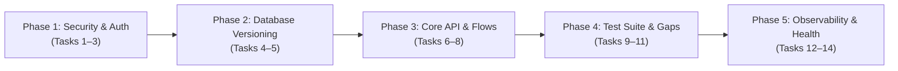

# OptiBuild Engineering Roadmap & Action Plan (PLAN.md)

> **Document Type:** Actionable Engineering Implementation Plan  
> **Repository:** `divyal27/OptiBuild-Main`  
> **Version:** 2.0.0 (Post-Audit Baseline)  
> **Date:** 2026-10-29  
> **Guiding Principle:** Small, targeted tasks (each 1–2 hours). Zero unnecessary rewrites of working code. Strict adherence to the 5 locked invariants and 7 RBAC roles.

---

## Plan Overview & Phase Architecture



| Phase | Focus Area | Tasks | Estimated Total |
|:---|:---|:---:|:---:|
| **Phase 1** | Security, Auth & Dependency Modernization | Tasks 1–3 | ~4.5 Hours |
| **Phase 2** | Database Migrations & Tooling | Tasks 4–5 | ~3.0 Hours |
| **Phase 3** | Missing MVP Features & Flow Completion | Tasks 6–8 | ~4.5 Hours |
| **Phase 4** | Test Coverage & Quality Assurance | Tasks 9–11 | ~4.5 Hours |
| **Phase 5** | Observability, Resilience & Health Checks | Tasks 12–14 | ~4.0 Hours |

---

## Phase 1: Security, Auth & Dependency Modernization

### Task 1: Next.js Security Patch Upgrade (`16.4.0` $\rightarrow$ `16.4.3`)
* **Category:** Security / Auth
* **Estimate:** 1.0 Hour
* **Objective:** Merge security patch from PR #1 to upgrade Next.js to `16.4.3`, resolve automated CVE advisories, and verify zero build regressions.
* **Files to Touch:**
  * [`frontend/package.json`](file:///d:/OptiBuild%20BE%20Project/OptiBuild-Main/frontend/package.json)
  * [`frontend/package-lock.json`](file:///d:/OptiBuild%20BE%20Project/OptiBuild-Main/frontend/package-lock.json)
  * [`DEPENDENCIES.md`](file:///d:/OptiBuild%20BE%20Project/OptiBuild-Main/DEPENDENCIES.md)
* **Dependencies:** None.
* **Verification Procedure:**
  ```powershell
  cd frontend
  npm.cmd install
  npm.cmd run lint
  npm.cmd run build
  ```
* **Definition of Done (DoD):**
  * `next` package is updated to `^16.4.3`.
  * `npm run build` succeeds with exit code 0 across all 13 routes.
  * No new vulnerabilities reported in `npm audit`.

---

### Task 2: Next.js 16 Proxy Routing Transition
* **Category:** Refactor / Deprecation Notice
* **Estimate:** 1.5 Hours
* **Objective:** Replace deprecated Next.js `middleware.ts` convention with the recommended Next.js 16 proxy pattern while preserving cookie auth protection.
* **Files to Touch:**
  * [`frontend/src/middleware.ts`](file:///d:/OptiBuild%20BE%20Project/OptiBuild-Main/frontend/src/middleware.ts) (or replacement proxy configuration)
  * [`frontend/next.config.ts`](file:///d:/OptiBuild%20BE%20Project/OptiBuild-Main/frontend/next.config.ts)
  * [`ARCHITECTURE.md`](file:///d:/OptiBuild%20BE%20Project/OptiBuild-Main/ARCHITECTURE.md)
* **Dependencies:** Task 1.
* **Verification Procedure:**
  ```powershell
  cd frontend
  npm.cmd run build
  # Verify that: "The 'middleware' file convention is deprecated" warning is eliminated.
  ```
  * Test unauthenticated access to `/wbs` $\rightarrow$ verifies automatic redirect to `/login`.
  * Test authenticated access with `optibuild_token` $\rightarrow$ loads protected page.
* **Definition of Done (DoD):**
  * Build executes without middleware deprecation warnings.
  * Route protection for non-static routes works identically.

---

### Task 3: Cryptographic Secret & Session Expiry Hardening
* **Category:** Security / Auth
* **Estimate:** 1.5 Hours
* **Objective:** Enforce strict validation on `JWT_SECRET` on application startup (minimum 32 characters, forbid default insecure values in production) and add token expiration toast detection on frontend.
* **Files to Touch:**
  * [`backend/app/core/config.py`](file:///d:/OptiBuild%20BE%20Project/OptiBuild-Main/backend/app/core/config.py)
  * [`backend/app/core/auth.py`](file:///d:/OptiBuild%20BE%20Project/OptiBuild-Main/backend/app/core/auth.py)
  * [`frontend/src/lib/api.ts`](file:///d:/OptiBuild%20BE%20Project/OptiBuild-Main/frontend/src/lib/api.ts)
  * [`frontend/src/context/AuthContext.tsx`](file:///d:/OptiBuild%20BE%20Project/OptiBuild-Main/frontend/src/context/AuthContext.tsx)
* **Dependencies:** None.
* **Verification Procedure:**
  * Set `JWT_SECRET="short"` in temporary test $\rightarrow$ backend refuses startup with `ValueError`.
  * Send request with expired token $\rightarrow$ frontend interceptor catches `401`, triggers Sonner toast (*"Session expired. Please log in again."*), and redirects to `/login`.
* **Definition of Done (DoD):**
  * Secret length validation active on startup.
  * 401 token expiration cleanly handles redirection without crashing page state.

---

## Phase 2: Database Versioning & Schema Tooling

### Task 4: Initialize Alembic Migration Framework
* **Category:** Database / Tech Debt
* **Estimate:** 1.5 Hours
* **Objective:** Initialize Alembic versioned migrations in `backend/alembic/` without modifying any existing table schemas or column definitions.
* **Files to Touch:**
  * `backend/alembic.ini` (New)
  * `backend/alembic/env.py` (New)
  * `backend/alembic/script.py.mako` (New)
  * [`DATABASE.md`](file:///d:/OptiBuild%20BE%20Project/OptiBuild-Main/DATABASE.md)
* **Dependencies:** None.
* **Verification Procedure:**
  ```powershell
  cd backend
  python -m alembic revision -m "test_migration"
  # Confirm revision file is created and references Base.metadata cleanly
  ```
* **Definition of Done (DoD):**
  * `alembic` commands execute against both PostgreSQL and SQLite configurations.
  * `backend/alembic/env.py` registers all 10 models from `backend/app/db/models.py`.

---

### Task 5: Generate Baseline Schema Revision (`0001_initial_schema`)
* **Category:** Database / Migrations
* **Estimate:** 1.5 Hours
* **Objective:** Autogenerate the initial migration script capturing all 10 existing tables, indexes, and cascades. Stamp existing databases without altering live data.
* **Files to Touch:**
  * `backend/alembic/versions/0001_initial_schema.py` (New)
  * [`backend/app/main.py`](file:///d:/OptiBuild%20BE%20Project/OptiBuild-Main/backend/app/main.py)
  * [`DATABASE.md`](file:///d:/OptiBuild%20BE%20Project/OptiBuild-Main/DATABASE.md)
* **Dependencies:** Task 4.
* **Verification Procedure:**
  ```powershell
  cd backend
  python -m alembic check
  # Confirm: No new schema changes detected against current models.
  ```
* **Definition of Done (DoD):**
  * `0001_initial_schema.py` accurately mirrors [`backend/app/db/models.py`](file:///d:/OptiBuild%20BE%20Project/OptiBuild-Main/backend/app/db/models.py).
  * `alembic stamp head` succeeds against existing test databases.

---

## Phase 3: Core API Completeness & Flow Completion

### Task 6: Direct Project CRUD Endpoints (`PUT` and `DELETE`)
* **Category:** Missing MVP Feature
* **Estimate:** 1.5 Hours
* **Objective:** Implement `PUT /api/v1/projects/{project_id}` and `DELETE /api/v1/projects/{project_id}` in backend, allowing PMs and Admins to edit project parameters (name, delay days, escrow funds) and delete decommissioned projects with full cascading.
* **Files to Touch:**
  * [`backend/app/api/v1/projects.py`](file:///d:/OptiBuild%20BE%20Project/OptiBuild-Main/backend/app/api/v1/projects.py)
  * [`API.md`](file:///d:/OptiBuild%20BE%20Project/OptiBuild-Main/API.md)
* **Dependencies:** None.
* **Verification Procedure:**
  * Run automated pytest testing project update and cascade delete.
  * Verify `ondelete="CASCADE"` cleans child `tasks`, `material_logs`, `drawings`, and `site_photos`.
* **Definition of Done (DoD):**
  * `PUT /api/v1/projects/{id}` updates permitted fields and returns updated project.
  * `DELETE /api/v1/projects/{id}` cleanly removes project and child entities.
  * Updated in [`API.md`](file:///d:/OptiBuild%20BE%20Project/OptiBuild-Main/API.md).

---

### Task 7: Ad-Hoc Task CRUD & Dependency Validation
* **Category:** Missing MVP Feature
* **Estimate:** 1.5 Hours
* **Objective:** Implement `POST /api/v1/projects/{project_id}/tasks` and `DELETE /api/v1/projects/{project_id}/tasks/{task_id}` for adding and removing individual schedule activities outside the parametric generator, with Kahn's cycle check on predecessor additions.
* **Files to Touch:**
  * [`backend/app/api/v1/projects.py`](file:///d:/OptiBuild%20BE%20Project/OptiBuild-Main/backend/app/api/v1/projects.py)
  * [`backend/app/schemas/schedule.py`](file:///d:/OptiBuild%20BE%20Project/OptiBuild-Main/backend/app/schemas/schedule.py)
  * [`API.md`](file:///d:/OptiBuild%20BE%20Project/OptiBuild-Main/API.md)
* **Dependencies:** None.
* **Verification Procedure:**
  * Add task with cyclic predecessor (`T01` $\rightarrow$ `T02` $\rightarrow$ `T01`) $\rightarrow$ returns HTTP 400 Bad Request.
  * Add valid task $\rightarrow$ returns HTTP 201 Created and updates project task list.
* **Definition of Done (DoD):**
  * Task creation endpoint enforces cycle-free graph via [`CPMEngine`](file:///d:/OptiBuild%20BE%20Project/OptiBuild-Main/backend/app/engine/cpm.py).
  * Permitted for `project_manager` and `admin`.

---

### Task 8: Resilient Offline Weather Widget Fallback
* **Category:** Broken / Incomplete Flow
* **Estimate:** 1.5 Hours
* **Objective:** Add graceful offline fallback with cached site climatology in `SiteWeatherWidget.tsx` so external Open-Meteo network failures in firewalled site offices do not trigger console errors or layout shifts.
* **Files to Touch:**
  * [`frontend/src/components/weather/SiteWeatherWidget.tsx`](file:///d:/OptiBuild%20BE%20Project/OptiBuild-Main/frontend/src/components/weather/SiteWeatherWidget.tsx)
* **Dependencies:** None.
* **Verification Procedure:**
  * Simulate offline mode (Network tab: Offline) $\rightarrow$ widget displays cached weather badge (*"Simulated Site Conditions (Offline)"*) without unhandled errors.
* **Definition of Done (DoD):**
  * Weather widget renders consistently online and offline.
  * Zero uncaught promise rejections on fetch failure.

---

## Phase 4: Test Suite & Quality Assurance

### Task 9: Backend Algorithmic Unit Tests (CPM & Crashing)
* **Category:** Test Gaps
* **Estimate:** 1.5 Hours
* **Objective:** Create comprehensive unit tests verifying CPM forward/backward pass math, Kahn's cycle detection, and greedy critical path cost slope minimization against known analytical solutions.
* **Files to Touch:**
  * `backend/tests/test_cpm_engine.py` (New)
  * `backend/tests/test_optimizer_engine.py` (New)
* **Dependencies:** None.
* **Verification Procedure:**
  ```powershell
  cd backend
  pytest tests/test_cpm_engine.py tests/test_optimizer_engine.py -v
  ```
* **Definition of Done (DoD):**
  * 100% test pass rate across CPM float calculations and edge cases (isolated nodes, multiple critical paths).
  * Crashing test verifies that cheapest cost slope is chosen first.

---

### Task 10: MahaRERA Flow & Invariant End-to-End Tests
* **Category:** Test Gaps
* **Estimate:** 1.5 Hours
* **Objective:** Implement pytest integration test suite verifying the 5 locked invariants:
  * **INV-2:** Drawings uploaded with attach-only flag; unparsed content.
  * **INV-3:** Bill attachments saved as unparsed proof.
  * **INV-4:** MahaRERA PDF upload produces draft only; DB record created ONLY after `/confirm`.
  * **INV-5:** Classifier is decoupled from scheduling endpoints.
* **Files to Touch:**
  * `backend/tests/test_invariants.py` (New)
* **Dependencies:** Task 6.
* **Verification Procedure:**
  ```powershell
  cd backend
  pytest tests/test_invariants.py -v
  ```
* **Definition of Done (DoD):**
  * All 5 locked invariants covered with explicit assertion tests.

---

### Task 11: ESLint Rule Hygiene & Clean Build
* **Category:** Quality Assurance / Refactor
* **Estimate:** 1.5 Hours
* **Objective:** Clean up remaining `any` types in `frontend/src/lib/api.ts` and `frontend/src/context/AuthContext.tsx`, and restore `@typescript-eslint/no-explicit-any` rule in ESLint config.
* **Files to Touch:**
  * [`frontend/src/lib/api.ts`](file:///d:/OptiBuild%20BE%20Project/OptiBuild-Main/frontend/src/lib/api.ts)
  * [`frontend/src/context/AuthContext.tsx`](file:///d:/OptiBuild%20BE%20Project/OptiBuild-Main/frontend/src/context/AuthContext.tsx)
  * [`frontend/eslint.config.mjs`](file:///d:/OptiBuild%20BE%20Project/OptiBuild-Main/frontend/eslint.config.mjs)
* **Dependencies:** None.
* **Verification Procedure:**
  ```powershell
  cd frontend
  npm.cmd run lint
  # Target: 0 errors and < 50 warnings
  npm.cmd run build
  ```
* **Definition of Done (DoD):**
  * Strict typing applied to fetch interceptor and context states.
  * `npm run lint` passes cleanly.

---

## Phase 5: Observability, Resilience & Health Checks

### Task 12: Structured Logging Migration
* **Category:** Observability / Refactor
* **Estimate:** 1.5 Hours
* **Objective:** Replace ad-hoc `print()` statements across backend initialization scripts (`seed.py`, `init_db.py`, `storage/s3.py`) with standard Python `logging` using formatted loggers.
* **Files to Touch:**
  * [`backend/app/db/seed.py`](file:///d:/OptiBuild%20BE%20Project/OptiBuild-Main/backend/app/db/seed.py)
  * [`backend/app/db/init_db.py`](file:///d:/OptiBuild%20BE%20Project/OptiBuild-Main/backend/app/db/init_db.py)
  * [`backend/app/storage/s3.py`](file:///d:/OptiBuild%20BE%20Project/OptiBuild-Main/backend/app/storage/s3.py)
  * [`backend/app/main.py`](file:///d:/OptiBuild%20BE%20Project/OptiBuild-Main/backend/app/main.py)
* **Dependencies:** None.
* **Verification Procedure:**
  * Run `init_db.py` $\rightarrow$ output renders structured log format with timestamps and severity levels (`[INFO]`, `[WARNING]`).
* **Definition of Done (DoD):**
  * Zero raw `print()` statements in production code paths.

---

### Task 13: Health Probes Expansion (`/health/liveness` & `/health/readiness`)
* **Category:** Observability / Infra
* **Estimate:** 1.0 Hour
* **Objective:** Expand the basic `/health` check into Kubernetes/ECS compatible probes:
  * `GET /health/liveness`: Checks ASGI process responsive.
  * `GET /health/readiness`: Pings database (`SELECT 1`) and verifies S3 bucket access.
* **Files to Touch:**
  * [`backend/app/main.py`](file:///d:/OptiBuild%20BE%20Project/OptiBuild-Main/backend/app/main.py)
  * [`API.md`](file:///d:/OptiBuild%20BE%20Project/OptiBuild-Main/API.md)
* **Dependencies:** None.
* **Verification Procedure:**
  ```powershell
  curl.exe http://localhost:8000/health/readiness
  # Returns: {"status": "ready", "database": "connected", "storage": "available"}
  ```
* **Definition of Done (DoD):**
  * Liveness and readiness endpoints return HTTP 200 on healthy services.
  * Readiness returns HTTP 503 if database connection fails.

---

### Task 14: Interactive Bruno / Postman Collection Export
* **Category:** Documentation / Developer Experience
* **Estimate:** 1.5 Hours
* **Objective:** Generate a complete JSON API collection covering all 33 endpoints with pre-configured authentication scripts for the 7 demo accounts and parameter examples.
* **Files to Touch:**
  * `docs/api/OptiBuild_API_Collection.json` (New)
  * `docs/api/README.md` (New)
* **Dependencies:** Tasks 6 and 7.
* **Verification Procedure:**
  * Import collection into Bruno / Postman; execute 1-click login as `pm@optibuild.io` $\rightarrow$ verifies automatic token extraction and subsequent authenticated calls.
* **Definition of Done (DoD):**
  * Valid OpenAPI 3.0 / Postman v2.1 collection file committed to `docs/api/`.
  * Pre-configured environment variables for local (`localhost:8000`) and Docker (`backend:8000`).

---

## Execution Guidelines & Guardrails

1. **One Task per Step:** Complete one task, verify with build/lint/test, commit with standard prefix, and push.
2. **Three-Attempt Bounded Loop:** If a task encounters unexpected issues, limit attempts to 3 before reverting to clean git state.
3. **No Unnecessary Rewrites:** Leave working algorithmic engines (`cpm.py`, `ga.py`, `optimizer.py`) and UI components untouched unless specifically mandated by task goals.
4. **Preserve Documentation Integrity:** Update corresponding documentation (`API.md`, `DATABASE.md`, `PRD.md`) in lockstep with code additions.

---

*Roadmap generated from system audit and approved as single source of truth in `PLAN.md`.*
