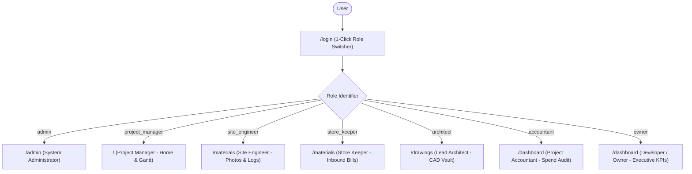
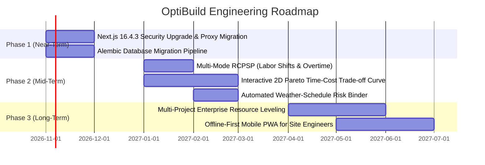

# OptiBuild Product Requirements Document (PRD.md)

> **Document Type:** Product Requirements Document (PRD) — Current State Baseline  
> **Product Name:** OptiBuild — Penalty-Aware Construction Scheduling & Resource Optimization Engine  
> **Repository:** `divyal27/OptiBuild-Main`  
> **Version:** 1.0.0 (MVP Complete)  
> **Date:** 2026-10-29  
> **Author:** Antigravity Engineering & Product Architecture Team

---

## 1. Product Vision & Problem Statement

### 1.1 Problem Statement
In the Indian real estate and infrastructure sector, project delays trigger severe statutory liabilities under the **Real Estate (Regulation and Development) Act, 2016 (RERA)**. Under **MahaRERA Section 18**, developers who fail to hand over apartments or plots by the registered possession date are mandated by law to compensate allottees with monthly interest at:
$$\text{Statutory Rate} = \text{State Bank of India (SBI) Highest MCLR} + 200\text{ bps (presently } 10.85\%\text{ p.a.)}$$
This interest is calculated across the total funds collected from all buyers (often $70\%$ to $100\%$ of project valuation), resulting in catastrophic daily cash outflows of ₹50,000 to ₹10,00,000+ per delayed day.

Traditional project management software (such as Primavera P6, Microsoft Project, or generic Gantt tools) manages schedules purely as abstract duration networks and Critical Path Method (CPM) floats. They operate in complete isolation from RERA statutory interest liabilities, site-level material inflation, and statutory compliance protocols.

### 1.2 Product Vision
**OptiBuild** bridges this divide by delivering an engineering-grade, penalty-aware construction planning and resource allocation system. OptiBuild directly links CPM scheduling and resource-constrained leveling (RCPSP) with statutory financial penalties. When delays occur, OptiBuild calculates daily MahaRERA delay liabilities and performs greedy critical path schedule crashing, recommending whether it is financially optimal to **Crash Critical Activities** or **Pay Statutory Delay Penalties**, with quantified net savings in Indian Rupees ($\text{INR } ₹$).

---

## 2. Locked Architectural Invariants (Non-Negotiable Guardrails)

The implementation strictly complies with 5 architectural invariants that define the system boundaries:

| # | Invariant Rule | Implementation & Code Safeguards |
|:---|:---|:---|
| **INV-1** | **Hero Engine Primacy** | The CPM + Genetic Algorithm (RCPSP) scheduling engine is the central hero visual and core computational module. All other subsystems (WBS, PDF parser, CV classifier, dashboard) are auxiliary feeders. |
| **INV-2** | **Architect's Drawing Safeguard** | Architectural drawings (`.dwg`, `.dxf`, `.pdf`, `.png`) are strictly **attach-only**. Uploaded with metadata `{"type": "architect_drawing_attach_only", "unparsed": "true"}`. They are stored securely in S3/MinIO for human viewing and **NEVER parsed or OCR'd**. |
| **INV-3** | **Bill Photo Evidence Safeguard** | Invoice photos uploaded to the Material & Cost Log are stored strictly as **unparsed documentary audit evidence**. No OCR, text scraping, or automated invoice parsing is permitted. |
| **INV-4** | **MahaRERA PDF Pre-Fill Safeguard** | MahaRERA certificate PDF extraction **only pre-fills a draft review form**. The system requires explicit human engineer verification inside an `AlertDialog` before any database record or project is created. |
| **INV-5** | **Decoupled CV Classifier Boundary** | The site progress photo classifier is a lightweight heuristic computer vision assessment module (`STRUCTURAL_STAGE` vs. `FINISHING_STAGE`). Algorithmic scheduling and delay optimization **never depend on the CV classifier** to execute. |

---

## 3. Current User Personas & Role-Based Access Control (RBAC)

OptiBuild implements 7 discrete, mutually exclusive user personas. Each role has a dedicated default landing page (`ROLE_HOMES`), filtered navigation items, and permission-denied shields.



### 3.1 Persona Profiles & Access Matrix

#### 1. System Administrator (`admin`)
* **Persona:** IT Director / Enterprise Admin (`admin@optibuild.io`)
* **Primary Responsibilities:** User management, role provisioning, organization security, system configuration.
* **Default Landing:** `/admin`
* **Permitted Modules:** Complete access to all 10 modules across the platform.

#### 2. Project Manager (`project_manager`)
* **Persona:** Rajesh Sharma, Senior PM (`pm@optibuild.io`)
* **Primary Responsibilities:** MahaRERA project onboarding, team role assignment, parametric WBS generation, CPM + GA schedule optimization, delay recovery analysis.
* **Default Landing:** `/` (Projects Overview & Hero Gantt)
* **Permitted Modules:** Projects Overview, MahaRERA Review, Parametric WBS, Schedule Gantt, Delay Recovery Optimizer, Drawings, Materials, Dashboard, Benchmark.

#### 3. Site Engineer (`site_engineer`)
* **Persona:** Amit Patil, Field Operations Engineer (`site@optibuild.io` / `engineer@optibuild.io`)
* **Primary Responsibilities:** Daily site progress inspection, capturing milestone photos, reviewing automated stage predictions, updating task progress percentages.
* **Default Landing:** `/materials` (Field Workspace)
* **Permitted Modules:** Materials & Site Evidence (`/materials`), Drawings Vault (View Only), Project Task Progress Updates. Restricted from financial dashboards, user admin, and solver benchmarks.

#### 4. Store Keeper (`store_keeper`)
* **Persona:** Suresh Deshmukh, Materials & Inventory Manager (`store@optibuild.io`)
* **Primary Responsibilities:** Inbound procurement logging, recording supplier names and delivery challans, uploading unparsed bill photos.
* **Default Landing:** `/materials`
* **Permitted Modules:** Materials & Procurement Log (`/materials`). Restricted from schedule optimization, financial S-curves, and administrative settings.

#### 5. Lead Architect (`architect`)
* **Persona:** Pooja Kulkarni, Chief Project Architect (`architect@optibuild.io`)
* **Primary Responsibilities:** Uploading sanctioned architectural CAD, structural layout, and MEP blueprint revisions.
* **Default Landing:** `/drawings` (Drawings Vault)
* **Permitted Modules:** Architectural Drawings (`/drawings`). View-only access to Project Overview. Blocked from WBS generation, materials, and administrative functions.

#### 6. Project Accountant (`accountant`)
* **Persona:** Vikas Joshi, Cost Controller & Billing Auditor (`accountant@optibuild.io`)
* **Primary Responsibilities:** Budget vs. Actual spend audits, package variance tracking, evaluating material price inflation, triggering crash-cost slope recalibration.
* **Default Landing:** `/dashboard` (Executive Dashboard)
* **Permitted Modules:** Executive Dashboard (`/dashboard`), Materials Log (View Only), Project Overview.

#### 7. Owner / Real Estate Developer (`owner`)
* **Persona:** Anand Singhania, Managing Director / Promoter (`owner@optibuild.io`)
* **Primary Responsibilities:** Executive oversight, RERA delay penalty exposure assessment, cumulative cashflow S-Curve tracking, approving delay recovery strategy.
* **Default Landing:** `/dashboard`
* **Permitted Modules:** Executive Dashboard (`/dashboard`), Project Overview (`/`), Delay Optimizer (Read Only).

---

## 4. Implemented Core Features (As Built in Codebase)

### 4.1 Authentication & Session Management
* **Credentials:** 7 pre-seeded demo accounts with identical credentials across the frontend, seed scripts, and documentation (`Admin@123`, `Pm@123`, etc.).
* **1-Click Demo Login:** Interactive role switcher chips on `/login` that instantly populate credentials and role metadata.
* **Dual Security Layer:**
  * Issues HS256 JWT tokens containing `sub`, `email`, `role`, and `name`.
  * Sets an HTTP-only, `SameSite=Lax` browser cookie (`access_token`).
  * Stores user state in `localStorage` for Authorization headers in client API calls.
* **Automatic Cold-Start Wakeup:** Client-side interceptor in [`frontend/src/lib/api.ts`](file:///d:/OptiBuild%20BE%20Project/OptiBuild-Main/frontend/src/lib/api.ts) detects slow requests ($>5\text{s}$), displays a kinetic loader, and retries up to 3 times with exponential backoff.

### 4.2 MahaRERA PDF Ingestion & Safeguarded Setup (`/rera-review`)
* **PDF Parser Engine:** Three-tier fallback parser in [`backend/app/engine/pdf_parser.py`](file:///d:/OptiBuild%20BE%20Project/OptiBuild-Main/backend/app/engine/pdf_parser.py):
  1. `pdfplumber` high-accuracy text and tabular layout extraction.
  2. `pypdf` fallback text extractor.
  3. `pypdfium2` page rendering + `pytesseract` OCR for scanned physical certificates.
* **Extracted Fields:** RERA Registration No (`P5XXXXXXXXXX`), Project Name, Promoter/Developer, Proposed Completion Date, Plot Area, Built-up Area, Floors, Basements, Total Estimated Cost.
* **Field-Level Confidence Scoring:** Highlights extracted fields with visual badges: `HIGH` (exact regex/table hit), `INFERRED` (heuristic fallback), or `NOT_FOUND` (requires manual entry).
* **Compulsory Human Confirmation Gate:** Prevents automated database writes. Users review the pre-filled form and must confirm inside a shadcn `AlertDialog`.
* **4-Step Guided Setup (`GuidedStepper`):**
  1. Upload & Confirm MahaRERA Certificate.
  2. Assign Project Team Members.
  3. Building Parameters & Parametric WBS.
  4. Run CPM + GA Schedule & Delay Optimizer.

### 4.3 Parametric WBS & Cost Estimator (`/wbs`)
* **Parametric Generator:** Takes Built-up Area (sq.ft.), Number of Floors (G+N), Number of Basements, and Base Construction Rate (₹/sqft).
* **CPWD Standard Ratios:** Generates an itemized 6-package WBS based on standard Indian construction proportions:
  1. *Substructure & Earthwork* (~12%)
  2. *Superstructure RCC Frame* (~38%)
  3. *Masonry & Plastering* (~14%)
  4. *Electrical & Plumbing MEP* (~16%)
  5. *Flooring & Finishing* (~12%)
  6. *Handover & External Development* (~8%)
* **Precomputed Criticality & Float:** During task generation, the engine executes an initial CPM pass to precompute `is_critical`, `total_float`, and `free_float`, and maps normal costs to crash costs ($1.35\times$) and crash durations ($0.65\times$).
* **High-Density Data Table:** `@tanstack/react-table` interface with package collapsibles, percentage bars, and Indian Rupee Lakh/Crore formatting.

### 4.4 Hero Scheduling Engine: CPM + Genetic Algorithm RCPSP (`/wbs` & `/schedule`)
* **Critical Path Method (CPM) Engine:**
  * Builds task dependency network using NetworkX.
  * Validates network with Kahn's algorithm cycle check (`CycleDetectedException`).
  * Computes Early Start (ES), Early Finish (EF), Late Start (LS), Late Finish (LF), Total Float, and Free Float.
  * Identifies the exact critical path sequence.
* **Resource-Constrained Project Scheduling (RCPSP) Genetic Algorithm:**
  * Simulates resource limits across 4 labor and equipment types: Masons, Barbenders, Concrete Pumps, Cranes.
  * Uses **Serial Schedule Generation Scheme (Serial SGS)** to translate chromosomes into active, precedence-feasible schedules.
  * Uses **Precedence-Preserving Crossover (PPX)** and random swap mutation to minimize overall makespan without resource over-allocation.
* **Interactive Gantt Chart:**
  * Restyled `gantt-task-react` wrapped in the site-office blueprint design system.
  * Highlights critical path tasks in Safety Orange (`#E8590C`).
  * Zoom toggles for Day, Week, and Month views.
  * Interactive task hover tooltips displaying duration, float, and predecessor dependencies.

### 4.5 Statutory MahaRERA Delay Recovery Optimizer (`/optimizer`)
* **Statutory Liability Calculation:**
  $$\text{Effective Annual Rate} = \text{SBI MCLR Rate} + \text{RERA Spread (200 bps)}$$
  $$\text{Daily RERA Penalty (INR)} = \text{Total Allottee Investment} \times \frac{\text{Effective Annual Rate} / 100}{365}$$
  $$\text{Total Penalty Liability} = \text{Daily Penalty} \times \text{Delay Days}$$
* **Greedy CPM Schedule Crashing:**
  * Computes cost slope for all critical activities:
    $$S_i = \frac{\text{Crash Cost} - \text{Normal Cost}}{\text{Normal Duration} - \text{Crash Duration}}$$
  * Compresses the critical activity with the lowest marginal cost slope day-by-day.
  * Recomputes CPM after each day's compression to account for critical path shifts.
* **Decision Engine & Side Panel (`RecoverySidePanel`):**
  * Compares **Option A (Accept RERA Penalty)** vs. **Option B (Crash Critical Path)**.
  * Dynamically awards the `CHEAPER` and `(RECOMMENDED)` badge to the lower-cost alternative.
  * Quantifies net savings in Indian Rupees and provides plain-language engineering rationale.
  * Visualizes the CPM Cost-Time trade-off curve using Recharts.

### 4.6 Executive Dashboard & Invoice Recalibration (`/dashboard`)
* **12-Month S-Curve Spend Visualizer:** Cumulative planned spend vs. actual site outlays rendered with Recharts.
* **Package Budget Variance:** Itemizes spend across the 6 WBS packages, flagging variances as *Under Budget* or *Over Budget*.
* **Live Rate Recalibration Engine:**
  * When actual material invoice rates logged on-site differ from initial estimates (e.g., steel rebar surges from ₹54,000/MT to ₹58,000/MT), clicking *Recalibrate Crash Slopes* updates the database.
  * Recalculates task crash cost slopes so subsequent optimizer runs reflect true market conditions.

### 4.7 Material Procurement & Site Progress Evidence (`/materials`)
* **Procurement Entry Log:** Store Keeper records date, category, description, quantity, unit, unit rate, total amount, vendor, invoice number, and linked WBS code.
* **Unparsed Bill Photo Attachment:** Uploads image/PDF receipt directly to object storage. Stored as unparsed legal evidence only.
* **Site Progress Photo Classifier:**
  * Site Engineer uploads on-site progress photos.
  * Built-in `SitePhotoClassifier` analyzes RGB color histograms (concrete gray, earth brown, structural blue) and spatial edge contour density.
  * Predicts construction stage (`STRUCTURAL_STAGE` vs. `FINISHING_STAGE`) with confidence score and detected visual features.
  * Site Engineer explicitly confirms or corrects the milestone.

### 4.8 Architectural Drawings Vault (`/drawings`)
* **Drawing Sheet Grid:** Organizes drawings across *Architectural*, *Structural*, and *MEP* disciplines.
* **Attach-Only Invariant:** Files are stored in S3/MinIO and accessed via 10-minute short-lived presigned URLs. Strictly unparsed for human viewing only.
* **Slide-Over Preview `Sheet`:** Displays technical drawing metadata, revision count, file size, and upload timestamp with high-contrast view-only badges.

### 4.9 Solver Benchmark: GA vs. Google OR-Tools CP-SAT (`/benchmark`)
* **Comparative Solver Architecture:**
  * Formulates identical construction DAGs as an exact mathematical constraint satisfaction problem using Google OR-Tools CP-SAT.
  * Compares makespan, CPU runtime (ms), and memory footprint against the heuristic Genetic Algorithm.
* **Problem Presets:** Small Substructure (10 tasks), Medium Superstructure (25 tasks), Large Complex (50+ tasks).
* **Side-by-Side Analytics:** Bar charts and automatically generated markdown benchmark summaries.

### 4.10 Site Office Technical Design System
* **Aesthetic Direction:** Industrial site-office workstation and CAD drafting vellum. No generic purple gradients or AI slop.
* **Color Palette:**
  * Light Vellum: `#F4F1EA` / Drafting Ink `#1E2530`
  * Dark Blueprint: `#14181F` / Border `#232C3B`
  * Safety Orange Accent: `#E8590C`
  * Status Tokens: Success (`#2B8A3E`), Warning (`#E67700`), Danger (`#C92A2A`)
* **Strict Constraints:** Maximum 4px border radius (`rounded-[4px]`), 1px technical borders, zero heavy blur shadows.
* **Typography:** Space Grotesk (Headings), IBM Plex Sans (Body), IBM Plex Mono (Data, Costs, Floats, IDs).
* **Number Formatting:** All currency values formatted using Indian numbering system (`₹12,45,000` Lakhs / `₹4.85 Cr` Crores).

---

## 5. User Stories & Acceptance Criteria

```
┌────────────────────────────────────────────────────────────────────────┐
│                        USER STORY TRACEABILITY                         │
├───────────────────┬────────────────────────────────────────────────────┤
│ Role              │ Epic / Primary Workflow                            │
├───────────────────┼────────────────────────────────────────────────────┤
│ Project Manager   │ MahaRERA Ingestion & Guided Project Creation       │
│ Project Manager   │ Parametric WBS & Schedule Generation               │
│ Project Manager   │ Delay Recovery Crashing vs. Penalty Evaluation     │
│ Site Engineer     │ Site Progress Photo Upload & CV Inspection         │
│ Store Keeper      │ Material Delivery Logging & Bill Photo Evidence    │
│ Lead Architect    │ Secure Architectural Blueprint Vault Storage       │
│ Accountant        │ S-Curve Spend Audit & Live Cost Recalibration      │
│ Developer / Owner │ Executive Delay Exposure & Liability Oversight     │
│ System Admin      │ User Provisioning & Project Role Assignment        │
└───────────────────┴────────────────────────────────────────────────────┘
```

### US-1: Project Manager — MahaRERA Ingestion & Guided Onboarding
* **Story:** As a Project Manager, I want to upload a MahaRERA registration certificate PDF, so that project dimensions and statutory dates are pre-filled automatically without manual transcription.
* **Acceptance Criteria:**
  1. Dragging a valid MahaRERA PDF into `/rera-review` triggers `POST /api/v1/rera/upload-parse`.
  2. System extracts RERA number, project name, completion date, built-up area, and floors with confidence badges (`HIGH`, `INFERRED`, `NOT_FOUND`).
  3. Scanned PDFs without native text layers automatically trigger `pypdfium2` + `pytesseract` OCR fallback.
  4. System **must not** create a project record in the database upon upload.
  5. Clicking *Confirm & Register Project* opens a confirmation `AlertDialog`. Confirming triggers `POST /api/v1/rera/confirm`, persists the project, and advances the `GuidedStepper`.

### US-2: Project Manager — Parametric WBS & CPM Scheduling
* **Story:** As a Project Manager, I want to generate a 6-package WBS from gross building dimensions, so that I have a resource-constrained schedule with identified critical paths.
* **Acceptance Criteria:**
  1. Entering built-up area and floor counts on `/wbs` and submitting triggers `POST /api/v1/projects/{project_id}/wbs`.
  2. Total cost is partitioned across CPWD standard ratios and persists activities in `TaskModel`.
  3. Precomputes CPM total float and criticality for all generated tasks.
  4. Running the schedule invokes `POST /api/v1/projects/{project_id}/schedule`, generating both unconstrained CPM and GA resource-constrained schedules.
  5. Critical path tasks are rendered in Safety Orange (`#E8590C`) on the interactive Gantt chart.

### US-3: Project Manager — MahaRERA Delay Recovery Optimization
* **Story:** As a Project Manager, I want to evaluate statutory delay penalties against schedule crashing costs, so that I can recommend the lower-cost recovery strategy to executive stakeholders.
* **Acceptance Criteria:**
  1. Navigating to `/optimizer` loads current project delay days and allottee investment.
  2. Triggers `POST /api/v1/projects/{project_id}/optimizer`.
  3. Calculates daily penalty at $\text{SBI MCLR} + 200\text{ bps}$ ($10.85\%$ p.a.).
  4. Greedily crashes critical path activities with the lowest marginal cost slopes ($S_i = \frac{\Delta C}{\Delta D}$).
  5. Dynamic comparison cards display `CHEAPER` and `(RECOMMENDED)` on the lower-cost option and display net savings in ₹ Lakh/Crore.

### US-4: Site Engineer — Milestone Evidence & CV Progress Classification
* **Story:** As a Site Engineer, I want to upload site photos from field inspections, so that automated visual heuristics classify the construction milestone without manual data entry.
* **Acceptance Criteria:**
  1. Uploading a site JPEG/PNG on `/materials` invokes `POST /api/v1/projects/{project_id}/photos`.
  2. File size is validated ($\le 5\text{MB}$) and file headers checked (`\xff\xd8\xff`).
  3. `SitePhotoClassifier` evaluates color histograms and edge contour density, predicting `STRUCTURAL_STAGE` or `FINISHING_STAGE` with a confidence score.
  4. The record is persisted in `site_photos` with predicted features, notes, and the engineer's confirmed stage.

### US-5: Store Keeper — Material Delivery Logging & Bill Evidence
* **Story:** As a Store Keeper, I want to log incoming material challans and attach bill photos, so that site procurement is audited without parsing errors.
* **Acceptance Criteria:**
  1. Entering category, vendor, quantity, unit rate, and bill photo on `/materials` triggers `POST /api/v1/materials/log`.
  2. Bill photo is uploaded to S3/MinIO via `POST /api/v1/materials/upload-bill` and stored as **unparsed documentary evidence**.
  3. Grand total expenditure and category totals update immediately in the materials data table.

### US-6: Lead Architect — Secure Blueprint Vault Storage
* **Story:** As a Lead Architect, I want to upload sanctioned CAD and PDF drawings to a view-only repository, so that site teams access the latest revisions without risking accidental parsing or modification.
* **Acceptance Criteria:**
  1. Uploading a CAD/PDF drawing on `/drawings` triggers `POST /api/v1/projects/{project_id}/drawings`.
  2. File is stored in S3/MinIO with metadata `{"type": "architect_drawing_attach_only", "unparsed": "true"}`.
  3. Drawings are strictly view-only; clicking a drawing opens a slide-over `Sheet` with pre-signed download URLs (valid for 600s).

### US-7: Project Accountant & Owner — Budget vs. Actual Spend & Recalibration
* **Story:** As a Project Accountant, I want to compare actual material outlays against the baseline S-Curve and recalibrate crash costs when inflation occurs, so that financial forecasts remain accurate.
* **Acceptance Criteria:**
  1. Navigating to `/dashboard` triggers `GET /api/v1/dashboard/budget-vs-actual`.
  2. Displays cumulative planned vs actual monthly spend in a dual-line S-Curve chart.
  3. Displays package-level cost variance (Under / Over budget).
  4. Clicking *Recalibrate Crash Slopes* triggers `POST /api/v1/dashboard/recalibrate-crash-costs`, updating task crash cost slopes in the database based on real logged invoice rates.

### US-8: System Administrator — Identity & Project Role Assignment
* **Story:** As a System Administrator, I want to create user accounts and assign members to project teams, so that role-based permissions are enforced across all workspaces.
* **Acceptance Criteria:**
  1. Admin opens `/admin` and creates a user via `POST /api/v1/users`.
  2. User password is encrypted with bcrypt.
  3. Admin or PM assigns the user to a project via `POST /api/v1/projects/{project_id}/members`.
  4. Unassigned users attempting to access project-specific APIs or routes receive strict `403 Forbidden` responses.

---

## 6. Current MVP Scope vs. Out-of-Scope (Baseline as of Today)

```
┌────────────────────────────────────────────────────────────────────────┐
│                        OPTIBUILD SYSTEM SCOPE                          │
├───────────────────────────────────┬────────────────────────────────────┤
│ IN SCOPE (MVP Delivered Today)     │ OUT OF SCOPE (Current Baseline)    │
├───────────────────────────────────┼────────────────────────────────────┤
│ 7 RBAC Roles & 1-Click Login      │ Multi-tenant self-service signup   │
│ MahaRERA PDF Extraction & Gate    │ Multi-state RERA rules (RERA-KA)   │
│ Parametric CPWD WBS Generator     │ Custom enterprise WBS templates    │
│ CPM + GA RCPSP Schedule Solver    │ Multi-Mode RCPSP (worker shifts)   │
│ Interactive Blueprint Gantt Chart │ 4D BIM / IFC CAD Model Rendering   │
│ MahaRERA Sec 18 Delay Optimizer   │ Multi-objective Pareto Frontier    │
│ S-Curve Budget vs Actual Audit    │ Automated Accounting ERP Sync      │
│ Crash-Cost Slope Recalibration    │ Predictive Machine Learning Slopes │
│ Unparsed Bill Photo Evidence      │ Automated OCR Invoice Scraping     │
│ Decoupled Heuristic CV Classifier │ Deep Learning Object Detection     │
│ Attach-Only Architectural Vault   │ CAD Vector Parsing / DWG Diffing   │
│ OR-Tools CP-SAT Solver Benchmark  │ Distributed GPU Solver Cluster     │
│ Offline Standalone SQLite Option  │ Cloud Multi-Region Active-Active   │
└───────────────────────────────────┴────────────────────────────────────┘
```

### 6.1 In-Scope (Implemented & Verified Today)
1. Complete RBAC authentication with 7 pre-seeded roles and 1-click login switchers.
2. MahaRERA PDF parsing (pdfplumber/pypdf/tesseract) with confidence badges and compulsory confirmation gate.
3. Parametric 6-package CPWD WBS cost generator with DAG task precedence.
4. Unconstrained CPM baseline timeline (ES/EF, LS/LF, total float, free float, Kahn's cycle check).
5. Resource-Constrained Project Scheduling (RCPSP) solver powered by Genetic Algorithm with Serial SGS and PPX.
6. Interactive Gantt chart with Safety Orange (`#E8590C`) critical path rendering and Day/Week/Month zoom.
7. MahaRERA Section 18 statutory delay penalty calculator ($\text{SBI MCLR} + 200\text{ bps}$).
8. Greedy critical path schedule crashing engine comparing Penalty vs. Crashing.
9. 12-Month S-Curve Budget vs. Actual spend audit with package variance tracking.
10. Dynamic crash-cost slope recalibration based on live procurement invoice rates.
11. Unparsed documentary bill photo evidence storage in private S3/MinIO buckets.
12. Heuristic spatial computer vision site progress photo classifier (`STRUCTURAL_STAGE` vs. `FINISHING_STAGE`).
13. Attach-only, view-only architectural drawing vault with presigned download URLs.
14. Solver benchmark comparing heuristic GA against exact Google OR-Tools CP-SAT formulation.
15. Resilient offline development mode with automatic SQLite fallback and startup auto-seeding.

### 6.2 Out-of-Scope (Explicitly Excluded from Current MVP)
1. **Automated Invoice Scraping / OCR:** Strictly excluded under **INV-3**. Invoices are legal evidence only.
2. **CAD Vector Parsing / IFC / 4D BIM:** Strictly excluded under **INV-2**. Architectural drawings are human view-only attachments.
3. **Multi-State RERA Legislation:** Currently models Maharashtra Real Estate Regulatory Authority (**MahaRERA**) Section 18. Other state regulatory bodies (e.g., Karnataka RERA, UP RERA) are not modeled.
4. **Multi-Mode RCPSP:** Tasks currently execute under a single fixed resource configuration rather than flexible multi-shift labor assignments.
5. **Direct Accounting ERP Integrations:** Does not synchronize directly with external accounting platforms (e.g., Tally, SAP, QuickBooks); uses self-contained procurement logs.
6. **Deep Learning Cloud Inference:** CV stage classification uses lightweight local image heuristics rather than heavy external vision models (ResNet/YOLO/Cloud Vision API).

---

## 7. Known Gaps & Technical Debt (Audit Findings)

1. **Next.js 16 Middleware Convention Warning:** Next.js 16 build outputs:
   `⚠ The "middleware" file convention is deprecated. Please use "proxy" instead.`
   While functional, `frontend/src/middleware.ts` should migrate to the Next.js 16 proxy pattern in future updates.
2. **Database Versioning / Alembic:** The codebase initializes database tables using `Base.metadata.create_all(bind=engine)`. It lacks an Alembic migration history, requiring manual schema management when adding columns to existing databases.
3. **Next.js Dependency Advisory:** A dependency advisory on Next.js `16.4.0` was noted during build. A clean upgrade PR (#1) to `16.4.3` exists on branch `security-upgrade`.
4. **SQLite Concurrency & Feature Parity:** The standalone SQLite fallback is resilient for single-user offline demonstrations, but does not support advanced JSON search operators or high-concurrency transactions available in PostgreSQL.
5. **Local Ephemeral Storage Fallback:** When S3/MinIO is unconfigured, files are saved to `uploads/` on the local disk. In containerized production environments, this requires a persistent volume mount.
6. **Client-Side Weather API Dependency:** `SiteWeatherWidget.tsx` queries the Open-Meteo API directly from the browser client, which can be blocked in offline or air-gapped demo environments (gracefully falls back to simulated site weather).

---

## 8. Prioritized Future Feature Roadmap



### 8.1 Phase 1 (Near-Term: Infrastructure & Hardening)
* **P1.1 — Next.js 16.4.3 Security Upgrade & Proxy Migration:** Merge branch `security-upgrade` and refactor `middleware.ts` to `proxy` to address framework deprecation warnings.
* **P1.2 — Alembic Database Migration Pipeline:** Initialize Alembic (`alembic init backend/alembic`) with versioned revision history for all 10 models to replace raw `create_all()`.
* **P1.3 — Server-Side Weather Caching:** Route weather requests through an internal endpoint (`/api/v1/weather`) with server-side caching to prevent client-side CORS or connectivity issues.

### 8.2 Phase 2 (Mid-Term: Algorithmic & Solver Expansion)
* **P2.1 — Multi-Mode RCPSP Execution:** Extend `backend/app/engine/ga.py` to support multi-mode task execution (e.g., standard 8-hour shift vs. expedited 2-shift overtime) where tasks can swap duration for higher daily resource allocations.
* **P2.2 — Interactive 2D Pareto Time-Cost Frontier:** Enhance `/optimizer` with an interactive 2D Pareto curve (Completion Days vs. Total Project Cost) allowing project managers to evaluate intermediate recovery milestones rather than an all-or-nothing decision.
* **P2.3 — Weather-Driven Schedule Risk Binding:** Link `SiteWeatherWidget` rainfall and wind risk directly to task scheduling, automatically inserting weather contingency buffer days into outdoor activities (Earthwork, Foundation, External Plastering).

### 8.3 Phase 3 (Long-Term: Enterprise Operations)
* **P3.1 — Multi-Project Enterprise Resource Leveling:** Extend the GA and OR-Tools CP-SAT engines to optimize shared heavy machinery (tower cranes, concrete boom pumps) across multiple nearby construction sites in the same developer portfolio.
* **P3.2 — Offline-First PWA for Field Operations:** Provide an offline-first Progressive Web App (PWA) allowing site engineers and store keepers to log deliveries and upload site photos in low-connectivity basement levels, syncing automatically when network is restored.

---

*Product Requirements Document validated against live repository code and approved as baseline specification.*

