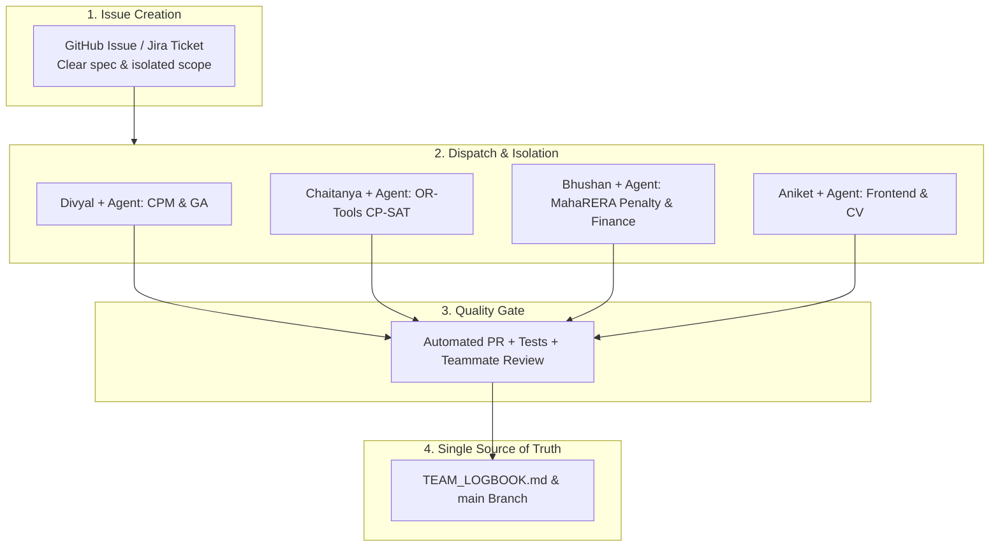

# 📓 OptiBuild Team Logbook & Multi-Agent Fleet Protocol

> **OptiBuild — Resource-Constrained Project Scheduling & MahaRERA Optimization Platform**  
> *Savitribai Phule Pune University (SPPU) B.E. Final Year Project*  
> **Team Members:** Bhushan Bhosale | Divyal | Chaitanya | Aniket  

---

## 🧭 Multi-Agent Operating Protocol (4 Teammates + Autonomous AI Coding Fleet)

When 4 developers using autonomous AI coding agents (Antigravity, Claude Code, OpenAI Codex, Cursor) work simultaneously on the same repository, uncoordinated agent pushes will cause merge conflicts and chaos. Follow this protocol to make it run like a well-oiled machine:

### 1. The 4 Golden Rules of Coordinated Agent Fleets

1. **Strict Folder Isolation (No Overlapping Edits):**
   * **Divyal:** `backend/app/engine/cpm/`, `backend/app/engine/ga/`
   * **Chaitanya:** `backend/app/engine/cpsat/`, `backend/app/engine/benchmark/`
   * **Bhushan:** `backend/app/engine/penalty/`, `docs/`, `research/`
   * **Aniket:** `frontend/`, `backend/app/cv/`, `backend/app/ingestion/`
   * *Shared schemas:* If editing `backend/app/schemas/`, announce in the group before merging.

2. **Branch Naming Standard:**
   * Human feature branches: `feat/<name>-<feature>` (e.g. `feat/bhushan-financial-model`)
   * AI agent branches: `agent/<name>-<ticket>` or `codex/<name>-<ticket>` (e.g. `agent/divyal-cpm-dag`)
   * **Rule:** Nobody pushes directly to `main`. Ever.

3. **Issue-Driven AI Agent Dispatch:**
   * Never let an AI agent "freestyle" across the whole repo.
   - Create a GitHub Issue with clear inputs, expected output, and target folder.
   * Command the agent: *"Work strictly inside `backend/app/engine/penalty/`. Write unit tests. Open a PR when green."*

4. **Pull Request (PR) Quality Gate:**
   * AI agent creates a PR. The human lead of that module reviews the PR diff.
   * Once approved & merged, log a 1-line update in this logbook.

---

## 👥 Module Ownership & Viva Registry

| Team Member | Module Role | Primary Directory | Viva Defense Focus |
|---|---|---|---|
| **Bhushan Bhosale** | **Financial & Penalty Engine** | `backend/app/engine/penalty/`, `docs/` | MahaRERA Sec 18 delay interest (SBI MCLR + 2%), crash cost tradeoffs, system architecture. |
| **Divyal** | **Optimization Lead (GA & CPM)** | `backend/app/engine/cpm/`, `ga/` | CPM DAG scheduling (NetworkX), DEAP Genetic Algorithm, resource-constrained chromosome encoding. |
| **Chaitanya** | **Benchmark & Solvers Lead** | `backend/app/engine/cpsat/`, `benchmark/` | Google OR-Tools CP-SAT exact formulation, optimality gap, interval variables. |
| **Aniket** | **Full-Stack & CV Lead** | `frontend/`, `backend/app/cv/` | Next.js interactive Gantt dashboard, FastAPI routing, MobileNetV2 site progress classifier. |

---

## 📋 Active Sprint & Agent Dispatch Board

| Member | Active Branch / AI Agent | Current Task | Status | Target Date |
|---|---|---|---|---|
| **Bhushan** | `feat/academic-research-docs` | Push verified, 74 tests green, Next.js 16.4.3, academic docs | 🟢 Complete | Oct 30 |
| **Divyal** | `main` | Collaborator setup & Optimization foundation | ✅ Merged | Oct 29 |
| **Chaitanya** | `main` | OR-Tools CP-SAT baseline solver setup | ✅ Merged | Oct 30 |
| **Aniket** | `main` | Frontend dashboard & API contract setup | ✅ Merged | Oct 30 |

*Status key: 🟢 Active | 🟡 In Review | 🔴 Blocked | ⚪ Queued | ✅ Merged*

---

## 📝 Daily Worklog & Audit Trail

> **How to log:** Whenever you or your AI coding agent finishes a task, append a new row below. Keep it concise.

### Format:
`### [YYYY-MM-DD] Member - Brief Summary`
- **Branch:** `branch-name`
- **PR / Ticket:** `#PR-Number` or `Jira-Key`
- **Changes:** What files were created or modified.
- **Viva Value:** Why this matters for the SPPU viva examiner.

---

### [2026-10-28] Bhushan Bhosale - Multi-Agent Coordination Protocol & Logbook Initialized
- **Branch:** `optibuild-playground`
- **Changes:** Created `TEAM_LOGBOOK.md` with multi-agent AI protocol, directory ownership boundaries, and active dispatch board.
- **Viva Value:** Demonstrates strict agile software engineering practices, professional version control, and multi-agent AI workflow governance.

---

### [2026-10-30] Bhushan Bhosale - Collaborator Push Verification, Full-Stack Sync, 74 Tests Green & Academic Deliverables
- **Branch:** `feat/academic-research-docs`
- **PR / Ticket:** `SCRUM-14` / `PR (feat/academic-research-docs)`
- **Changes:**
  - Verified push access to `divyal27/OptiBuild-Main` using authenticated git credentials.
  - Merged complete SPPU academic suite: IEEE Conference Paper (`.tex`, `.docx`, `.pdf`, figures, Overleaf `.zip`), Stage 1 Synopsis (`.docx`, `.md`), Review-II Presentation (`.pptx`, `.md`), Chapter 2 Literature Survey (`.docx`), and E-Cell Startup Playbook.
  - Resolved `auth.py` missing `import os` bug and aligned user management RBAC tests with `API.md`. Full 74/74 pytest test suite verified passing (`100% green`).
  - Spun up isolated engineering subagent in a separate git worktree to upgrade Next.js to `16.4.3` with `experimental: { agentUpgrade: "security" }`. Verified clean production build (13/13 static routes prerendered).
  - Synchronized and pushed to both `upstream` (`divyal27/OptiBuild-Main`) and personal testing fork (`26BB/OptiBuild`).
- **Viva Value:** Validates complete end-to-end integration across algorithms, full-stack web engineering, rigorous automated testing, and formal IEEE research publication ready for university review.
