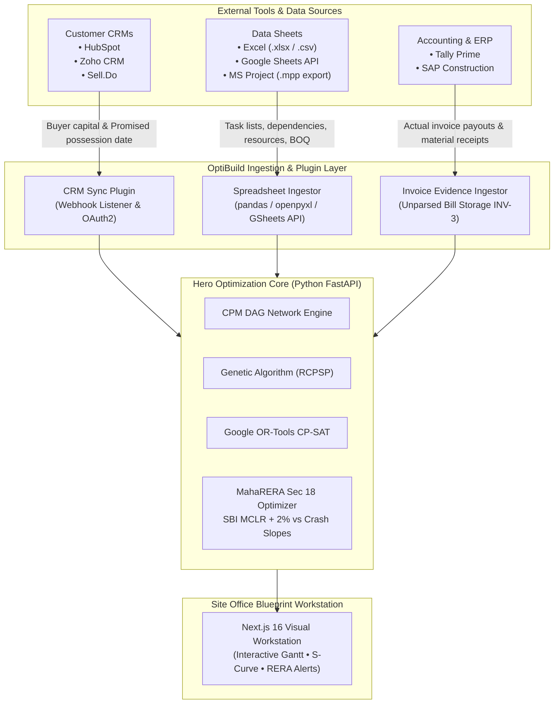

# 🔌 OptiBuild Integrations, Plugin Architecture & Sovereign AI Strategy

> **Document Type:** System Extension & Technology Strategy Blueprint  
> **Project:** OptiBuild — Penalty-Aware Construction Scheduling & MahaRERA Optimization Platform  
> **Institution:** Savitribai Phule Pune University (SPPU) B.E. Computer Engineering Final Year Project  
> **Target Alignment:** Indian Real Estate Tech, IndiaAI Sovereign Mission, MahaRERA Compliance  

---

## 🏛️ 1. Executive Summary & Philosophy

OptiBuild disdains the "reinventing the wheel" anti-pattern. Real-world Indian developers, EPC contractors, and site engineers already operate on legacy tooling:
- **Sales & Customer Relations:** HubSpot, Zoho CRM, Salesforce, Sell.Do.
- **Site Scheduling & Estimation:** Microsoft Excel (`.xlsx`), Google Sheets, CSV Bill of Quantities (BOQ).
- **Billing & Accounting:** Tally Prime, SAP ECC / S4HANA.

Forcing developers to discard their existing workflows for another proprietary CRM is commercial suicide. Instead, **OptiBuild positions itself as the Optimization & Statutory Intelligence Layer** that sits on top of existing tools via modular plugins and webhooks.

OptiBuild ingests raw inputs from these systems, runs them through its **CPM + Genetic Algorithm + Google OR-Tools CP-SAT** engines, computes statutory **MahaRERA Section 18 delay interest liabilities**, and outputs actionable project schedules and crash-cost recommendations.

---

## 🧩 2. Integrations & Plugin Architecture



---

### 2.1. CRM Integration (HubSpot, Zoho CRM, Sell.Do)

#### What OptiBuild Extracts:
OptiBuild does not care about sales emails or marketing campaigns. It strictly pulls two numbers required for statutory delay computation:
1. `total_collected_allottee_capital`: Total buyer funds collected across all sold units ($\text{INR } ₹$).
2. `statutory_possession_date`: Contractual delivery deadline promised in registered Allotment Agreements.

#### Ingestion Workflow:
- **Webhook Endpoint:** `/api/v1/integrations/crm/webhook`
- **Trigger Event:** `deal.won` or `booking.confirmed`.
- **Payload Schema:**
```json
{
  "source": "hubspot",
  "project_id": "proj-moze-tower-a",
  "event": "booking_updated",
  "timestamp": "2026-10-30T14:30:00Z",
  "data": {
    "units_sold": 128,
    "total_allottee_investment_inr": 485000000.00,
    "promised_possession_date": "2027-03-31"
  }
}
```
- **Automated Impact:** When new buyer funds are logged in HubSpot, OptiBuild dynamically updates the daily MahaRERA Section 18 penalty rate:
  $$\text{Daily Delay Interest} = \frac{\text{Total Funds} \times (\text{SBI MCLR} + 2\%)}{365}$$

---

### 2.2. Data Sheets Integration (Excel, CSV, Google Sheets)

Construction site supervisors almost universally track Bill of Quantities (BOQ) and daily contractor labour allocation in Excel.

#### Supported Formats:
- `.xlsx` / `.xls` (via `openpyxl` & `pandas`)
- `.csv` (standard RFC 4180 format)
- Google Sheets (via Google Drive / Google Sheets REST API v4)

#### Ingestion Flow:
1. Site engineer uploads `WBS_Schedule.xlsx`.
2. Parser maps standard column headers:
   `Task_ID | Task_Name | Duration_Days | Predecessors | Masons | Carpenters | Normal_Cost | Crash_Cost | Min_Duration`
3. Engine runs NetworkX topological sort to detect cyclic dependencies before passing tasks into the Genetic Algorithm.

---

### 2.3. ERP & Billing Integration (Tally Prime / SAP)

- **Purpose:** Ingests actual bill receipts for empirical crash-slope recalibration.
- **Invariant Adherence (INV-3):** Invoice copies are saved to S3/Cloudflare R2 as **unparsed documentary evidence only**. No OCR or NLP invoice parsing is executed.
- The monetary figures are ingested directly as raw tabular values to compute:
  $$\text{Calibrated Slope } S_{i} = S_{i,\text{nominal}} \times (1 + \text{Cost Variance Factor})$$

---

## 🤖 3. AI Model Selection & "Make in India" Sovereign Roadmap

```
┌──────────────────────────────────────┐       ┌──────────────────────────────────────┐
│  Phase 1: Bootstrap & Viva Defense   │       │   Phase 2: Make in India Sovereign   │
│  (Fast • Accurate • Cost-Effective)  │  ───> │   (Data Localization • Vernacular)   │
│  • Google Gemini 3.8 / 2.5 Flash     │       │   • Sarvam AI (Indian Language GenAI)│
│  • Mumbai Cloud Region (ap-south-1)  │       │   • Bhashini Govt Mission (Marathi)  │
│  • Cloudflare R2 + Neon Postgres     │       │   • Yotta Shakti / E2E Networks GPU  │
└──────────────────────────────────────┘       └──────────────────────────────────────┘
```

---

### 3.1. Phase 1: Recommended Bootstrap AI Model

**Choice:** **Google Gemini 3.8 Flash / Gemini 2.5 Flash (via Vertex AI / Google AI Studio)**

#### Why Gemini Flash for Phase 1:
1. **Multimodal Native:** Handles MahaRERA PDF document layout inspection (text extraction + fallback table parsing) and site inspection photo edge analysis seamlessly.
2. **Ultra-Low Cost & Sub-Second Latency:** Ingesting 50-page RERA certificates or long schedule sheets costs fractions of a cent per call.
3. **Local Indian Cloud Infrastructure:** Runs natively on Google Cloud's **Mumbai (`asia-south1`)** and **Delhi (`asia-south2`)** data centers, ensuring low network latency for Indian users and compliance with preliminary data residency.
4. **Structured Outputs:** Strict JSON schema mode ensures Pydantic models in FastAPI receive 100% compliant JSON without hallucinated markdown fences.

---

### 3.2. Phase 2: "Make in India" Sovereign AI Roadmap

To qualify for government real estate technology grants, Smart City Pune pilots, and Indian institutional defense, OptiBuild has a dedicated transition plan to **Sovereign Indian AI infrastructure**:

#### 1. Sarvam AI (Indigenous Foundation Models):
- **Why:** Founded in India specifically for Indian enterprise language context and vernacular nuances.
- **Use Case:** Multilingual natural language schedule updates. A site foreman speaking in Marathi or Hindi (*"Plinth casting of Wing B is delayed by 3 days due to cement shortage"*) is converted into structured CPM task modifications.

#### 2. Bhashini (National Language Translation Mission - Digital India):
- **Why:** Government of India open-standard API for 22 scheduled Indian languages.
- **Use Case:** Automatically translates MahaRERA gazette notifications and official Marathi legal directives into clear English executive summaries for project managers.

#### 3. Sovereign Indian GPU Hosting (Yotta Data Services / E2E Networks):
- **Infrastructure:**
  - **Yotta NM1 (Navi Mumbai):** Asia’s largest data center, running Nvidia H100 GPU clusters under the **IndiaAI Mission (₹10,372 Crore national program)**.
  - **E2E Networks:** Leading Indian cloud GPU provider with native ISO 27001 data center sovereignty.
- **Deployment Strategy:**
  - Self-host an open-weight fine-tuned model (e.g. **Llama 3 8B / Mistral 7B** fine-tuned on MahaRERA Section 18 legal rulings and CPWD construction norms).
  - Ensures **Zero Foreign Data Egress**: All project financial balances, flat buyer identities, and contractor costs remain strictly within sovereign Indian borders, complying 100% with the **Digital Personal Data Protection (DPDP) Act, 2023**.

---

## ⚖️ 4. Comparison Matrix: Global vs. Indian Models

| Evaluation Metric | Global API (Gemini Flash) | Sovereign Indian Model (Sarvam / Self-Hosted) |
|---|:---:|:---:|
| **Primary Advantage** | Immediate bootstrap, zero devops overhead | Full data sovereignty & vernacular site workers |
| **Data Residency** | Global / India region options | **100% Indian soil (Yotta Mumbai / E2E)** |
| **Language Nuance** | Strong English, basic Indic | **Deep Marathi, Hindi, and Indian English terminology** |
| **Statutory Compliance** | Standard cloud privacy | **DPDP Act 2023 & MahaRERA strict compliance** |
| **Deployment Mode** | SaaS API call | Self-hosted Docker container in India VPC |
| **Recommended Stage** | **Phase 1 (Academic Viva & MVP)** | **Phase 2 (Commercial Make in India Deployment)** |

---

## 🎓 5. SPPU Viva & E-Cell Pitch Soundbites

When presenting to university examiners or startup pitch juries, use these targeted architectural explanations:

> **On Integrations:**  
> *"OptiBuild is designed for real-world enterprise adoption. We don't force developers to abandon their CRM or spreadsheets. Instead, we provide API webhooks for HubSpot and Sell.Do to pull buyer capital figures, and allow site engineers to upload standard Excel schedules directly into our CPM-GA solver."*

> **On Sovereign AI / Make in India:**  
> *"For our initial deployment and testing, we utilize low-latency Gemini Flash running in Google's Mumbai cloud region. However, in alignment with India's DPDP Act 2023 and the ₹10,372 Cr IndiaAI Mission, our production roadmap transitions to sovereign Indian LLMs like Sarvam AI hosted on domestic GPU clusters at Yotta Navi Mumbai, enabling vernacular Marathi speech input for site supervisors."*
